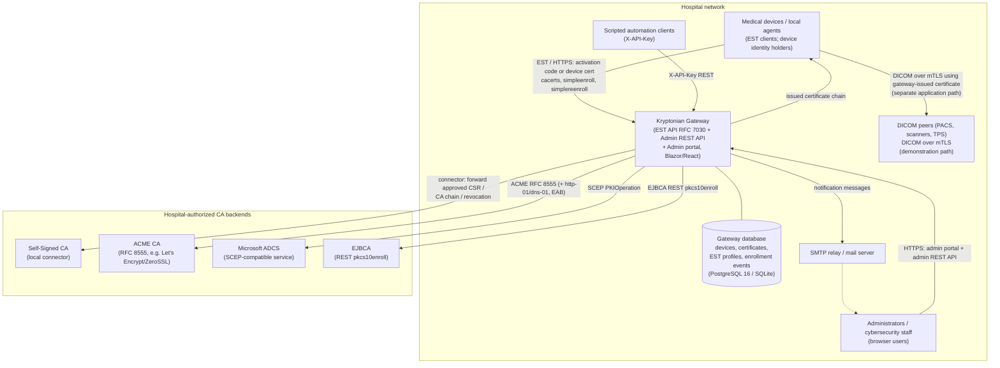
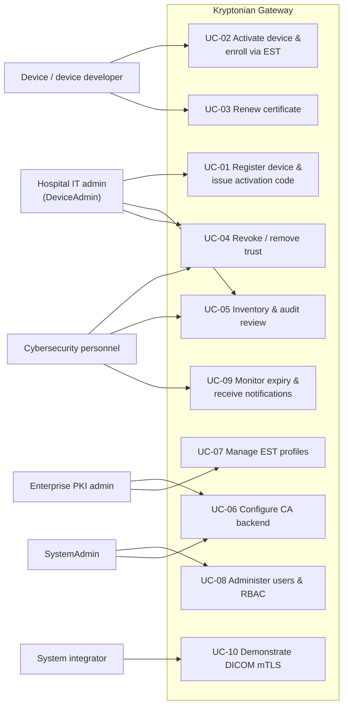
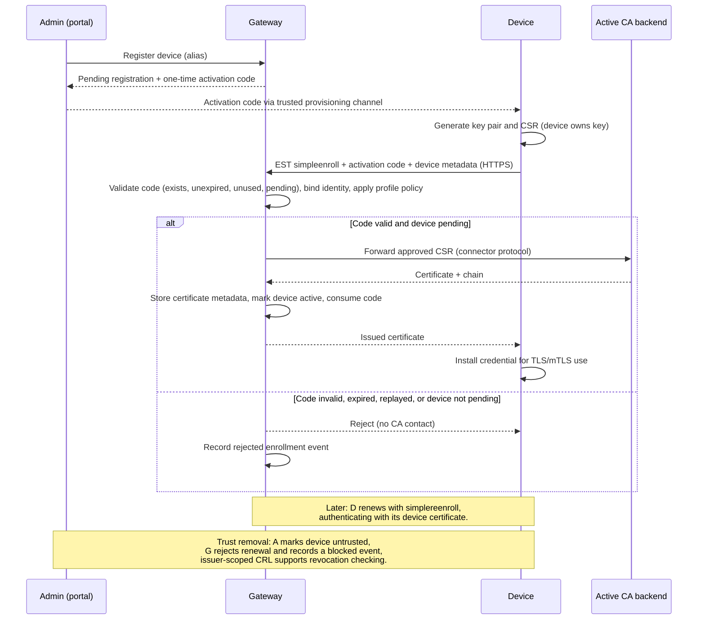

# Kryptonian Product Definition

| Field | Value |
|---|---|
| Document title | Kryptonian Product Definition and Scope |
| Document ID | KSPEC-001 |
| Version | 0.2 (Draft) |
| Review status | Draft — pending review |
| Created | 2026-10-13 |
| Baseline repository commit | `682f996c8447afec13bc1fce5b7f59e6a06efa25` (branch `feat/windows-sandbox-installer`, "Release Windows gateway and portable enrollment demo 0.1.4") |
| Repository | https://github.com/AAPM-RT-SEC/RTSec.Kryptonian |
| Revision history | 0.1 — 2026-10-13 — Initial draft generated from baseline documentation and evidence map (Author: requirements engineering team). |
| Source references | KSPEC-000 (conventions); README.md; Mvp.md; docs/IMPLEMENTATION-TRACKER.md; docs/HACKATHON-DELIVERABLE.md; docs/background.md; docs/ORNET-ALIGNMENT-2026-09-09.md; docs/CHANGES-AND-ORNET-ALIGNMENT.md; docs/flow.md; docs/ARCHITECTURE.md; docs/device-enrollment.md; docs/user-management.md; docs/ca-backend-configuration.md; docs/medical-device-demo.md; docs/DEPLOYMENT.md |
| Author | Name: TBD — Date: TBD — Signature: TBD |
| Reviewer | Name: TBD — Date: TBD — Signature: TBD |
| Approver | Name: TBD — Date: TBD — Signature: TBD |
| Reconciliation revision | 0.2 - 2026-10-13 - source/document audit and publication controls (KSPEC-016) |

This document defines the product purpose, stakeholders, intended users, operating
environment, system boundaries, assumptions, dependencies, exclusions, primary use
cases, operational scenarios, and scope classification (AS-IS / TO-BE / PROPOSED) for
the RTSec.Kryptonian Certificate Enrollment Gateway. It follows the conventions of
KSPEC-000 and classifies every technical assertion with a provenance class
(VERIFIED / CODE-OBSERVED / DOCUMENTED / INFERRED / PROPOSED / UNKNOWN).

---

## 1. Introduction

### 1.1 Purpose of this document

This document establishes a shared, evidence-classified understanding of what the
Kryptonian gateway *is*, who it serves, where it runs, what lies inside and outside its
boundary, and which behaviors exist today (AS-IS) versus are intended (TO-BE) or merely
proposed (PROPOSED). It is the upstream source from which stakeholder and user
requirements (KSPEC-002, UR-nnn) and software requirements (KSPEC-003, SR-*) are derived.

### 1.2 Intended audience

Reviewers of the formal specification package, AAPM RT-SEC working-group members,
hospital stakeholders evaluating the gateway, and engineers performing gap analysis
(KSPEC-010) and traceability (KSPEC-009).

## 2. Product purpose

**Provenance: DOCUMENTED** (README.md; Mvp.md; docs/background.md)

Kryptonian is an **enterprise healthcare IT cybersecurity infrastructure** component: a
certificate enrollment, identity provisioning, and credential lifecycle management
gateway for networked medical devices. It sits between device-side EST clients
(RFC 7030, Enrollment over Secure Transport) and one or more hospital-authorized
certificate authority (CA) backends.

The problem it addresses: hospitals operate heterogeneous CA infrastructures (Microsoft
ADCS, EJBCA, ACME services, private self-signed CAs), while device manufacturers cannot
control which CA a given hospital uses. Without an intermediary, each vendor must
implement custom, often incomplete certificate-handling logic per hospital, producing
manual certificate installs, expired-certificate outages, incompatible TLS settings, and
inconsistent trust models (Mvp.md; docs/background.md).

Kryptonian provides:

- **Device enrollment** — devices register against an administrator-issued, one-time
  activation code, are bound to an approved identity, and receive certificates through
  EST (README.md; docs/device-enrollment.md).
- **Automatic certificate renewal** — approved devices renew credentials without
  administrator intervention unless their privileges are revoked (README.md).
- **Renewal monitoring** — administrators receive notifications when certificates are
  not renewed as expected, signaling potential device problems (README.md).
- **Multi-CA abstraction** — a single EST interface for devices regardless of which CA
  backend the institution uses (README.md; docs/flow.md).
- **Centralized inventory and audit** — device records, certificate metadata, and
  enrollment events recorded for every enrollment decision (docs/flow.md).
- **Trust lifecycle** — administrative trust removal and revocation so that devices can
  no longer obtain fresh credentials, with demonstrated revocation checking by peers
  (docs/flow.md; IMPLEMENTATION-TRACKER.md).

The project is a **reference implementation and test environment** contributed by the
AAPM RT-SEC working group. It is positioned to contribute operational DICOM lifecycle
evidence to the OR.NET / IEEE 11073 SDC enrollment work — **not** to define a competing
enrollment protocol (README.md; docs/ORNET-ALIGNMENT-2026-09-09.md). It is a
proof-of-concept research prototype, not intended for clinical deployment, and not an
adopted OR.NET enrollment profile, SDC conformity implementation, or DICOM TLS
certification (README.md disclaimer).

### 2.1 Binding product classification

Per KSPEC-000 §3, which is binding on this document:

- Kryptonian is **not a regulated medical device** and performs **no clinical functions**.
  It is excluded from medical-device regulatory classification discussions, FDA pathways,
  IEC 62304 lifecycle classification, and ISO 14971 medical-device hazard analysis.
- The following distinctions are preserved throughout the specification:
  - **Device identity** — the X.509 credential a device holds.
  - **Certificate enrollment authorization** — approval to obtain a credential.
  - **Network trust** — TLS/mTLS peer authentication.
  - **Application-level authorization** — what a device may do at the application layer.
  - **Clinical capability** — explicitly out of scope; never derived from Kryptonian state.
- The device simulators (`Kryptonian.MedicalDevice`, `Kryptonian.DICOMTls`) are
  demonstration/reference clients, not production product deliverables.

"Certificate renewal" throughout this specification means renewal of cryptographic
credentials. It does **not** recertify a device's clinical safety, regulatory status, or
SDC conformity (docs/CHANGES-AND-ORNET-ALIGNMENT.md).

## 3. Stakeholders

| Stakeholder | Interest in the gateway | Provenance |
|---|---|---|
| Hospital IT administrators | Operate the gateway: register devices, issue activation codes, manage the device inventory, configure CA backends and EST profiles, monitor the dashboard. | DOCUMENTED (docs/user-management.md; docs/ca-backend-configuration.md; README.md) |
| Hospital cybersecurity personnel | Audit enrollment events, enforce trust policy, remove trust and revoke credentials, configure notifications, ensure secrets and deployment hardening. | DOCUMENTED (docs/flow.md; docs/email-notifications.md) |
| Device manufacturers | Implement one standard device-side enrollment workflow (EST) that works across heterogeneous hospital CA choices. | DOCUMENTED (docs/background.md; Mvp.md) |
| Device software developers | Implement and maintain the device-side EST client (bootstrap activation, `simpleenroll`, `simplereenroll`, key generation and protection, credential installation and renewal). | DOCUMENTED (docs/medical-device-demo.md; src/Kryptonian.MedicalDevice) |
| Clinical engineering (biomedical/HTM staff) | Keep imaging and therapy devices operational; avoid expired-certificate outages; need certificate expiry visibility without confusing it with clinical service status. | INFERRED (derived from README.md renewal-monitoring motivation and Mvp.md outage-reduction goals) |
| Healthcare system integrators | Integrate the gateway into hospital estates and automation via the REST admin API, API keys, and containerized or Windows deployment. | DOCUMENTED (docs/DEPLOYMENT.md; docs/API-GUIDE.md) |
| Enterprise PKI administrators | Connect institution-managed CAs through connectors; control certificate policy (subject-DN rules, key usage, validity) via EST profiles; manage issuer trust and revocation publication. | DOCUMENTED (docs/ca-backend-configuration.md; KSPEC-000 §9 terminology) |
| AAPM RT-SEC / OR.NET research community | Use the gateway as a reference implementation and test environment; contribute operational DICOM lifecycle evidence to the OR.NET/IEEE 11073 SDC enrollment effort under shared requirements and test cases. | DOCUMENTED (README.md; docs/ORNET-ALIGNMENT-2026-09-09.md; docs/CHANGES-AND-ORNET-ALIGNMENT.md) |

Patients and clinical operations benefit indirectly (fewer insecure transfers,
expired-certificate outages, and manual installation mistakes — docs/background.md) but
are not direct users of the gateway.

---

## 4. Intended users

| User class | Roles used in the gateway (AS-IS) | Typical activities |
|---|---|---|
| Gateway administrators (SystemAdmin) | Full access: user management, CA backends, EST profiles, gateway and notification settings. | First-run admin setup; user administration; backend/profile configuration. |
| Device administrators (DeviceAdmin) | Register/approve/remove devices; generate API keys for scripted device management. | Device registration; activation-code handover; device removal; API-key issuance. |
| Standard (read-only) users | View dashboards, devices, certificates, EST profiles, CA backends, event log. | Monitoring and audit review. |
| Scripted/automation clients | `X-API-Key` authenticated REST clients carrying the owner's role. | CI pipelines, integration automation. |
| Devices (non-human) | EST clients authenticating with activation code (first enrollment) or device certificate (renewal). | Enrollment, renewal, CRL retrieval. |

**Provenance: DOCUMENTED** (docs/user-management.md). RBAC elaboration: KSPEC-002
(UR-032) and KSPEC-003 (SR-Z area).

---

## 5. Operating environment

**Provenance: DOCUMENTED** unless noted.

- **Deployment targets**: Docker / Docker Compose (Docker 24.0+, Compose 2.20+) and
  Kubernetes manifests (docs/DEPLOYMENT.md); a Windows gateway package with installer
  and Windows sandbox distribution (docs/medical-device-demo.md; docs/windows-installation.md).
- **Runtime**: .NET 8, ASP.NET Core. The API serves the React/TypeScript dashboard from its built static files. `RTSec.Kryptonian.Web` is a separate optional Blazor Server/MudBlazor portal; React is not embedded in that process (CODE-OBSERVED: both `Program.cs` files).
- **Persistence**: PostgreSQL 16 in the production topology; SQLite exercised in the
  developer/Windows preview environment; PostgreSQL schema upgrades implemented but only
  SQLite persistence exercised at baseline (docs/DEPLOYMENT.md;
  IMPLEMENTATION-TRACKER.md — see TBD-006 in §14).
- **Network position**: hospital network segment reachable by devices for EST
  (`/.well-known/est/{profile}/...` over HTTPS) and by administrators for the portal and
  admin REST API; gateway reaches CA backends over HTTPS/REST (ADCS via an
  SCEP-compatible service, EJBCA REST, ACME directory) (docs/ARCHITECTURE.md;
  docs/ca-backend-configuration.md).
- **TLS**: TLS 1.2+; device-facing EST over HTTPS; mTLS demonstrated end-to-end for
  DICOM via gateway-issued certificates (docs/ARCHITECTURE.md;
  IMPLEMENTATION-TRACKER.md).
- **Email (SMTP)**: outbound SMTP used for notification delivery (MailKit;
  docs/email-notifications.md).
- **Demonstration environment**: the AAPM RT-SEC hackathon CA Harness (hosted
  selfsigned/ADCS/EJBCA/ACME backends, DIMSE TLS proxy, Orthanc DICOM endpoints) and a
  local fo-dicom TLS store SCP in the DICOM mTLS demo (docs/HACKATHON-DELIVERABLE.md;
  README.md §DICOM TLS demo).
- **Device-side**: the reference device client is a Windows x64 self-contained WPF
  application (`Kryptonian.MedicalDevice`); automatic renewal runs only while the
  application is open (docs/medical-device-demo.md; IMPLEMENTATION-TRACKER.md).

## 6. System boundaries

### 6.1 Context diagram

**Provenance: DOCUMENTED** for all elements and edges above, from the sources cited in
§5 plus docs/flow.md, docs/user-management.md, docs/email-notifications.md.

### 6.2 Boundary statements

| Boundary element | Inside the gateway boundary | Outside the gateway boundary |
|---|---|---|
| Trust policy | Device trust registry, activation, approval, profile selection, renewal-window decisions (docs/flow.md). | CA-internal issuance policy configured at the CA itself. |
| Certificate issuance | CSR validation and forwarding of **approved** requests only; certificate metadata storage. | Actual signing, which is performed by the CA backend. |
| Credential use | Issuance and lifecycle; demonstration of mTLS acceptance via the DIMSE-TLS proxy (AS-IS demonstration only). | Production DICOM/SDC application protocols and their authorization. |
| Device software | Reference simulators shipped as demonstration clients. | Real vendor device firmware and clinical applications. |

---

## 7. Assumptions

| ID | Assumption | Provenance |
|---|---|---|
| ASM-001 | Devices (or their local agents) generate and protect their own private keys; the gateway does not take custody of device private keys in the intended design. | DOCUMENTED (docs/flow.md responsibility split; docs/ORNET-ALIGNMENT-2026-09-09.md target architecture) |
| ASM-002 | The institution operates and authorizes at least one CA backend and supplies its connector configuration. | DOCUMENTED (docs/ca-backend-configuration.md) |
| ASM-003 | Administrators deliver activation codes to devices through a trusted provisioning channel outside the gateway. | DOCUMENTED (docs/device-enrollment.md) |
| ASM-004 | Devices can reach the gateway's HTTPS EST endpoint over the hospital network, and the gateway can reach the active CA backend. | INFERRED (deployment topology; not separately evidenced) |
| ASM-005 | Reliable time sources are available for certificate validity and renewal-window logic. | PROPOSED (docs/ORNET-ALIGNMENT-2026-09-09.md lists reliable time among availability evidence needs; not evidenced as implemented) |
| ASM-006 | The gateway is deployed inside a segmented network; CA backend connectors are reachable from a more restricted network zone than devices. | PROPOSED (Mvp.md §8 recommends segmentation; deployment realization UNKNOWN at baseline) |
| ASM-007 | The gateway is a research prototype not deployed in clinical production; independent security assessment precedes any such deployment. | DOCUMENTED (README.md disclaimer) |

## 8. Dependencies

| ID | Dependency | Nature | Provenance |
|---|---|---|---|
| DEP-001 | .NET 8 runtime / ASP.NET Core hosting | Runtime | DOCUMENTED (docs/ARCHITECTURE.md) |
| DEP-002 | PostgreSQL 16 (production) or SQLite (developer/preview) | Persistence | DOCUMENTED (docs/DEPLOYMENT.md; IMPLEMENTATION-TRACKER.md) |
| DEP-003 | Entity Framework Core 8, BouncyCastle, Certes, Serilog, AspNetCoreRateLimit, MailKit (+ BouncyCastle transitive) | Libraries | DOCUMENTED (docs/ARCHITECTURE.md; IMPLEMENTATION-TRACKER.md) |
| DEP-004 | A reachable, institution-authorized CA backend of one of the supported types | External system | DOCUMENTED (docs/ca-backend-configuration.md) |
| DEP-005 | SMTP service for email notifications | External system | DOCUMENTED (docs/email-notifications.md) |
| DEP-006 | TLS server certificate (and public issuing CA certificate) for the EST/HTTPS listener; for the Windows sandbox this is distributed as a public CA file | Configuration | DOCUMENTED (docs/medical-device-demo.md) |
| DEP-007 | Docker 24.0+ / Compose 2.20+ (container deployment) or Windows host (installer/sandbox) | Platform | DOCUMENTED (docs/DEPLOYMENT.md; docs/medical-device-demo.md) |
| DEP-008 | Remaining high-severity transitive dependency advisories (SQLitePCLRaw.lib.e_sqlite3 2.1.6, System.Security.Cryptography.Xml 8.0.2) identified as deployment blockers | Known constraint | DOCUMENTED (IMPLEMENTATION-TRACKER.md) |

---

## 9. Exclusions (out of scope)

The following are explicitly **out of scope** for the product definition and for the
requirements derived from it:

| ID | Exclusion | Basis |
|---|---|---|
| EXC-001 | Clinical authorization: determining or expressing what a device is clinically permitted to do. Clinical capability is never derived from Kryptonian state. | KSPEC-000 §3 (binding) |
| EXC-002 | SDC role assignment: issuing certificates containing SDC OIDs is not an SDC role or interoperability demonstration; no SDC participant exchange exists at baseline. | DOCUMENTED (IMPLEMENTATION-TRACKER.md deliberate boundaries) |
| EXC-003 | Key escrow and server-side key generation in production design: device private keys are never exported by design; any server-side key generation would require HSM-grade treatment and is not an MVP function. | DOCUMENTED (Mvp.md §1, §8) |
| EXC-004 | Defining a competing enrollment protocol or a new medical-device interoperability requirement from prototype-specific headers (e.g., legacy activation headers must not become mandatory). | DOCUMENTED (README.md; IMPLEMENTATION-TRACKER.md) |
| EXC-005 | Standards conformity claims: no EST, SDC, SDPi, ATNA, DICOM TLS/B.12/B.13 conformance, FDA/IEC 62304/ISO 14971 classification, or OR.NET adoption claims. | DOCUMENTED (README.md disclaimer; ORNET-ALIGNMENT review limits) |
| EXC-006 | Long-lived OS-service device operation, hardware-backed key storage, and old-certificate retirement policy: flagged as deployment policy decisions, not baseline features. | DOCUMENTED (IMPLEMENTATION-TRACKER.md) |
| EXC-007 | Instant mid-association revocation of established TLS/DICOM connections: proxy connections have bounded lifetimes; revocation affects new connections and credential acquisition. | DOCUMENTED (IMPLEMENTATION-TRACKER.md; ORNET-ALIGNMENT availability note) |
| EXC-008 | ATNA/DICOM audit-format conformance and audit export protection: mapping lifecycle events to audit standards is a separate conformance task. | DOCUMENTED (docs/ORNET-ALIGNMENT-2026-09-09.md) |

## 10. Primary use cases

### 10.1 Use-case overview

### 10.2 Use-case descriptions

| ID | Use case | Primary actor | Summary (AS-IS unless noted) | Provenance |
|---|---|---|---|---|
| UC-01 | Register device and issue activation code | Hospital IT admin | Admin creates a pending device alias in the Devices portal; gateway generates a one-time, time-limited, hashed activation code. Admin hands the code to the device operator through the hospital provisioning process. | DOCUMENTED (docs/device-enrollment.md) |
| UC-02 | Activate device and enroll via EST | Device | Device generates key pair + CSR, presents activation code with device metadata (CN from CSR, manufacturer, model, serial); gateway validates the code (exists, unexpired, unused, belongs to pending registration), binds identity, forwards CSR to the active CA backend, returns the first certificate, marks device active, consumes the code. | DOCUMENTED (docs/device-enrollment.md) |
| UC-03 | Renew certificate | Device | Active device re-authenticates with its existing device certificate (not the activation code) and uses EST `simplereenroll` in the renewal window; gateway re-approves automatically and returns a fresh certificate. | DOCUMENTED (docs/device-enrollment.md; README.md) |
| UC-04 | Revoke and remove trust | Cybersecurity personnel / DeviceAdmin | Admin marks device untrusted/removed; gateway rejects subsequent enrollment and renewal, records a blocked enrollment event; issuer-scoped signed CRLs support revocation; demonstrated online revocation checking independent of registry lookup. | DOCUMENTED (docs/flow.md trust removal); VERIFIED for revocation behavior (IMPLEMENTATION-TRACKER.md: revocation followed by X509Chain reporting Revoked) |
| UC-05 | Inventory and audit review | IT admin / cybersecurity / read-only users | Portal lists devices with status (pending/active/untrusted/retired), certificates with issuer/validity/status, and enrollment events (who/what, source IP, CSR subject, result, reason). | DOCUMENTED (docs/flow.md gateway database model) |
| UC-06 | Configure CA backend | PKI admin / SystemAdmin | Admin adds a backend of type selfsigned, acme, adcs, or ejbca with guided or JSON config, tests it, and activates it; exactly one backend is active and receives future enrollments; the device never sends a backend id. | DOCUMENTED (docs/ca-backend-configuration.md) |
| UC-07 | Manage EST profiles | PKI admin / SystemAdmin | Admin creates/enables named EST profiles binding devices to a CA backend, subject-DN rules, key usage, validity, and trust policy; profiles are reachable at `/.well-known/est/{profile}/...`; unknown profile labels are rejected. | DOCUMENTED (KSPEC-000 §9; docs/ca-backend-configuration.md); VERIFIED for profile issuer routing (IMPLEMENTATION-TRACKER.md, PR 37) |
| UC-08 | Administer users and RBAC | SystemAdmin | First-run wizard or env-seeded initial SystemAdmin; create/edit/deactivate/delete users; three roles (Standard, DeviceAdmin, SystemAdmin); API keys carry the generating owner's role; last active SystemAdmin cannot be deleted. | DOCUMENTED (docs/user-management.md) |
| UC-09 | Monitor expiry and receive notifications | Cybersecurity personnel / clinical engineering | Gateway watches certificate expiry (CertificateExpiryWatcher) and sends email notifications when certificates are not renewed as expected or approach expiry; notification settings configurable in the portal. | DOCUMENTED (README.md; evidence map; docs/email-notifications.md) |
| UC-10 | Demonstrate DICOM mTLS | System integrator / researchers (demonstration) | Two demo devices enroll via EST, then establish a mutually authenticated TLS DICOM C-STORE association using gateway-issued certificates with issuer, TLS-purpose, and online revocation checks; temporary demo devices are archived/deleted afterward. Demonstration only; the DIMSE-TLS proxy is an AS-IS demonstration component. | VERIFIED (IMPLEMENTATION-TRACKER.md: two actual mTLS C-STORE transfers with SOP Instance UID readback, recorded under artifacts/developer/verify-*/) |

### 10.3 Core enrollment flow (supporting diagram)

**Provenance: DOCUMENTED** (docs/device-enrollment.md; docs/flow.md;
IMPLEMENTATION-TRACKER.md for replay-rejection and renewal-by-certificate behavior,
classified VERIFIED per executed evidence).

---

## 11. Operational scenarios

| ID | Scenario | Flow summary | Provenance |
|---|---|---|---|
| SCN-01 | First device onboarding in a hospital | Admin registers alias → activation code handed over → device enrolls over EST → certificate issued via hospital CA → device appears active in inventory. | DOCUMENTED (docs/device-enrollment.md; docs/ca-backend-configuration.md common setup sequence) |
| SCN-02 | Unactivated device attempts enrollment | Unknown/pending device presents a CSR; gateway rejects it before any CA contact and records a rejected enrollment event visible in the audit view. | DOCUMENTED (docs/flow.md walkthrough) |
| SCN-03 | Routine automatic renewal | Approved device renews on schedule via `simplereenroll` with certificate authentication; no administrator action; `renewed` enrollment event recorded. | DOCUMENTED (README.md; docs/device-enrollment.md) |
| SCN-04 | Silent renewal failure | Device stops renewing (e.g., powered off or failing); expiry watcher flags it; administrators receive notification emails indicating a potential device problem. | DOCUMENTED (README.md renewal monitoring); expiry-watcher mechanism DOCUMENTED via evidence map; notification-delivery behavior at baseline: UNKNOWN (no executed evidence reviewed) — see TBD-002 |
| SCN-05 | Device decommissioning / compromise | Admin marks the device untrusted/removed; gateway blocks renewal and records `blocked`; issuer-scoped CRL is published; peers performing online revocation checking reject the credential on new associations; existing associations are not instantly terminated (bounded proxy lifetimes). | DOCUMENTED (docs/flow.md trust removal; IMPLEMENTATION-TRACKER.md; ORNET-ALIGNMENT availability note) |
| SCN-06 | CA backend migration | PKI admin adds a new backend, tests it, activates it; future enrollments route to the new backend; existing device records and issued certificates remain available. | DOCUMENTED (docs/ca-backend-configuration.md) |
| SCN-07 | Certificate-gated DICOM transfer (demonstration) | Demo devices enroll, then perform mTLS DICOM C-STORE; receiver enforces issuer, TLS purpose, and online revocation; received SOP Instance UIDs verified by readback. | VERIFIED (IMPLEMENTATION-TRACKER.md executed evidence) |
| SCN-08 | Developer lifecycle verification | Reproducible HTTPS/EST/DICOM proof: independent curl HTTP-Basic EST over real HTTPS, replay rejection, spoofed-forwarding rejection, restart persistence on SQLite, five loopback proxy tests including unknown/expired/revoked rejection. | VERIFIED (IMPLEMENTATION-TRACKER.md; artifacts/developer/verify-*/evidence.json) |
| SCN-09 | Hospital outage during renewal window | Scenario required by OR.NET-alignment analysis (early renewal, retry/backoff, atomic installation, behavior when the enrollment service is unavailable); not yet a specified baseline behavior. | PROPOSED (docs/ORNET-ALIGNMENT-2026-09-09.md §availability) |
| SCN-10 | Credential rotation of the EST listener / proxy PFX | Externally rotated PFX is replaced atomically; fresh handshakes observe the new credential; expired replacement fails closed. | VERIFIED for demonstration loopback tests (IMPLEMENTATION-TRACKER.md); automation of the rotation itself: PROPOSED (not automated at baseline) |

## 12. Current-versus-intended scope (AS-IS / TO-BE / PROPOSED)

| Area | AS-IS (at baseline commit) | TO-BE (intended, formally specified target) | PROPOSED (requires stakeholder approval) |
|---|---|---|---|
| Enrollment protocol | EST `/cacerts`, `/simpleenroll`, `/simplereenroll` over HTTPS; activation-code bootstrap with legacy compatibility headers; independent curl HTTP-Basic EST demonstrated | Standards-based RFC 7030 enrollment and renewal usable by independent clients without gateway-private headers; private headers documented as compatibility-only | Retire/flag legacy activation headers as non-normative; agree EST profile conventions jointly with OR.NET |
| CA backends | Self-Signed, ACME, ADCS (SCEP-compatible), EJBCA connectors implemented; single active backend; enum-only types (cfssl, Vault, Smallstep, OpenXPKI) unimplemented | Multi-CA abstraction with tested/activated backends and profile-level routing | Additional connector types beyond the four implemented |
| Device lifecycle | Registration → activation-code enrollment → certificate-authenticated renewal → removal blocking | Full credential lifecycle with renewal-window automation and monitoring | Long-lived OS-service renewal; hardware-backed key storage; old-certificate retirement policy |
| Revocation | Issuer-scoped signed CRLs; transactional revocation; online revocation checking demonstrated for device/DICOM peers; unsupported remote-CA revocation fails closed | Trust removal plus revocation publication and peer checking with explicit stale-revocation-data handling | Automated CA-side revocation interoperability validation for real ADCS/EJBCA deployments |
| Audit | Enrollment events persisted; event log in portal | Complete lifecycle audit supporting incident investigation; mapping to ATNA/DICOM audit formats as a separate conformance task | Standard-format audit export over protected transport |
| Notifications | Email notification settings and infrastructure present | Renewal-failure and expiry alerting with configurable rules | Metrics/alerting integration; additional delivery channels |
| RBAC | Standard / DeviceAdmin / SystemAdmin; API keys carrying owner role | Documented RBAC as security requirement basis | Federated identity/SSO integration |
| Deployment | Docker Compose, Kubernetes manifests, Windows installer/sandbox package; PostgreSQL upgrades implemented, SQLite exercised | Hardened production deployment guidance including secrets management | Secret-store integration (vault) for connector credentials |
| DICOM integration | DIMSE-TLS proxy and DICOM mTLS demo (demonstration components) | Gateway-issued credentials usable for DICOM TLS in demonstration/reference contexts | Production DICOM TLS profile alignment and certification (out of scope to claim) |
| OR.NET alignment | Positioning as RT-SEC reference implementation; no joint tests performed | Shared requirements/test-vector agreement as research goal; no competing protocol | Joint SDC-partner demonstration; shared EST profile white-paper alignment |

**Provenance:** AS-IS column DOCUMENTED/VERIFIED per the cited tracker and docs;
TO-BE column is the formally specified intent (KSPEC-002/003) and is not evidence of
implementation; PROPOSED column items are recommendations from
docs/ORNET-ALIGNMENT-2026-09-09.md, IMPLEMENTATION-TRACKER.md, and Mvp.md and are never
presented as normative without approval (KSPEC-000 §4).

---

## 13. Traceability

Stakeholder requirements derived from this product definition are specified in
KSPEC-002 (UR-nnn). Each UR record carries a traceability note naming the
product-definition element (UC-*, SCN-*, ASM-*, EXC-*) it elaborates. Software
requirements (SR-*) are defined only in KSPEC-003 per KSPEC-000 §7; this document does
not allocate SR identifiers.

## 14. Open questions and TBD items

| ID | Open question | Provenance |
|---|---|---|
| TBD-001 | Exact production certificate-lifetime policy (to be chosen from outage tolerance and revocation objectives, not an arbitrary short-lived demo value). | UNKNOWN (ORNET-ALIGNMENT recommends the decision method; no decision recorded) |
| TBD-002 | Notification delivery behavior and rule expressiveness at baseline (what triggers exist beyond expiry watching; delivery reliability). | UNKNOWN (mechanism documented; no executed evidence reviewed) |
| TBD-003 | Which clinical settings and bootstrap options the forthcoming OR.NET white paper covers (offline sites, legacy devices). | UNKNOWN (correspondence-reported intentions only) |
| TBD-004 | Where shared OR.NET/RT-SEC requirements and test vectors will live, and the reported adoption status of each. | UNKNOWN (open question in ORNET-ALIGNMENT joint discussion) |
| TBD-005 | Production secrets-management approach for connector credentials (environment variables at baseline; store integration unimplemented). | PROPOSED (Mvp.md §8) with UNKNOWN deployment realization |
| TBD-006 | PostgreSQL deployment behavior in practice (schema upgrades implemented but only SQLite exercised). | UNKNOWN (IMPLEMENTATION-TRACKER.md) |

---

## 15. References

- KSPEC-000, *Specification Conventions and Document Controls* (this package).
- Repository sources as listed in the header table and in KSPEC-000 §10 (evidence source map).
- RFC 7030 (EST); RFC 8555 (ACME); DICOM PS3.15 security/ATNA references; IEEE 11073 SDC — referenced as context only, with no conformity claims (KSPEC-000 §3; EXC-005).
