# Kryptonian Formal Engineering Specification — Software Design

| Field | Value |
|---|---|
| Document ID | KSPEC-004 |
| Title | Software Design — System Architecture and Detailed Design |
| Version | 0.2 (Draft) |
| Status | Draft — pending review |
| Created | 2026-10-13 |
| Baseline commit | `682f996c8447afec13bc1fce5b7f59e6a06efa25` (branch `feat/windows-sandbox-installer`) |
| Repository | https://github.com/AAPM-RT-SEC/RTSec.Kryptonian |
| Revision history | 0.1 — 2026-10-13 — Initial draft from baseline inspection |
| Source references | docs/ARCHITECTURE.md, docs/flow.md, docs/IMPLEMENTATION-TRACKER.md, docs/ORNET-ALIGNMENT-2026-09-09.md, docs/device-enrollment.md, docs/DEPLOYMENT.md, docs/windows-installation.md, docs/windows-sandbox.md, docs/sequence-diagrams/*.mmd, src/RTSec.Kryptonian.*, src/Kryptonian.*, docker-compose.yml, deploy/, installer/ |
| Author | — (name–date–signature) |
| Reviewer | — (name–date–signature) |
| Approver | — (name–date–signature) |
| Reconciliation revision | 0.2 - 2026-10-13 - source/document audit and publication controls (KSPEC-016) |

---

## 1. Introduction

### 1.1 Purpose and scope

KSPEC-004 describes the software design of RTSec.Kryptonian (hereafter "the gateway"): a
certificate enrollment, identity provisioning, and credential lifecycle management gateway
speaking EST (RFC 7030) on the device side and adapting to institution-managed CA backends
on the other side. It covers system context; component architecture; deployment topology
(Docker, Windows installer, database options); security trust boundaries; principal data
flows and sequence diagrams for the six principal workflows; state machines and the database
conceptual model; certificate lifecycle design and backend connector architecture; failure
recovery; concurrency; configuration and secrets management; external dependencies; and an
explicit AS-IS vs TO-BE architecture comparison with PROPOSED items.

This document describes **enterprise healthcare IT cybersecurity infrastructure**. Per
KSPEC-000 §3 it is **not** a regulated medical device, performs **no clinical functions**,
and contains no medical-device regulatory classification content. Certificate renewal here
means renewal of cryptographic credentials only; it never recertifies clinical safety,
regulatory status, or clinical capability [KSPEC-000 §3].

### 1.2 Provenance and classification legend

Every substantive assertion carries exactly one evidence provenance class (KSPEC-000 §5):
**VERIFIED**, **CODE-OBSERVED**, **DOCUMENTED**, **INFERRED**, **PROPOSED**, or **UNKNOWN**.
Architecture elements and behavior are additionally classified **AS-IS** (present at the
baseline commit), **TO-BE** (normative target behavior), or **PROPOSED** (requires
stakeholder approval before becoming normative) (KSPEC-000 §4). Where a diagram is adapted
from an existing repository sequence diagram, the provenance of that source is noted.
Defects and prototype shortcuts observed at baseline are recorded as findings/gaps, never
reproduced as intended requirements.

### 1.3 Requirement references

KSPEC-003 contains the canonical requirement register. Area-level design references are navigation aids; concrete bindings are maintained in KSPEC-009 §§4 and 7. No area reference allocates a new requirement or substitutes for a concrete verification obligation.

### 1.4 Design evidence base

| Evidence | Provenance |
|---|---|
| Layer structure, entity model, connector abstraction, middleware pipeline, hosted services | CODE-OBSERVED (source inspection of `src/*` at this baseline) |
| Enrollment/renewal/revocation/activation behavior and live DICOM mTLS evidence | VERIFIED (source inspection plus recorded executed evidence under `artifacts/developer/verify-*/` and tests listed in IMPLEMENTATION-TRACKER.md) |
| Docker Compose and Windows installer behavior | CODE-OBSERVED (compose files, installer scripts) plus DOCUMENTED run notes in docs/windows-installation.md, docs/windows-sandbox.md |
| ADCS/EJBCA interoperability with a real hospital CA | UNKNOWN at baseline (IMPLEMENTATION-TRACKER.md: hospital enrollment/revocation interoperability remains unverified) |
| PostgreSQL deployment | CODE-OBSERVED (schema-upgrade SQL exists); only SQLite persistence was exercised (IMPLEMENTATION-TRACKER.md) |

---

## 2. System context

The gateway sits between medical devices that speak one standard enrollment protocol (EST)
and whichever hospital CA backend is authorized to sign device credentials. It is a policy
decision point and trust registry, not a pass-through relay: it tracks devices, enforces
activation and trust policy, selects the CA backend per EST profile, persists selected lifecycle outcomes (complete auditing is TO-BE, GAP-038),
and only forwards approved CSRs [DOCUMENTED — docs/flow.md; consistent with source,
CODE-OBSERVED].

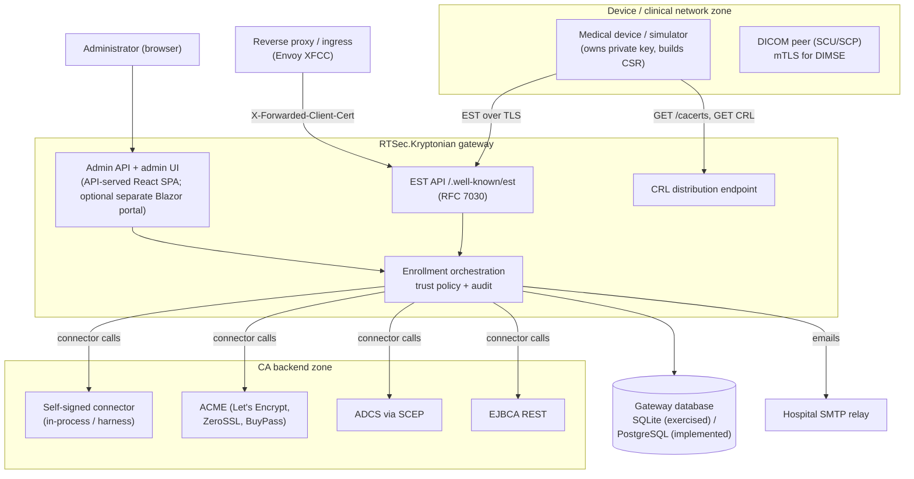

### 2.1 External actors and systems

| Actor / system | Interaction | Classification | Provenance |
|---|---|---|---|
| EST device client | `/cacerts` bootstrap, `/simpleenroll` (activation or certificate-authenticated), `/simplereenroll` | AS-IS | VERIFIED (independent curl HTTP Basic EST over real HTTPS, no private enrollment headers — IMPLEMENTATION-TRACKER.md) |
| DICOM peers | mTLS DIMSE associations using gateway-issued credentials on a **separate application path** from enrollment | AS-IS (demonstration) | VERIFIED (two actual mTLS C-STORE transfers with SOP Instance UID read-back, IMPLEMENTATION-TRACKER.md) |
| Administrator | Browser against admin API/UI: devices, certificates, CA backends, EST profiles, users, API keys, notification and gateway settings, revocation | AS-IS | CODE-OBSERVED (Controllers, Web, Ui projects) |
| CA backends | Self-signed (in-process and harness variants), ACME; ADCS via SCEP client; EJBCA REST | AS-IS (connectors present) | CODE-OBSERVED; real-hospital interoperability UNKNOWN |
| CaHarness | Stand-in CA backend exposing EST-compatible and ACME-compatible APIs for demo/scoring | AS-IS (test/demo component) | CODE-OBSERVED |
| Database | SQLite (exercised) / PostgreSQL 16 (implemented, additive SQL upgrades) | AS-IS | VERIFIED (restart on populated SQLite preserved configured profile, issuer and devices) / CODE-OBSERVED (Npgsql branch) |
| SMTP relay | Rejection and near-expiry email via MailKit | AS-IS | CODE-OBSERVED (MailKitSmtpSender, NotificationSettings) |
| Reverse proxy / Envoy ingress | May forward client certificates via `X-Forwarded-Client-Cert` (Hash/Cert/Chain format) | AS-IS | CODE-OBSERVED (CertificateForwarding options in Program.cs) |

---

## 3. Component architecture

### 3.1 Clean-architecture layers

The solution follows clean-architecture layering with dependency inversion: the domain layer
defines entities, enums, value objects, and interfaces; application services orchestrate;
infrastructure implements persistence, cryptography, and CA connectors; the API host wires
everything [CODE-OBSERVED — RTSec.Kryptonian.sln, project references].

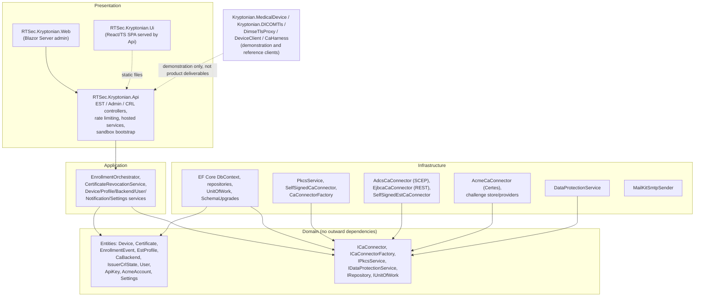

### 3.2 Component inventory

| Component | Layer | Responsibility | Classification | Provenance |
|---|---|---|---|---|
| `RTSec.Kryptonian.Api` | Host | Controllers (Est, Devices, Certificates, Crl, CaBackends, EstProfiles, Users, Auth, ApiKeys, NotificationSettings, GatewaySettings, Logs, Status, AcmeChallenge), Kestrel HTTPS + client-cert listeners, rate limiting, `CertificateExpiryWatcher`, sandbox bootstrap | AS-IS | CODE-OBSERVED |
| `RTSec.Kryptonian.Application` | Application | Enrollment orchestration, revocation, device/profile/backend/user/notification/gateway-settings services, CSR and returned-certificate policy enforcement, notification dispatch abstraction | AS-IS | CODE-OBSERVED |
| `RTSec.Kryptonian.Domain` | Domain | Entities, enums (`DeviceStatus`, `CertificateStatus`, `EnrollmentStatus`, `CaBackendType`, `UserRole`, `RevocationReason`, `SmtpTlsMode`, ...), value objects, connector interfaces | AS-IS | CODE-OBSERVED |
| `RTSec.Kryptonian.Infrastructure` | Infrastructure | EF Core persistence (SQLite/Npgsql), repositories + unit of work, additive schema upgrades, PKCS services, in-process self-signed CA, harness connectors (ADCS SCEP, EJBCA REST), ACME via Certes, data protection, MailKit SMTP | AS-IS | CODE-OBSERVED |
| `RTSec.Kryptonian.Web` | Presentation | Blazor Server admin dashboard calling the admin API | AS-IS | CODE-OBSERVED |
| `RTSec.Kryptonian.Ui` | Presentation | React/TypeScript admin dashboard (Vite) served as static files by the API with immutable `/assets` caching | AS-IS | CODE-OBSERVED |
| `Kryptonian.MedicalDevice` | Demonstration | WPF device simulator with EST enrollment client (legacy activation headers retained for compatibility) and automatic renewal while open | AS-IS (demonstration only) | DOCUMENTED (IMPLEMENTATION-TRACKER.md) |
| `Kryptonian.DICOMTls` | Demonstration | DIMSE-TLS demonstration terminating mTLS for DICOM associations; enforces issuer, TLS purpose, online revocation | AS-IS (demonstration only) | VERIFIED (loopback proxy tests, IMPLEMENTATION-TRACKER.md) |
| `RTSec.Kryptonian.DimseTlsProxy` | Demonstration | Standalone DIMSE TLS proxy with bounded connection lifetimes and atomic PFX reload; expired replacement fails closed | AS-IS (demonstration only) | VERIFIED (five loopback proxy tests, IMPLEMENTATION-TRACKER.md) |
| `RTSec.Kryptonian.CaHarness` | Test/demo | Stand-in CA backend used by harness connectors and ACME relay/challenge flows | AS-IS (test/demo) | CODE-OBSERVED |
| `RTSec.Kryptonian.Bridge`, `RTSec.Kryptonian.DeviceClient`, `RTSec.Kryptonian.Shared` | Supporting | Supporting/client/shared components | AS-IS | CODE-OBSERVED (solution membership) |

### 3.3 Request pipeline (device- and admin-facing)

Middleware order in `Program.cs` [CODE-OBSERVED]:

1. Serilog structured logging (console + rolling file + live `LiveLogBroadcaster` ring buffer powering the admin Events page) with correlation/request-ID and client-IP enrichment.
2. Optional Windows-service hosting (`UseWindowsService`); sandbox mode requires the Production environment and injects in-memory configuration (ports, SQLite path, secrets) from `SandboxBootstrap`.
3. Kestrel listeners: in sandbox mode, distinct localhost HTTPS listeners for admin, EST, and CRL ports; the admin listener uses `ClientCertificateMode.NoCertificate`; the EST listener allows client certificates with optional configured client-CA trust (`ConfiguredClientCertificateTrust` over `Kryptonian:Tls:ClientCaFiles`).
4. Certificate forwarding for Envoy `X-Forwarded-Client-Cert` (structured `Hash=...;Cert="..."[;Chain="..."]` header, URL-encoded PEM leaf).
5. Static dashboard (content-hashed `/assets` cached immutable; `index.html` no-cache) with API-only fallback when no bundle exists.
6. EST-over-plain-HTTP rejection: HTTP 426 unless `Kryptonian:Est:AllowPlainHttp` is explicitly enabled (development escape hatch).
7. HTTPS redirection (default outside Development) and CORS policy `KryptonianUi` (configurable origins; defaults are the localhost:5173 development origins).
8. Authentication (JWT bearer for admin users; API-key authentication handler) and role-based authorization.
9. Controllers; health endpoint `GET /api/status/health`; SPA fallback excluding `/api` and `/.well-known`.
10. `AspNetCoreRateLimit` IP/endpoint rate limiting on EST paths [DOCUMENTED — docs/ARCHITECTURE.md shows the intended configuration; the package is referenced by source, CODE-OBSERVED].

---

## 4. Deployment topology

### 4.1 Overview

Three deployment shapes exist at baseline [CODE-OBSERVED — docker-compose.yml, deploy/,
installer/]:

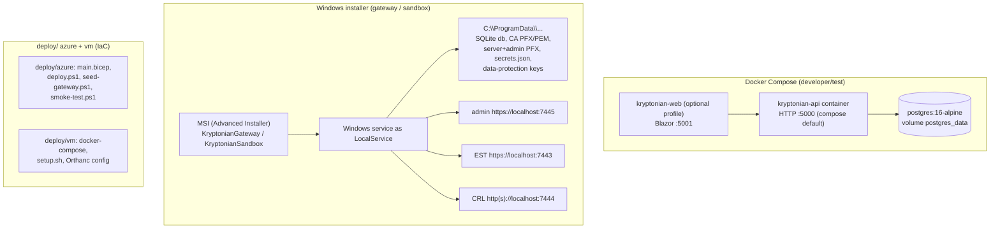

### 4.2 Docker Compose (AS-IS)

`docker-compose.yml` defines a PostgreSQL 16 container, the API container (built from
`src/RTSec.Kryptonian.Api/Dockerfile`), and an optional `web` profile container for the
Blazor UI [CODE-OBSERVED]. Notable AS-IS properties:

- API default ingress is `http://+:5000` in compose — TLS termination is expected to be added by the surrounding environment; this must be corrected for any real deployment (see §17, TO-BE B-2).
- Secrets are provided via environment variables with insecure development defaults (`POSTGRES_PASSWORD`, `ADMIN_API_KEYS`, `KRYPTONIAN_JWT_SECRET`, initial admin seed credentials).
- A self-signed CA can be mounted read-only at `/app/certs/ca.pfx` with a PFX password.
- Health checks: `pg_isready` for PostgreSQL and `curl /api/status/health` for the API.
- `docker-compose.hackathon.yml` provides the demonstration variant [CODE-OBSERVED, file present].
- `deploy/azure` contains Bicep IaC, deploy/seed/smoke scripts; `deploy/vm` contains a VM compose, setup script and Orthanc demo configuration [CODE-OBSERVED, file inventory].

### 4.3 Windows installer and sandbox topology (AS-IS)

The Windows installer ships two gateway personalities built from the same binaries
[CODE-OBSERVED — installer/windows, SandboxBootstrap.cs; DOCUMENTED — windows-installation.md,
windows-sandbox.md]:

- **KryptonianGateway** — persistent installation as a Windows service.
- **KryptonianSandbox** — local-only, offline preview: Windows service `KryptonianSandbox`
  running as LocalService, with mutable state under `C:\ProgramData\KryptonianSandbox`
  restricted to service/SYSTEM/administrators.

Sandbox bootstrap behavior [CODE-OBSERVED — SandboxBootstrap.cs]:

- Separate administration CA (`admin-ca.pfx`/`admin-ca.pem`) and device CA (`ca.pfx`/`ca.pem`), plus `server.pfx` (EST/CRL) and `admin.pfx` (admin listener); the administration CA is installed in the user store only inside a Windows Sandbox guest, never on the host [DOCUMENTED].
- Secrets persisted in `secrets.json` (CA PFX password, PFX password, JWT secret, admin API key); on first start a `48-byte` random secret is generated per field.
- State directory protection: ACL restriction to current identity, LocalSystem, LocalService, Administrators; reparse points rejected.
- Incompleteness guard: if some but not all required files exist, or if data-protection/DB state exists without CA material, startup **refuses to regenerate** certificate authority material rather than silently recreating keys.
- Distinct localhost ports: admin 7445 (no client certificates), EST 7443 (client certificates allowed), CRL 7444.
- Database provider forced to SQLite (`kryptonian.db` in the state directory); ASP.NET Core Data Protection keys stored under `dataprotection/`.

### 4.4 Database options

| Option | Status | Notes | Provenance |
|---|---|---|---|
| SQLite | AS-IS, exercised | Sandbox and developer flows; gateway restart on populated SQLite preserved configured profile, issuer and devices | VERIFIED |
| PostgreSQL 16 | AS-IS, implemented but not exercised | Npgsql provider with raw additive upgrade SQL in `SchemaUpgrades.cs`; connection pooling via Npgsql [DOCUMENTED — ARCHITECTURE.md] | CODE-OBSERVED / IMPLEMENTATION-TRACKER.md |
| EF Core `EnsureCreated` + additive upgrades | AS-IS | Existing installations were created with `EnsureCreated`; `SchemaUpgrades` performs additive column/table/index upgrades and never recreates a populated database | CODE-OBSERVED (SchemaUpgrades.cs header comment and SQL) |

---

## 5. Security trust boundaries

### 5.1 Trust-boundary diagram

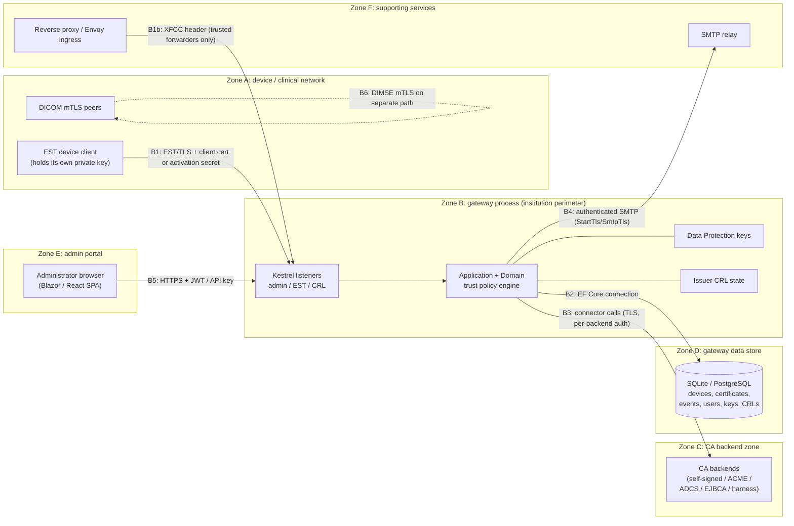

### 5.2 Boundary inventory

| ID | Boundary | AS-IS controls | Classification / provenance |
|---|---|---|---|
| B1 | Device-network → gateway (EST ingress) | HTTPS required for `/.well-known/est` (426 otherwise); optional Kestrel client-certificate validation against configured client CA files; per-profile client-certificate chain validation and trusted thumbprint lists; one-time activation code (hashed, expiring, single-use) for first enrollment; certificate-authenticated renewal; issuer-scoped profile routing with unknown-label rejection; rate limiting | AS-IS, VERIFIED (replay rejected, forwarded-certificate spoof rejected — IMPLEMENTATION-TRACKER.md) |
| B1b | Reverse proxy → gateway | Envoy `X-Forwarded-Client-Cert` header is parsed and trusted unconditionally once certificate forwarding is enabled; network placement of the gateway behind a trusted forwarder is a deployment assumption, not enforced in code | AS-IS risk finding → TO-BE (§17, C-3) |
| B2 | Gateway → database | EF Core over SQLite/Npgsql; sensitive values encrypted with ASP.NET Core Data Protection (`RTSec.Kryptonian.SensitiveData.v1` purpose) — SMTP password, ACME account keys, EAB HMAC keys; activation codes stored hashed; file ACLs in Windows deployment; data-protection key ring persisted with state | AS-IS, CODE-OBSERVED |
| B3 | Gateway → CA backend | Per-connector authentication (harness HTTP, ACME account key + optional EAB, SCEP, EJBCA REST credentials); backend disabled-state checked before use; issuer identity verified against stored certificate before revocation; remote revocation unsupported → fails closed (HTTP 501/503) | AS-IS, CODE-OBSERVED; CA outage behavior partially exercised (UNKNOWN for real hospital CAs) |
| B4 | Gateway → SMTP relay | Authenticated SMTP via MailKit; TLS modes StartTls/SmtpTls/None; optional `TrustServerCertificate` bypass flag (off by default, explicit operator choice for internal-CA relays) | AS-IS, CODE-OBSERVED |
| B5 | Admin portal → gateway | JWT bearer for users, hashed API keys with prefix + role + expiry, roles `Standard`/`DeviceAdmin`/`SystemAdmin`; sandbox admin listener explicitly `NoCertificate` | AS-IS, CODE-OBSERVED |
| B6 | Gateway credentials → application layer (DICOM mTLS) | Peers validate issuer, TLS purpose (EKU), hostname, and online revocation against the gateway CRL; revocation is not instant for established associations (bounded lifetimes) | AS-IS (demonstration), VERIFIED (unknown/expired/revoked client rejection — IMPLEMENTATION-TRACKER.md) |

Distinct separations are preserved per KSPEC-000 §3: device identity (X.509 holder),
certificate enrollment authorization (activation/approval), network trust (TLS/mTLS peer
authentication), and application-level authorization are never conflated, and clinical
capability is never derived from Kryptonian state.

---

## 6. Principal data flows

| Flow | Summary | Classification |
|---|---|---|
| Enrollment (registration → activation → issuance) | Administrator creates a pending device alias; gateway issues a one-time activation code (stored hashed). Device generates a key pair and CSR and presents the code plus metadata over EST HTTPS. Gateway validates the code (exists, unexpired, unused, belongs to a pending device), validates the CSR signature, binds the CSR CN and metadata to the registration, consumes the code, routes to the profile's CA backend, stores certificate metadata, marks the device active, and audits an `Issued` event. | AS-IS, VERIFIED |
| Re-enrollment / renewal | Active devices renew by presenting the existing certificate (native TLS client certificate), never the activation code. Gateway checks device status, enforces CSR and returned-certificate policy, preserves the approved identity, and issues a new credential with a new key; a pending response is supported so devices can retry. Automatic renewal runs while the device simulator is open. | AS-IS, VERIFIED |
| Revocation | Administrator revokes a certificate. Gateway verifies the certificate chains to the configured issuer, gathers all revoked serials for the issuer, increments the issuer CRL number, requests a signed issuer-scoped CRL from the connector, and persists it **transactionally** with the certificate status change. Unsupported backends fail closed. | AS-IS, VERIFIED (administrator revocation → native online X509Chain reports Revoked — IMPLEMENTATION-TRACKER.md) |
| Admin operations | CRUD on devices, CA backends, EST profiles, users, API keys, notification settings/recipients, gateway settings; partial profile updates preserve omitted trust lists; logs/events views. | AS-IS, CODE-OBSERVED |
| CRL distribution | Issuer-scoped signed CRLs served from `IssuerCrlState` via the CRL controller/listener; peers refresh periodically. Prototype CRL lifetime is 60 seconds; the HTTP listener denies non-CRL requests. | AS-IS, CODE-OBSERVED + VERIFIED (live checks) |
| Bootstrap (cacerts) | `/cacerts` resolves the **profile's own** CA backend (not a global active backend), fetches the chain via the connector, and encodes PKCS#7 for the EST response. | AS-IS, CODE-OBSERVED |

---

## 7. Sequence diagrams for the six principal workflows

Diagrams are adapted from `docs/sequence-diagrams/*.mmd` [DOCUMENTED] and cross-checked
against `EnrollmentOrchestrator.cs`, `CertificateRevocationService.cs`,
`CertificateExpiryWatcher.cs`, and the controllers [CODE-OBSERVED].

### 7.1 Registration → activation → enrollment

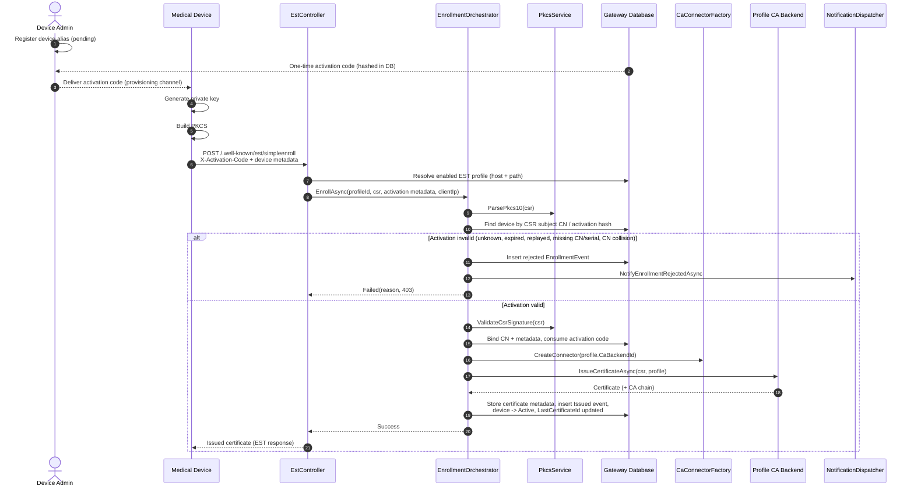

### 7.2 Re-enrollment renewal

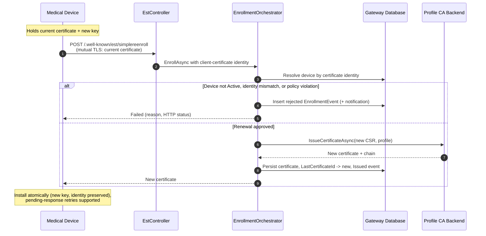

### 7.3 Revocation and trust removal

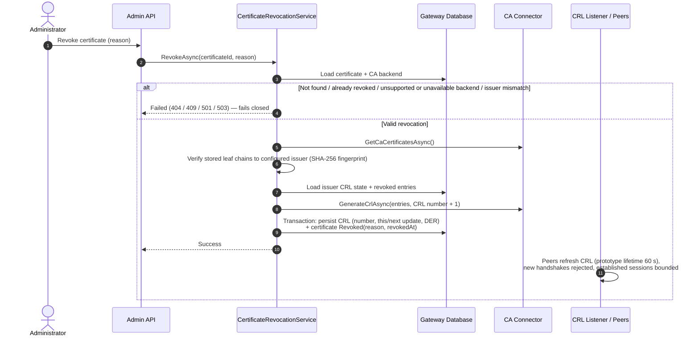

### 7.4 EST cacerts bootstrap

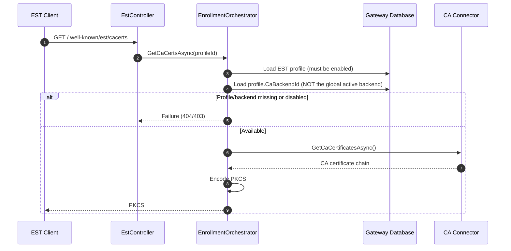

### 7.5 Expiry monitoring and notifications

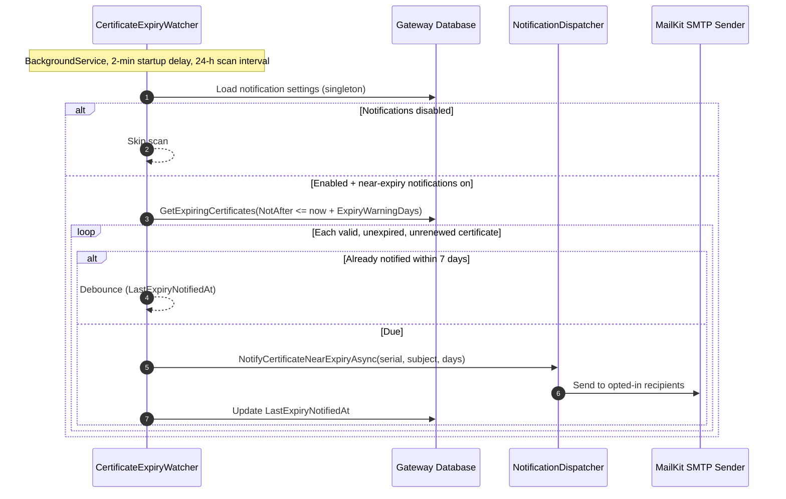

### 7.6 DICOM mTLS demonstration

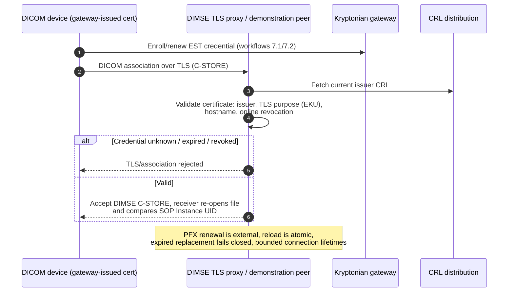

---

## 8. State machines

### 8.1 Device status lifecycle (AS-IS)

The `DeviceStatus` enum at baseline is `Pending`, `Active`, `Removed` [CODE-OBSERVED].
The earlier design sketches in docs/flow.md (`untrusted`, `retired`) are **not** present in
the baseline enum; trust withdrawal is expressed as `Removed` (device cannot enroll or
renew) [DOCUMENTED — docs/flow.md; CODE-OBSERVED — Device.cs, device-enrollment.md].

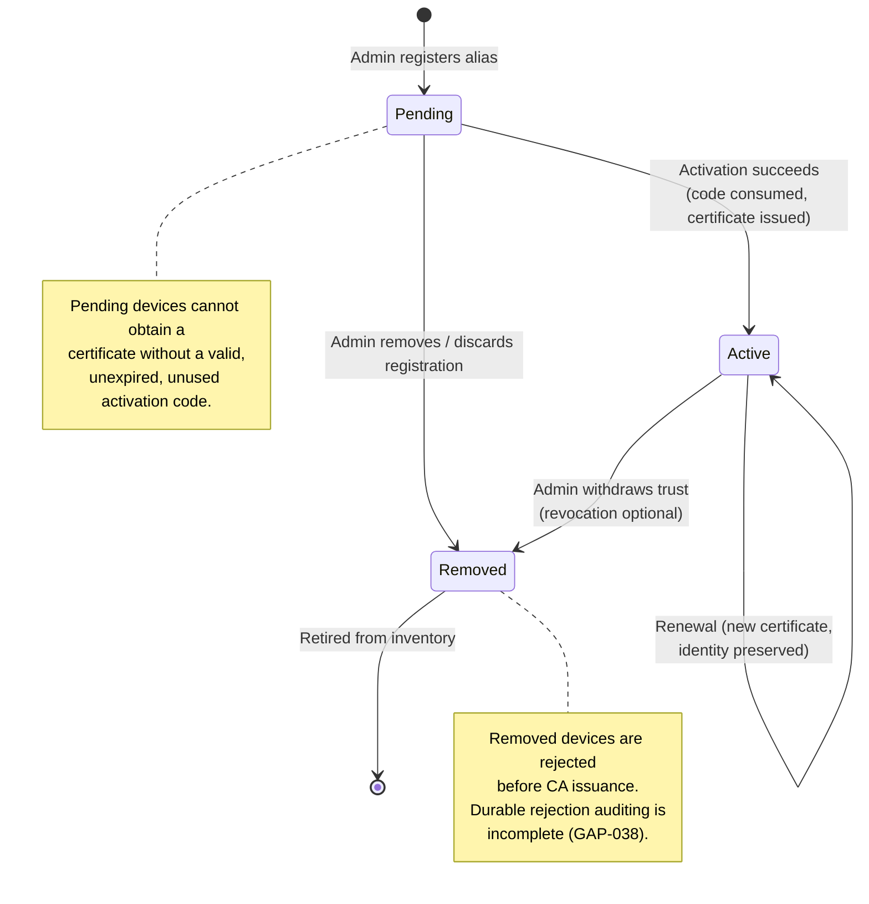

### 8.2 Certificate lifecycle (AS-IS validity view)

Expiration is a time-based validity condition. Baseline source checks NotAfter and
the watcher skips already-expired certificates; no automatic writer that changes the
stored Certificate.Status to Expired was observed. The diagram separates that logical
condition from administrative revocation, which explicitly persists Revoked status.

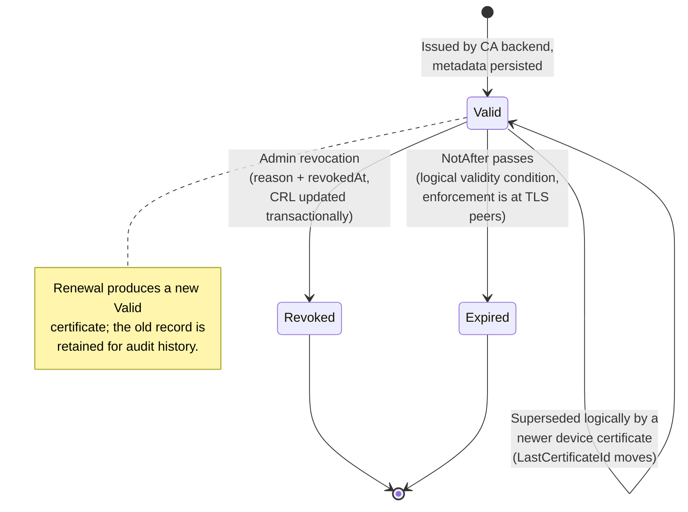

### 8.3 Activation code lifecycle (AS-IS)

Activation codes have no separate entity; the lifecycle is carried by fields on the pending
device (`ActivationCodeHash`, `ActivationCodeExpiresAt`, `ActivationCodeUsedAt`)
[CODE-OBSERVED — Device.cs]:

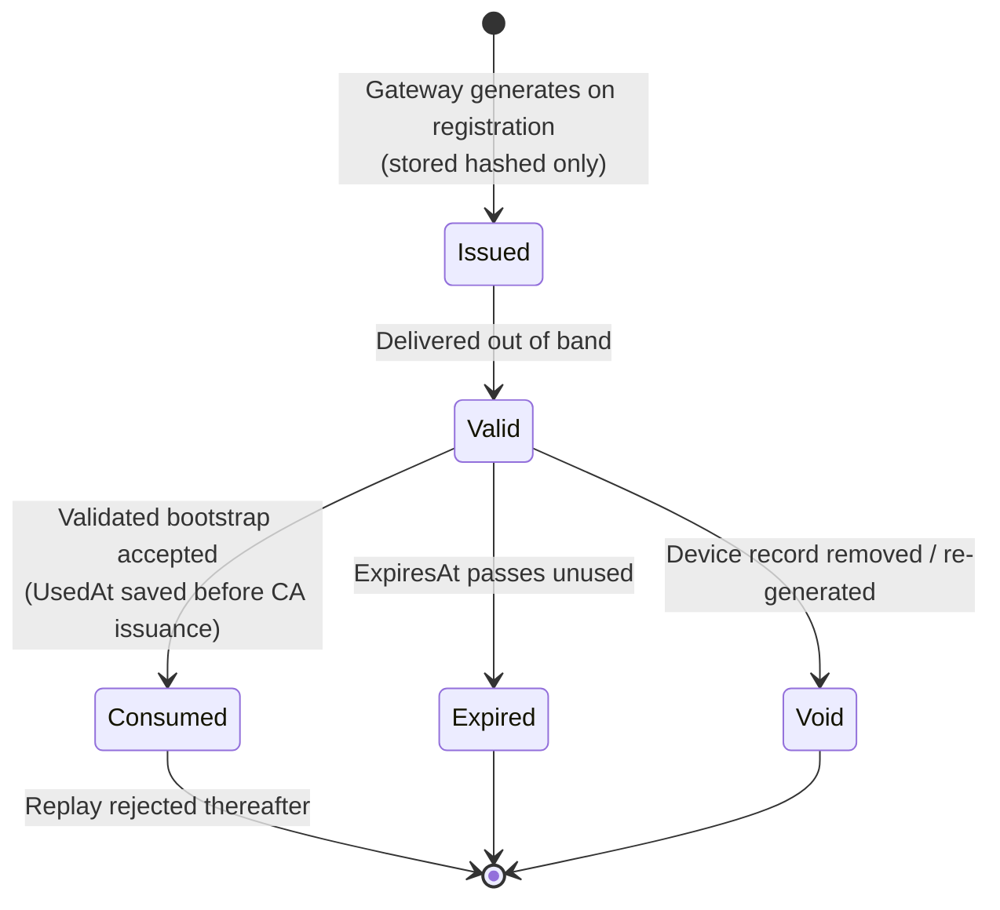

### 8.4 Enrollment request lifecycle (AS-IS)

`EnrollmentStatus` is `Issued`, `Pending`, `Rejected`, `Error` [CODE-OBSERVED —
EnrollmentStatus.cs, EnrollmentEvent.cs]:

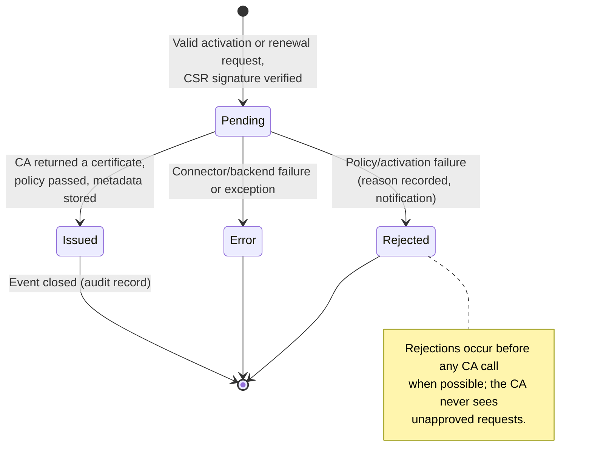

---

## 9. Database conceptual model

### 9.1 Entity-relationship diagram

Conceptual model derived from the domain entities and `KryptonianDbContext` [CODE-OBSERVED].

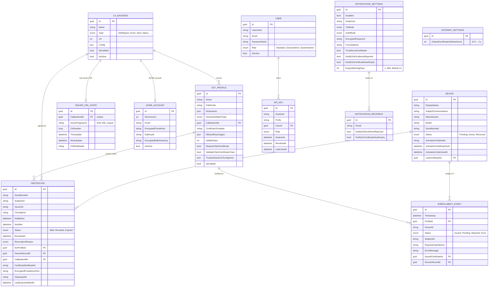

### 9.2 Key relations and notes

| Relation / constraint | Notes | Provenance |
|---|---|---|
| CaBackend → EstProfile (1 → 0..n) | Profile owns its issuer; `/cacerts` and enrollment resolve the backend **by profile**, not the globally active backend | CODE-OBSERVED (EnrollmentOrchestrator) |
| CaBackend → IssuerCrlState (1 → 0..1) | Unique per backend; SHA-256 `IssuerFingerprint` binds the CRL to the exact CA certificate; a rotated CA certificate blocks revocation with 409 until a new backend record is created | CODE-OBSERVED (CertificateRevocationService, SchemaUpgrades) |
| Device → Certificate (1 → 0..n) | Full history retained; `Device.LastCertificateId` points at the newest and is used by the expiry watcher to detect renewal | CODE-OBSERVED |
| Certificate → EnrollmentEvent (1 → 0..n) | Every attempt audited, including rejections and errors, with requestor IP and reason | CODE-OBSERVED |
| User → ApiKey (1 → 0..n) | Keys stored hashed with a display prefix, role, expiry, revocation, last use | CODE-OBSERVED |
| NotificationSettings → NotificationRecipient (1 → 0..n) | Per-recipient per-event opt-in; SMTP password encrypted via Data Protection and never returned over the API | CODE-OBSERVED |
| Uniqueness / integrity | Unique index `(ca_backend_id, serial_number)` on certificates; unique `issuer_fingerprint` on CRL state; activation requires the CSR CN not already bound to another device | CODE-OBSERVED (SchemaUpgrades.cs, orchestrator) |
| GatewaySettings | Singleton carrying the default certificate lifetime (bounded 24 h to 2 years, default 24 h — supporting short-lived demonstration credentials) | CODE-OBSERVED |

The `Certificate.EncryptedPrivateKeyPem` field indicates server-side key generation /
archival capability in the schema; its production use and key-protection policy are
TO-BE subjects (see §17) [CODE-OBSERVED field; policy UNKNOWN].

---

## 10. Certificate lifecycle design

| Phase | Design | Classification / provenance |
|---|---|---|
| Bootstrap trust | Device fetches `/cacerts` for its profile (PKCS#7 chain) before first enrollment; profile-scoped issuer prevents cross-profile trust confusion | AS-IS, CODE-OBSERVED |
| Identity binding | Activation binds the CSR subject CN, manufacturer, model, serial to the pending alias; CN collisions rejected; identity is preserved across renewals; a gateway OID extension under `1.3.6.1.4.1.99999.*` is carried in issued certificates and used for identity matching | AS-IS, CODE-OBSERVED + VERIFIED (enrollment identity binding, IMPLEMENTATION-TRACKER.md) |
| Issuance | CSR signature validated; CSR and returned-certificate policy enforced (subject DN rules, key usage, validity) via `EnrollmentCertificatePolicy`; gateway stores serial, thumbprint, issuer DN, PEM/DER, profile, backend | AS-IS, VERIFIED (PR 43 evidence) |
| Validity / monitoring | Default lifetime from `GatewaySettings` or profile `ValidityDays`; `CertificateExpiryWatcher` warns 1–365 days ahead (default 14), debounced 7 days per certificate, skips certificates already renewed | AS-IS, CODE-OBSERVED |
| Renewal | Certificate-authenticated re-enrollment only (activation codes never reusable); new key each renewal; approved identity preserved; pending-response retry supported; device simulator renews automatically while open | AS-IS, VERIFIED |
| Revocation | Administrator-initiated; issuer-verified; issuer-scoped signed CRL with monotonic CRL number; transactional persistence; unsupported backends fail closed (501/503) | AS-IS, VERIFIED |
| Retirement | Removed devices are blocked from enrollment/renewal; short demo lifetimes mean untrusted devices fall out of trust quickly; existing valid peer credentials keep working within their policy limits | AS-IS + DOCUMENTED (ORNET-ALIGNMENT) |
| Server-side key generation | `EncryptedPrivateKeyPem` exists on the certificate record; a bounded `/serverkeygen` design is a PROPOSED TO-BE extension, not an AS-IS normative behavior | PROPOSED |

---

## 11. Backend connector architecture

### 11.1 Abstraction and routing

`ICaConnector` (Domain) exposes `Type`, `GetCaCertificatesAsync`, `IssueCertificateAsync`,
`RevokeCertificateAsync`, `GenerateCrlAsync` (default `CrlGenerationResult.Unsupported()`),
and `TestConnectionAsync` [CODE-OBSERVED]. `CaConnectorFactory` (Infrastructure) maps
`CaBackend.Type` to a connector, caches one instance per backend id under a lock, and derives
per-connector configuration from backend `Config` JSON with environment-variable fallback
[CODE-OBSERVED]. Routing is **profile → backend**: every enrollment and bootstrap resolves
the connector through `profile.CaBackendId`; unknown backend types throw
`NotSupportedException` and requests fail closed [CODE-OBSERVED; VERIFIED — unknown-label
rejection, IMPLEMENTATION-TRACKER.md].

### 11.2 Per-connector behavior and limitations (AS-IS)

| Connector | Backend type | Issuance | Chain (/cacerts) | Revocation | Limitations | Provenance |
|---|---|---|---|---|---|---|
| `SelfSignedCaConnector` (in-process) | SelfSigned | Signs CSRs locally with BouncyCastle using the configured CA key; SHA-256 RSA/ECDSA; configurable CDP | Returns configured CA | Local CRL generation supported | CA private key held in gateway process; Windows key storage via MachineKeySet | CODE-OBSERVED |
| `SelfSignedEstCaConnector` (harness) | SelfSigned | Calls harness `est/selfsigned/simpleenroll` over HTTP | Harness `api/backends/selfsigned/cacerts` | Not supported by harness (returns false, logs warning) — revocation fails closed | Requires reachable harness service | CODE-OBSERVED |
| `AcmeCaConnector` | Acme (Certes) | ACME order with http-01 (relay) or dns-01 (stub) challenge; optional EAB; account key persisted Data-Protection-encrypted | Chain cached from last issuance; well-known ISRG chain for Let's Encrypt before first issuance | Not supported → fails closed | Public DNS/HTTP ACME only; demo dns-01 is a stub; chain unavailable before first issuance | CODE-OBSERVED |
| `AdcsCaConnector` | Adcs | SCEP: builds PKCSReq (PKCS#7/CMS) and POSTs PKIOperation | Fetches SCEP CA certificate | CRL generation per connector contract | Hospital ADCS interoperability unverified; template approval semantics not exercised | CODE-OBSERVED; interoperability UNKNOWN |
| `EjbcaCaConnector` | Ejbca | REST `pkcs10enroll` with certificate/end-entity profile names | Chain cached per connector instance (empty until configured) | CRL generation per connector contract | Hospital EJBCA interoperability unverified | CODE-OBSERVED; interoperability UNKNOWN |
| Not implemented types | Cfssl, HashiCorpVault, Smallstep, OpenXpki | Factory throws `NotSupportedException` | — | — | Enum values reserved; requests fail closed | CODE-OBSERVED (CaBackendType.cs, factory) |

### 11.3 Failure modes

| Failure | Gateway behavior | Provenance |
|---|---|---|
| Unknown/disabled profile or backend | Enrollment/cacerts rejected before any CA call (404/403) | CODE-OBSERVED |
| Connector `NotSupportedException` | Fail closed (e.g., revocation returns 501) | CODE-OBSERVED |
| Backend unreachable / HTTP error | Connector returns `CertificateIssuanceResult.Failed`; enrollment event records `Error`; device retries | CODE-OBSERVED |
| Expired CA or issuer rotation | Revocation refuses with 409/503 ("certificate authority is expired" / "CA certificate has rotated; create a new CA backend") | CODE-OBSERVED |
| Remote CA without a revocation API | Local issuer-scoped CRL path used where the connector supports it; otherwise revocation fails closed — no silent partial revocation | CODE-OBSERVED + DOCUMENTED (tracker) |

---

## 12. Failure recovery and interrupted-operation behavior

| Scenario | Behavior at baseline | Classification / provenance |
|---|---|---|
| Incomplete sandbox state (some CA files missing) | Startup refuses to regenerate CA material when state is partial, or when data-protection/DB state exists without matching CA files; operator intervention required instead of silent re-keying | AS-IS, CODE-OBSERVED (SandboxBootstrap guards) |
| Activation interrupted after code consumption but before certificate issuance | Replay after consumption is rejected (VERIFIED); full crash-mid-sequence rollback is bounded by the database transaction scope but is not separately tested — recorded as an open question | INFERRED / UNKNOWN |
| Revocation interrupted mid-write | CRL state and certificate status persisted inside one database transaction with rollback on failure; failed CRL generation aborts the revocation rather than publishing an inconsistent CRL | AS-IS, CODE-OBSERVED (BeginTransaction / TryPersistRevocationState / Rollback) |
| Gateway restart | Configured profile, issuer and devices preserved on populated SQLite; durable trust policy per PR 41 | VERIFIED (tracker) |
| PFX replacement on the DIMSE proxy | Atomic PFX replacement observed on fresh handshakes; expired replacement fails closed; established connections have bounded lifetimes | VERIFIED (loopback proxy tests) |
| MSI upgrade/uninstall | Uninstall removes program files and service but retains ProgramData state; MSI rollback is not a database rollback; schema-upgrade testing required; back up database, CA and encryption keys together before upgrades | DOCUMENTED (windows-sandbox.md) |
| Schema evolution | Additive-only upgrades (`ADD COLUMN IF NOT EXISTS`, `CREATE TABLE/INDEX IF NOT EXISTS`) for Npgsql and SQLite; never recreates a populated database | AS-IS, CODE-OBSERVED (SchemaUpgrades.cs) |
| CA outage during enrollment | Enrollment event recorded as `Error`; retry/backoff is client responsibility; availability expectations (early renewal, retry/backoff, reliable time, behavior when the enrollment service is unavailable) are TO-BE per the OR.NET alignment notes | DOCUMENTED (ORNET-ALIGNMENT-2026-09-09.md) |

---

## 13. Concurrency and consistency considerations

- **Connector cache**: `CaConnectorFactory` caches connectors per backend id under an
  explicit lock; disposal is serialized [CODE-OBSERVED].
- **CRL number monotonicity**: enforced via the single `IssuerCrlState` row per backend,
  incremented inside the revocation transaction; mismatched or rotated issuers are refused
  [CODE-OBSERVED]. Concurrent revocations serialize on the transaction; no explicit
  row-version concurrency token was observed on the state entity [INFERRED].
- **Activation code single use**: validation (unused/unexpired) and consumption occur in the
  enrollment path; replay is rejected afterward [VERIFIED]. Consumption is race-safe as
  implemented: `UnitOfWork.TryConsumeActivationCodeAsync` commits the consumption under
  optimistic concurrency and returns false on `DbUpdateConcurrencyException`, and
  `tests/RTSec.Kryptonian.Infrastructure.Tests/Data/DeviceActivationConcurrencyTests.cs`
  demonstrates that two separate contexts cannot both consume the same code
  [CODE-OBSERVED; VERIFIED in tracker: "One-time activation replay rejected"]. The open
  question is the transactional scope of consumption versus certificate issuance under
  crash (see §17 item 1), not double consumption.
- **Database write concurrency**: SQLite single-writer semantics apply in the exercised
  deployment; PostgreSQL is implemented but unexercised. No optimistic-concurrency token
  (row version) was observed on entities [INFERRED].
- **DateTime handling**: live checks exposed that SQLite's unspecified DateTime kind shifted
  refreshed CRL revocation times by five hours on one host; fixed with a runnable regression
  — consistent UTC normalization is a design constraint for every provider [VERIFIED —
  IMPLEMENTATION-TRACKER.md].
- **Chain caching**: ACME CA-chain cache is guarded by a lock; first-request-before-issuance
  returns a well-known chain or warns [CODE-OBSERVED].

---

## 14. Configuration and secrets management

| Secret / setting | AS-IS mechanism | Gap / TO-BE direction | Provenance |
|---|---|---|---|
| Database connection string | Environment/compose variable, or sandbox in-memory config (`Kryptonian:Database:...`) | Production secret handling to be defined | CODE-OBSERVED |
| JWT signing secret | `Kryptonian:Auth:JwtSecret` (≥32 chars in production); sandbox writes a generated secret to `secrets.json` | Managed secret store (vault / DPAPI-protected file) | CODE-OBSERVED |
| Admin API keys | `Kryptonian:AdminApi:ApiKeys` env/legacy keys honored as SystemAdmin; per-user hashed API keys in the database | Retire flat-file legacy keys; TO-BE uses DB-backed keys only | CODE-OBSERVED |
| CA PFX password | `KRYPTONIAN__CA__SELFSIGNED__PFXPASSWORD` env, or sandbox `secrets.json` | Managed secret store; no secrets in AIP/scripts/releases | CODE-OBSERVED + DOCUMENTED |
| SMTP credentials | DB `EncryptedPassword` via ASP.NET Core Data Protection; never returned over the API | Back up data-protection key ring with the database | CODE-OBSERVED |
| ACME account key / EAB HMAC | Persisted Data-Protection-encrypted (`AcmeAccount`) | Same | CODE-OBSERVED |
| Activation codes | Generated server-side, stored hashed only, time-limited, single-use | Same | CODE-OBSERVED |
| Initial admin credentials | Optional seed via env (`InitialAdminUsername/Password/Email`) with insecure demo defaults in compose; UI wizard otherwise | First-run wizard only; no seed defaults in production packages | CODE-OBSERVED |
| Compose defaults | Insecure development defaults present (`dev-api-key-change-in-production`, seeded admin password) | TO-BE: refuse startup in Production when known defaults are detected | CODE-OBSERVED gap → TO-BE (§17 D-1) |

---

## 15. External dependencies

| Dependency | Role | Notes | Provenance |
|---|---|---|---|
| .NET 8 runtime / ASP.NET Core | Application framework | Self-contained publish for the Windows installer | CODE-OBSERVED / DOCUMENTED |
| PostgreSQL 16 (`postgres:16-alpine`) | Database (Docker) | Npgsql provider | CODE-OBSERVED |
| SQLite (SQLitePCLRaw) | Database (Windows/sandbox) | Transitive audit reports high advisories in SQLitePCLRaw.lib.e_sqlite3 2.1.6 — deployment blocker | DOCUMENTED (tracker) |
| BouncyCastle | PKCS#7, X.509, CMS/SCEP signing | Upgraded to 2.6.2 with MailKit 4.16.0 | DOCUMENTED (tracker) |
| Certes | ACME client | Internet-dependent ACME directories (Let's Encrypt, ZeroSSL, BuyPass, staging) | CODE-OBSERVED |
| MailKit 4.16.0 | SMTP notifications | Patched per GHSA-9j88-vvj5-vhgr | DOCUMENTED (tracker) |
| `System.Security.Cryptography.Xml` | Transitive | 8.0.2 high advisory — deployment blocker | DOCUMENTED (tracker) |
| Serilog, AspNetCoreRateLimit, MudBlazor | Logging, rate limiting, UI components | | CODE-OBSERVED |
| Hospital SMTP relay | Notifications | Internal-CA relays may require the explicit trust flag | CODE-OBSERVED |
| Advanced Installer 22.0+ | MSI build (maintainers) | Build-time dependency, not runtime | DOCUMENTED |
| PowerShell 7.6.5 (portable) | Bundled installer payload | SHA-256-verified download at build time | DOCUMENTED (windows-sandbox.md) |

---

## 16. AS-IS vs TO-BE architecture comparison

### 16.1 Retained architecture (AS-IS carried into TO-BE)

The following AS-IS elements are **confirmed as the target design** and require no change
beyond formalization [VERIFIED/CODE-OBSERVED]:

- Clean-architecture layering and the `ICaConnector` abstraction with profile→backend routing.
- EST-facing protocol surface: standard Basic-authenticated enrollment, certificate-authenticated renewal, `/cacerts` PKCS#7 bootstrap, profile-scoped issuer resolution.
- One-time activation-code bootstrap: hashed, expiring, single-use, replay-rejected.
- Issuer-scoped signed CRLs with monotonic numbering and transactional revocation; fail-closed on unsupported backends.
- Complete per-attempt enrollment/renewal/revocation auditing is TO-BE; AS-IS persists selected issuance and rejection outcomes (GAP-038).
- Expiry monitoring with debounced near-expiry notifications.
- Separate trust zones for administration (own CA in sandbox mode) and device-facing EST.

### 16.2 AS-IS findings that drive TO-BE change

| ID | Area | AS-IS (baseline) | TO-BE (target) | Type |
|---|---|---|---|---|
| A-1 | Device status model | Enum `Pending/Active/Removed`; trust withdrawal collapses into `Removed` | Distinguish at least `Untrusted` (revocable trust withdrawal) from `Retired` (inventory retirement) so audit history and dashboard semantics are explicit | TO-BE (needs SR alignment) |
| A-2 | Certificate record | `EncryptedPrivateKeyPem` exists; archival/key-protection policy undefined | Define whether the gateway ever archives device private keys; if prohibited, remove the field or restrict it to explicit `/serverkeygen` profiles | TO-BE (policy decision) |
| A-3 | Demo OID namespace | Gateway OID under `1.3.6.1.4.1.99999.*` (unregistered, prototype PEN) | Obtain an authorized enterprise PEN or adopt agreed profile OIDs; the ORNET briefing forbids inventing a second protocol or private clinical-role OID | TO-BE (external stakeholder decision) |
| A-4 | CRL lifetime | Hard-coded 60-second prototype CRL lifetime | Configurable, policy-based CRL lifetime and next-update chosen from outage tolerance and revocation objectives, not a demo value | TO-BE |
| A-5 | Revocation propagation | Peers refresh CRLs on a timer; established associations have bounded lifetimes | Define stale-revocation-data and established-session handling explicitly; no promise of instant mid-association termination | TO-BE (normative statement) |
| A-6 | Audit export | Audit is a database table + structured logs | Map lifecycle/transport events to ATNA/DICOM audit definitions and protect export with a standard transport (separate conformance task) | TO-BE (PROPOSED scope) |
| A-7 | Automatic renewal scope | Device simulator renews only while open; no OS-service renewal | Deployment policy for long-lived operation, hardware-backed key storage, old-certificate retirement | TO-BE (needs SR) |
| A-8 | Legacy activation headers | Sample device client retains legacy private activation headers | Independent standard-Basic path remains the only interoperability requirement; legacy headers stay demo-only compatibility, never a new interoperability requirement | DOCUMENTED boundary (retained) |
| A-9 | PostgreSQL | Upgrade SQL implemented; only SQLite exercised | Exercise and verify the Npgsql path, then select the production database | TO-BE (V&V) |
| A-10 | Server leaf revocation | Launcher's initial server leaf revocation explicitly skipped without a CDP (hostname/purpose checks remain) | Every deployed issuer must publish a reachable CDP; this exception must not survive into production | DOCUMENTED boundary → TO-BE |

### 16.3 PROPOSED items (require stakeholder approval — never normative without it)

| ID | Proposal | Rationale |
|---|---|---|
| P-1 | Replace environment/`secrets.json` secret handling with a managed secret store (vault or OS-protected secret service) and fail-fast checks for known development defaults in Production | Reduces secret sprawl; supports institutional operation (SR-B/SR-S class) |
| P-2 | Enforce forwarder authentication for the XFCC client-certificate path (shared secret, network allow-list, or proxy→gateway mTLS) | The Envoy header is trusted unconditionally at baseline; closing boundary B1b closes a spoofing route |
| P-3 | Add `/csrattrs` (and evaluate `/serverkeygen`) per RFC 7030 with bounded profiles | Improves device-side guidance; enables constrained clients |
| P-4 | Metrics/observability endpoint (enrollment counts, CA latency, request rates) | Listed as planned/future in docs/ARCHITECTURE.md |
| P-5 | Add row-version concurrency tokens on hot entities and define/verify the crash-scope of activation consumption versus certificate issuance (one-time consumption itself is already enforced via optimistic concurrency — `UnitOfWork.TryConsumeActivationCodeAsync`, `DeviceActivationConcurrencyTests`) | Hardens the concurrency envelope identified in §13 and resolves the crash-scope question of §17 |
| P-6 | Dedicated notification outbox so rejected-enrollment and expiry emails survive transient SMTP outages | Notifications are dispatched inline at baseline [CODE-OBSERVED] |
| P-7 | Per-backend connector health surfaced on the status/health endpoint | Health currently reflects overall status; per-backend reachability exists only as connector `TestConnectionAsync` [CODE-OBSERVED] |

### 16.4 Comparison summary diagram

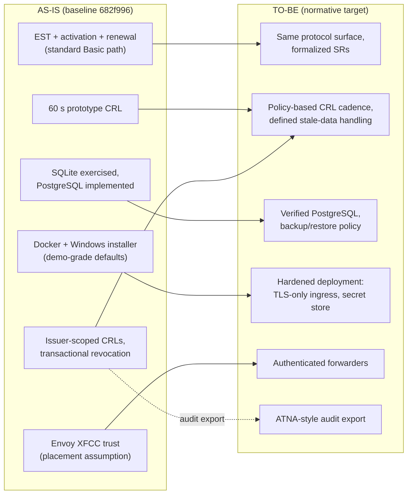

---

## 17. Open questions (UNKNOWN — recorded, not resolved here)

1. Consumption and issuance are separate persistence operations (CODE-OBSERVED): activation is saved before backend/policy/CA processing. Crash and pending-response recovery remain unverified; VT-060 specifies failure/restart and administrator-regeneration cases.
2. Real hospital ADCS/EJBCA enrollment and revocation interoperability (explicitly unverified at baseline).
3. PostgreSQL correctness/performance beyond the implemented additive upgrade SQL.
4. Whether `Certificate.EncryptedPrivateKeyPem` is written by any baseline code path or is dormant schema (field observed; writer not traced).
5. Windows Sandbox guest install/repair/upgrade/uninstall acceptance tests remained unverified on the authoring host per docs/windows-sandbox.md.

---

## 18. Document control notes

- This document is a **Draft** (KSPEC-000 review sequence: 003 → 004). It contains no
  conformity claims; executed-test references cite repository evidence only.
- KSPEC-003 exists; concrete SR bindings are maintained in KSPEC-009 §§4 and 7, and the §16.2 rows are promoted to TO-BE only where the
  corresponding requirement is approved.
- No application source code was modified in producing this document.
