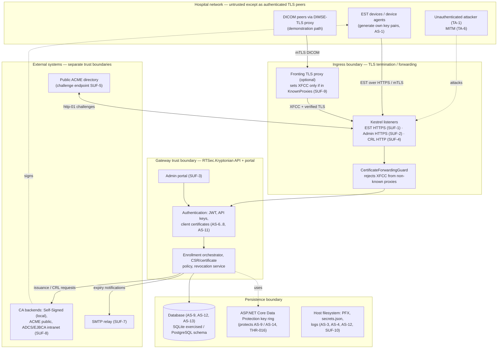

# Kryptonian Formal Engineering Specification — Cybersecurity Architecture and Threat Model

| Field | Value |
|---|---|
| Document ID | KSPEC-006 |
| Title | Cybersecurity Architecture and Threat Model (STRIDE) |
| Version | 0.2 (Draft) |
| Status | Draft — pending review |
| Created | 2026-10-13 |
| Baseline commit | `682f996c8447afec13bc1fce5b7f59e6a06efa25` (branch `feat/windows-sandbox-installer`, "Release Windows gateway and portable enrollment demo 0.1.4") |
| Revision history | 0.1 — 2026-10-13 — Initial draft STRIDE threat model covering 18 threat entries (THR-001 … THR-018), trust-boundary diagram, controls-to-requirements mapping, residual-risk summary |
| Source references | KSPEC-000 (conventions); `docs/IMPLEMENTATION-TRACKER.md`; `docs/ARCHITECTURE.md` (Security Architecture); `docs/device-enrollment.md`; `docs/user-management.md`; `docs/ORNET-ALIGNMENT-2026-09-09.md`; source under `src/RTSec.Kryptonian.{Api,Application,Infrastructure}`; tests under `tests/`; `docs/formal-specification/07-OPERATIONAL-RISK.md` |
| Author | _Name / Date / Signature_ |
| Reviewer | _Name / Date / Signature_ |
| Approver | _Name / Date / Signature_ |
| Reconciliation revision | 0.2 - 2026-10-13 - source/document audit and publication controls (KSPEC-016) |

---

## 1. Purpose and scope

This document is the cybersecurity architecture and threat model (KSPEC-006) for
RTSec.Kryptonian at baseline commit `682f996c8447afec13bc1fce5b7f59e6a06efa25`.
It applies the STRIDE methodology (Spoofing, Tampering, Repudiation, Information
disclosure, Denial of service, Elevation of privilege) to the gateway's security
assets, threat actors, and attack surfaces, and records:

- security assets and their ownership,
- threat actors and their assumed capabilities,
- attack surfaces and trust boundaries (Mermaid diagram, KSPEC-000 §12),
- a structured threat catalog with `THR-nnn` entries (owned by this document per
  KSPEC-000 §7),
- existing (AS-IS) controls with evidence provenance per KSPEC-000 §5,
- proposed (PROPOSED) controls requiring stakeholder approval,
- residual-risk ratings and a controls-to-requirements mapping.

Scope: deliberate security threats against the gateway, its EST endpoints, admin
API and portal, CRL publication, CA-backend connections, persistence layer, and
notification path; and misuse of gateway-managed credentials (device
certificates, activation codes, admin credentials, API keys, CA signing keys).

Out of scope:

- Medical-device hazard classification, IEC 62304 lifecycle classification,
  ISO 14971 medical-device risk management, and clinical harm probabilities.
  Kryptonian is enterprise healthcare IT cybersecurity infrastructure — an EST
  (RFC 7030) certificate enrollment and credential lifecycle gateway. It is not
  a regulated medical device and performs no clinical functions (KSPEC-000 §3).
- Clinical capability: device clinical function is never derived from Kryptonian
  state. Credential compromise degrades device *network identity and secure
  communication*, never clinical capability.
- Non-adversarial failure modes (component failure, power loss, clock drift,
  misconfiguration without an adversary); these are covered by KSPEC-007 (ORK-*)
  except where threat and operational risk intersect (cross-referenced as noted).
- Attacks against downstream applications that merely *use* gateway-issued
  certificates (DICOM associations, SDC participation) beyond the point at which
  the gateway's revocation data and trust policy reach them.
- No security standards conformity is claimed in this document. Control-framework
  references (§10) are recommended practices only, per KSPEC-000 §13.

## 2. Method, scales, and classification rules

### 2.1 Method

Each threat entry (identifier prefix `THR-`, owned by this document per
KSPEC-000 §7) is analyzed as:

1. **Description** — the attacker's goal, capability, and attack path.
2. **STRIDE category** — primary category; secondary categories where applicable.
3. **Affected assets / surfaces** — items from §3 and §5.
4. **Existing controls (AS-IS)** — controls present at baseline, each tagged with
   an evidence provenance class (VERIFIED / CODE-OBSERVED / DOCUMENTED / INFERRED)
   per KSPEC-000 §5 and repository evidence. Executed-test claims are taken from
   `docs/IMPLEMENTATION-TRACKER.md` and its test suites; this document adds no
   new executed evidence of its own.
5. **Proposed controls (PROPOSED)** — recommended enhancements requiring
   stakeholder approval; never presented as implemented.
6. **Residual risk** — qualitative likelihood × impact after *implemented*
   (AS-IS) controls only, using the scales in §2.2.
7. **Linked requirements** — prefix-level references into the KSPEC-003
   Requirements Register (see §2.4).
8. **Verification** — approach per KSPEC-000 §11 abbreviations (T = Test,
   I = Inspection, A = Analysis, D = Demonstration).

### 2.2 Qualitative risk scales

| Scale | Likelihood (after AS-IS controls) | Impact (after AS-IS controls) |
|---|---|---|
| Low | Requires privileged or physical access, or an exploitable chain unlikely in the deployment model; effect is trivially recoverable. | Transient, single-device, or fully recoverable effect; no credential compromise; audit trail intact. |
| Medium | Requires a foothold on the hospital network, a stolen low-value credential, or sustained attacker attention; plausible over the product lifetime. | One or a small number of device identities or enrollments affected; revocation/notification still work; manual recovery required. |
| High | Exploitable with commodity tooling by an unauthenticated network peer, or by any holder of an already-stolen low-value credential. | Gateway-wide: unauthorized issuance at scale, CA/trust-anchor compromise, silent loss of revocation, or loss of audit integrity. |

Residual risk band = likelihood × impact, rated Low / Medium / High / Critical
(High × High, or High likelihood combined with High-or-worse impact, is rated at
least Critical). Ratings are qualitative judgments by the author of this draft,
pending review; they are not measurements.

### 2.3 AS-IS / PROPOSED discipline

Per KSPEC-000 §4, prototype behavior and known weak points recorded in
`docs/IMPLEMENTATION-TRACKER.md` ("Deliberate boundaries and follow-up") are
reported as findings with residual risk; they are never restated as intended
requirements. PROPOSED controls in this document require review and approval
before they become normative (they would be realized as requirements in
KSPEC-003 and verified in KSPEC-008).

### 2.4 Requirement references

The canonical Requirements Register (`docs/formal-specification/03-SOFTWARE-REQUIREMENTS.md`,
KSPEC-003) was **not present** when this document was drafted. Linked
requirements are therefore **prefix-level references** only (e.g., `SR-A` for
authentication, `SR-Z` for authorization, `SR-S` for security, `SR-C` for
certificate lifecycle, `SR-U` for audit, `SR-D` for data management, `SR-V` for
availability, `SR-B` for deployment, `SR-R` for reliability, `SR-F` for
functional), per KSPEC-000 §7. This document does not define, number, or
redefine any `SR-*` requirement; concrete IDs will be substituted when the
register exists and reconciled in KSPEC-009.

## 3. Security assets

| Asset | Description | Owner / custodian | Notes |
|---|---|---|---|
| AS-1 | Device private keys | Device (generated locally by the EST client) | Never transferred to the gateway in the standard flow; device-side key protection is a deployment-policy gap (THR-016) |
| AS-2 | Device certificates (issued leaves) | Gateway database + device | Represent device network identity; recorded with subject DN, issuer DN, serial, validity |
| AS-3 | CA signing keys and CA certificates | Gateway-managed CA backends | Self-signed connector CA PFX under gateway control; institution CAs (ADCS/EJBCA) custodied externally; ACME account keys for public CAs |
| AS-4 | Gateway TLS server keys (admin + EST + CRL listeners) | Gateway host | PFX files on the gateway host, including sandbox-generated pairs (SandboxBootstrap) |
| AS-5 | Activation codes (one-time bootstrap secrets) | Gateway-generated; held by the device until use | Stored hashed, time-limited, atomically consumed |
| AS-6 | Administrator credentials and JWT sessions | Gateway database + browser | BCrypt-hashed passwords; HS256 JWT sessions (8 h default) |
| AS-7 | Admin API keys (`X-API-Key`) | Gateway database / environment configuration | DB keys stored as SHA-256 hashes; legacy static keys in plaintext configuration |
| AS-8 | JWT signing secret | Gateway configuration | Hard-coded development fallback exists (AS-IS, flagged in THR-007) |
| AS-9 | Database (devices, certificates, EST profiles, CA backends, users, API keys, enrollment events, issuer CRL state, gateway settings, notification settings) | Gateway | SQLite exercised; PostgreSQL schema implemented; CA-backend and SMTP credentials data-protected |
| AS-10 | Trust policy / EST profile configuration | Administrators via admin API | Binds profiles to CA backends, subject-DN rules, key usage, validity, trust expectations |
| AS-11 | Client-TLS trust anchors and issuer trust policy | Gateway configuration | Custom root trust store for device mTLS and issued-certificate chain validation |
| AS-12 | Audit trail: enrollment events, device events, structured logs (Serilog), live log stream | Gateway database + log files | Records enrollment/renewal/revocation attempts with outcome, subject DN, requestor IP |
| AS-13 | CRLs and issuer CRL state (CRL number, this/next update, DER) | Gateway database; published over the CRL HTTP listener | Issuer-scoped; generated and signed by the connector |
| AS-14 | SMTP credentials and notification configuration | Gateway database (data-protected) | Used by the MailKit sender for enrollment/expiry notifications |
| AS-15 | Gateway software and deployment artifacts | Repository, installer, Docker images, npm UI bundle | Supply-chain integrity (THR-014) |

## 4. Threat actors

| Actor | Assumed position | Assumed capability | Primary motivation |
|---|---|---|---|
| TA-1 | External attacker on the hospital network (unauthenticated) | Can reach EST, admin, and CRL TCP endpoints; cannot authenticate | Credential acquisition, enrollment abuse, disruption |
| TA-2 | Compromised device (or its local agent) | Holds a valid device certificate and key, or a pending activation code | Impersonating sibling devices, over-privileged enrollment, evasion of revocation |
| TA-3 | Malicious insider / low-privileged administrator | Valid DeviceAdmin/Standard account or API key | Unauthorized issuance, tampering with profiles/devices, audit evasion |
| TA-4 | Compromised CA backend or its connector channel | Can influence or forge issuance/CRL responses from "the CA" | Certificate misissuance, CRL suppression or forgery |
| TA-5 | Supply-chain attacker | Controls a dependency, build step, image, or update channel | Malicious code or vulnerable components in the deployed gateway |
| TA-6 | Network man-in-the-middle | Active position between device/peer and gateway | Request tampering, credential capture, replay, downgrade |
| TA-7 | Host-level attacker on the gateway machine | Filesystem/OS-level access to gateway processes and files | Key/PFX/database/secrets theft, log tampering |

## 5. Attack surfaces

| Surface | Endpoint / component | Exposure | Notes |
|---|---|---|---|
| SUF-1 | EST endpoints `/.well-known/est/{label}/cacerts`, `/simpleenroll`, `/simplereenroll` | HTTPS (8443 / sandbox 7443); HTTPS enforced in middleware (426 over plain HTTP unless explicitly allowed) | Device-facing; bootstrap uses activation code, renewal uses client-certificate mTLS |
| SUF-2 | Admin REST API (`/api/*`: auth, users, devices, certificates, profiles, CA backends, settings, logs, notifications) | HTTPS; JWT Bearer or `X-API-Key` | Role-based authorization (Standard / DeviceAdmin / SystemAdmin) |
| SUF-3 | Admin portal (API-served React/TypeScript dashboard plus optional separate Blazor Server portal dashboard) | HTTPS; browser session | First-run administrator bootstrap wizard on empty database |
| SUF-4 | CRL endpoints `GET /api/crl/{issuerFingerprint}.crl` | HTTP (separate CRL listener, sandbox port 7444) or HTTPS; `[AllowAnonymous]` by design | CRL port accept-only filter: GET/HEAD on `/api/crl` only |
| SUF-5 | ACME challenge endpoint (`/.well-known/acme-challenge/*` HTTP-01 store) | HTTP, public when ACME http-01 is used | Challenge tokens; short-lived by ACME design |
| SUF-6 | Database (SQLite file or PostgreSQL) | Host-local or network DB | Contains hashed secrets, data-protected credentials, CRL state |
| SUF-7 | SMTP relay connection | Outbound from gateway | Credentials and notification routing |
| SUF-8 | CA backend connections (Self-Signed local, ACME internet, ADCS/EJBCA intranet, SCEP) | Outbound per backend protocol | Connector abstraction; remote revocation fails closed when unsupported |
| SUF-9 | TLS ingress forwarding headers (`X-Forwarded-Client-Cert`, `X-Forwarded-For`) | Fronting proxy / load-balancer boundary | Guard restricts XFCC to known proxies |
| SUF-10 | Gateway host filesystem (PFX files, secrets.json, Data Protection key ring, log files) | Local only; sandbox restricts ACLs and rejects reparse points | THR-007 / THR-016 |
| SUF-11 | DIMSE-TLS proxy (demonstration component) | DICOM peer mTLS termination | AS-IS demonstration only; bounded connection lifetimes |

## 6. Trust boundaries

Boundary notes (all CODE-OBSERVED unless noted):

- B-1 — Devices↔gateway: EST requires HTTPS; device identity for renewal is a
  client certificate validated against configured CA files with custom root
  trust, clientAuth EKU required, online revocation, 5 s retrieval timeout
  (`ConfiguredClientCertificateTrust`); verified by
  `tests/RTSec.Kryptonian.Api.Tests/Authentication/ConfiguredClientCertificateTrustTests.cs`.
- B-2 — Proxy↔gateway: `X-Forwarded-Client-Cert` is accepted only from
  configured known proxies, only as a single header, and never when the
  connection already presented a client certificate
  (`CertificateForwardingGuard`). VERIFIED: direct forwarded-certificate spoof is
  rejected in the live checks recorded in `docs/IMPLEMENTATION-TRACKER.md`;
  tests: `tests/RTSec.Kryptonian.Api.Tests/Middleware/CertificateForwardingGuardTests.cs`.
  Trust in the fronting proxy's own identity verification is an explicit
  assumption (the tracker lists XFCC header trust as a known boundary).
- B-3 — Gateway↔CA: each EST profile resolves its own bound CA backend; the
  globally "active" backend is deliberately not used for issuance routing
  (`EnrollmentOrchestrator.ResolveProfileBackendAsync`), preventing cross-profile
  issuer substitution.
- B-4 — Gateway↔CRL consumers: CRL documents are served anonymously over a
  separate listener; the sandbox listener accepts only GET/HEAD on `/api/crl`
  (`SandboxBootstrap.AllowsRequest`). VERIFIED in `docs/IMPLEMENTATION-TRACKER.md`:
  "HTTP listener denies non-CRL requests"; tests:
  `tests/RTSec.Kryptonian.Api.Tests/SandboxBootstrapTests.cs`.
- B-5 — Admin UI↔API: CORS policy `KryptonianUi`, JWT/API-key authentication,
  role-based authorization; authorization tests exist for devices and
  certificate revocation (`DevicesControllerAuthorizationTests.cs`,
  `CertificateRevocationControllerAuthorizationTests.cs`).
- B-6 — Gateway↔SMTP / public ACME: outbound TLS; credentials from
  data-protected storage; the ACME challenge path is public by protocol design.

## 7. Threat catalog

Each entry follows the §2.1 structure. Residual risk is stated as
*likelihood × impact = band* after AS-IS controls only; PROPOSED controls, if
approved and implemented, are expected to lower the rating but that lowered
value is **not** claimed as the current residual risk.

### 7.1 Device impersonation

**THR-001 — Device impersonation at the EST endpoint.**
- **STRIDE:** Spoofing (primary).
- **Description:** TA-1 or TA-2 presents itself as a legitimate enrolled device at
  `/simplereenroll` (renewal path) without holding that device's private key, or
  attempts to renew/re-enroll as an arbitrary device by supplying its subject CN.
- **Affected assets / surfaces:** AS-1, AS-2, AS-5, AS-10; SUF-1.
- **Existing controls (AS-IS):**
  - Renewal requires client-certificate authentication; the device identity used
    for authorization is derived from the authenticated client certificate, not
    from request headers; `X-Device-Id` is logged but explicitly untrusted
    (CODE-OBSERVED, `EstController.GetDeviceIdentifier`).
  - Client certificates are chain-validated to configured CA roots only
    (custom root trust), must be end-entity with clientAuth EKU, and are checked
    for online revocation (CODE-OBSERVED, `ConfiguredClientCertificateTrust`;
    VERIFIED in tracker: revoked/expired clients rejected by the proxy and
    online `X509Chain` reporting `Revoked`).
  - Renewal CSR must byte-for-byte preserve the approved subject DN and SAN
    (CODE-OBSERVED, `EnrollmentCertificatePolicy.ValidateRequest`; tests:
    `EnrollmentCertificatePolicyTests`).
  - Removed devices cannot enroll or renew (CODE-OBSERVED,
    `EnrollmentOrchestrator` status/`RemovedAt` checks; DOCUMENTED,
    `docs/device-enrollment.md`).
- **Proposed controls (PROPOSED):** alarm on failed impersonation attempts per
  source address; consider certificate pinning for high-value devices; document
  required device-side key storage so a copied key cannot roam.
- **Residual risk:** Low likelihood × Medium impact = **Low–Medium**.
- **Linked requirements:** SR-A, SR-Z, SR-C.
- **Verification:** T (negative tests: wrong key, forged subject, removed
  device); D (tracker live renewal evidence); I (code inspection).

### 7.2 Unauthorized enrollment

**THR-002 — Unauthorized enrollment (enrollment without an approved device record).**
- **STRIDE:** Elevation of privilege (primary); Spoofing.
- **Description:** TA-1 submits a well-formed CSR to `/simpleenroll` without an
  activation code or without a pending device registration, attempting to obtain
  a certificate for an arbitrary CN from a gateway-authorized issuer.
- **Affected assets / surfaces:** AS-2, AS-3, AS-10; SUF-1.
- **Existing controls (AS-IS):**
  - Public enrollment requires a pending device record with a valid, unexpired,
    unused activation code; active devices must use authenticated re-enrollment;
    unknown subjects are rejected and recorded as rejected enrollment events
    (CODE-OBSERVED, `EnrollmentOrchestrator.EnrollAsync`; VERIFIED in tracker:
    one-time activation replay rejected; independent Basic-EST enrollment over
    real HTTPS with no private enrollment headers).
  - The requested CN must not already belong to another registered device
    (CODE-OBSERVED; DOCUMENTED, `docs/device-enrollment.md`).
  - CSR must carry a SHA-2 signature, RSA ≥ 2048 or approved NIST curve, and no
    CA BasicConstraints (CODE-OBSERVED, `EnrollmentCertificatePolicy`).
- **Proposed controls (PROPOSED):** enrollment-approval workflow with explicit
  administrator approval states and maker–checker separation for high-assurance
  profiles; verify rate limiting on repeated unknown-subject enrollment attempts
  (rate limiting is described for EST in `docs/ARCHITECTURE.md` — DOCUMENTED,
  deployed configuration not verified).
- **Residual risk:** Medium likelihood × High impact = **High** (unauthenticated
  network reach; a single misconfigured profile or code leak yields issuance).
- **Linked requirements:** SR-Z, SR-S, SR-C.
- **Verification:** T (unauthenticated-enrollment rejection matrix);
  D (tracker independent-client EST evidence); A (authorization-path analysis).

### 7.3 Credential and activation-code theft and replay

**THR-003 — Activation-code theft and replay.**
- **STRIDE:** Spoofing (primary); Replay; Elevation of privilege.
- **Description:** TA-1/TA-2 steals an activation code (e.g., by observing the
  provisioning channel or the admin screen) and replays it to enroll an
  attacker-controlled device before the legitimate device.
- **Affected assets / surfaces:** AS-5, AS-2; SUF-1, SUF-2 (code generation).
- **Existing controls (AS-IS):**
  - Codes are one-time: consumed atomically with the issuance flow, leaving the
    hash cleared; concurrent activation attempts are serialized
    (CODE-OBSERVED, `DeviceService` / `EnrollmentOrchestrator.TryConsumeActivationCodeAsync`;
    tests: `DeviceActivationConcurrencyTests`; VERIFIED in tracker: "One-time
    activation replay rejected").
  - Codes are stored only as `SHA-256(deviceId|code)` hashes with bounded
    lifetime (default 15 min, max 24 h) and generated with a CSPRNG
    (CODE-OBSERVED, `DeviceService`).
  - EST requires HTTPS, protecting the code in transit (CODE-OBSERVED,
    `Program.cs` EST HTTPS middleware; VERIFIED in tracker: Basic EST over real
    HTTPS).
  - AS-IS boundary (DOCUMENTED): the sample device client retains legacy
    activation headers for compatibility; they are not mandatory for other
    clients and must not become an interoperability requirement
    (`docs/IMPLEMENTATION-TRACKER.md`).
- **Proposed controls (PROPOSED):** delivery of activation codes only through an
  approved out-of-band provisioning workflow with acknowledgement; shorter
  default lifetimes for high-assurance profiles; administrator notification on
  code consumption so theft is detectable; protected distribution for QR
  payloads.
- **Residual risk:** Medium likelihood × High impact = **High** (a code is a
  bearer bootstrap secret valid until consumed; interception wins the race).
- **Linked requirements:** SR-A, SR-S, SR-C.
- **Verification:** T (concurrency/replay tests — existing); D (tracker);
  A (code-lifetime analysis); I (provisioning process review).

### 7.4 CSR manipulation

**THR-004 — CSR manipulation: subject-DN and key-usage/EKU spoofing.**
- **STRIDE:** Tampering (primary); Elevation of privilege.
- **Description:** TA-2 (compromised device) or TA-1 with a stolen code submits a
  CSR whose subject DN, SAN, key usage, EKU, or BasicConstraints differ from the
  approved profile — e.g., requesting another device's CN, a CA constraint, or
  serverAuth where only clientAuth is approved.
- **Affected assets / surfaces:** AS-2, AS-3, AS-10; SUF-1.
- **Existing controls (AS-IS):**
  - Initial enrollment subject must contain only the approved CN; renewal must
    preserve the complete subject and SAN byte-for-byte; CA BasicConstraints in
    a CSR are rejected (CODE-OBSERVED, `EnrollmentCertificatePolicy.ValidateRequest`).
  - Issued certificates returned by any CA are re-validated before delivery:
    end-entity constraint, exact key-usage match against the profile, EKU set
    equality with the profile, validity within the profile window, chaining to
    the profile's authorized issuers only, and the leaf may not outlive its
    issuer (CODE-OBSERVED, `EnrollmentCertificatePolicy.ValidateIssued`; tests:
    `EnrollmentCertificatePolicyTests`, `EstControllerTests`).
  - CSR signature must verify before issuance; the CSR request body is capped at
    64 KB (CODE-OBSERVED, `EnrollmentOrchestrator`, `EstController`).
- **Proposed controls (PROPOSED):** explicit profile-level allow-list of SAN
    types (DNS/IP/RID/otherName) with validation, rather than byte-comparison
    only; enrollment events should record the requested-but-rejected attribute
    set to support investigation; align CSR attribute advertisement via a
    `/csrattrs` endpoint when standardized.
- **Residual risk:** Low likelihood × High impact = **Medium–High** (policy
  enforcement is strong at baseline; residual risk concentrates in connector
  behavior for unverified institution CAs).
- **Linked requirements:** SR-C, SR-S.
- **Verification:** T (spoofed-attribute rejection tests — existing); A
  (connector-by-connector review); I.

### 7.5 Certificate misissuance

**THR-005 — Certificate misissuance by a compromised or misconfigured CA backend.**
- **STRIDE:** Tampering (primary); Elevation of privilege.
- **Description:** TA-4 (compromised CA backend) or an institution CA
  misconfiguration causes a certificate to be issued that violates the approved
  policy (wrong subject, excessive validity, wrong EKU), or a response that does
  not chain to the profile's authorized issuer.
- **Affected assets / surfaces:** AS-2, AS-3, AS-10, AS-11; SUF-8.
- **Existing controls (AS-IS):**
  - Every issued certificate is validated against the profile's approved policy
    and the profile's authorized issuer set before it is stored or returned;
    non-conforming responses raise an error and mark the enrollment event
    failed (CODE-OBSERVED, `EnrollmentCertificatePolicy.ValidateIssued`,
    `EnrollmentOrchestrator.IssueForDeviceAsync`).
  - Issuance is routed through the profile-bound backend, not the globally
    active backend (CODE-OBSERVED, B-3).
  - AS-IS boundary (DOCUMENTED): actual ADCS/EJBCA hospital enrollment
    interoperability remains unverified (`docs/IMPLEMENTATION-TRACKER.md`);
    the gateway-side validation is enforced regardless of connector.
- **Proposed controls (PROPOSED):** independent post-issuance reconciliation
  report comparing stored certificates against profile policy; institution-CA
  test vectors agreed with OR.NET per `docs/ORNET-ALIGNMENT-2026-09-09.md`;
  CA-backend credential rotation procedure.
- **Residual risk:** Low likelihood × High impact = **Medium–High**.
- **Linked requirements:** SR-C, SR-S, SR-F.
- **Verification:** T (policy-validation tests — existing); A (misissuance
  scenario analysis per backend type); D (with a partner CA once available).

### 7.6 Replay attacks

**THR-006 — Replay of enrollment, renewal, and revocation requests.**
- **STRIDE:** Replay (primary); Spoofing.
- **Description:** TA-6 captures an enrollment/activation/renewal exchange and
  replays it to re-obtain a credential or re-trigger an operation.
- **Affected assets / surfaces:** AS-2, AS-5, AS-13; SUF-1, SUF-4.
- **Existing controls (AS-IS):**
  - Activation codes are single-use and atomically consumed; replay of a
    consumed code is rejected with 403 (CODE-OBSERVED + VERIFIED, THR-003).
  - Renewal requires TLS client-certificate authentication and a fresh key pair;
    a captured exchange cannot be replayed to authenticate
    (CODE-OBSERVED; VERIFIED in tracker: renewal generates a new key and
    preserves the approved identity).
  - Revocation re-generates the CRL with an incrementing CRL number under a
    transaction; duplicate revocation is rejected with 409 (CODE-OBSERVED,
    `CertificateRevocationService`; tests: `CertificateRevocationServiceTests`).
- **Proposed controls (PROPOSED):** nonce/challenge extension for EST exchanges
  where a profile requires it; replay-detection heuristics on identical-CSR
  resubmission; TLS session-ticket hygiene guidance.
- **Residual risk:** Low likelihood × Medium impact = **Low–Medium**.
- **Linked requirements:** SR-A, SR-C.
- **Verification:** T (replay scenarios); D (tracker); A.

### 7.7 Authorization bypass and administrative compromise

**THR-007 — Authorization bypass on the admin API and portal; administrative compromise.**
- **STRIDE:** Elevation of privilege (primary); Spoofing; Information disclosure.
- **Description:** TA-1/TA-3 attempts to invoke SystemAdmin-only operations
  (user management, CA-backend changes, profile edits) with a Standard or
  DeviceAdmin credential, forges a JWT, or compromises an administrator account
  by credential guessing or session theft.
- **Affected assets / surfaces:** AS-6, AS-7, AS-8, AS-10; SUF-2, SUF-3, SUF-6.
- **Existing controls (AS-IS):**
  - Three-role model (Standard / DeviceAdmin / SystemAdmin) enforced in
    controllers; API keys carry their owner's role; deactivated users and
    revoked/expired keys fail authentication; the last active SystemAdmin
    cannot be deleted (CODE-OBSERVED, `ApiKeyAuthenticationHandler`,
    `UserService`; DOCUMENTED, `docs/user-management.md`; tests:
    `DevicesControllerAuthorizationTests`, `CertificateRevocationControllerAuthorizationTests`).
  - Passwords hashed with BCrypt (work factor 12); login failures are uniform
    (CODE-OBSERVED, `AuthService`).
  - DB-stored API keys are stored as SHA-256 hashes; static `kry_` lookup uses
    hash comparison (CODE-OBSERVED).
  - AS-IS weaknesses (CODE-OBSERVED / DOCUMENTED): a hard-coded JWT dev-fallback
    signing secret is used when `KRYPTONIAN__AUTH__JWTSECRET` is unset
    (`AuthService.DevFallbackSecret`; explicitly flagged "not secure for
    production" in code and tracker); a development anonymous-bypass exists
    (`AllowAnonymousInDevelopment`, dev mode only); legacy static API keys from
    `KRYPTONIAN__ADMINAPI__APIKEYS` act as SystemAdmin; passwords have minimum
    8 characters with no complexity rules (DOCUMENTED, `docs/user-management.md`).
- **Proposed controls (PROPOSED):** fail closed (refuse startup) when no JWT
    secret is configured in production; disable the legacy static API-key path
    by default; password-policy and MFA options for SystemAdmin; session
    revocation on role change/deactivation; stricter audit of role changes.
- **Residual risk:** Medium likelihood × High impact = **High** (mis-deployed
    gateway defaults: fallback JWT secret allows token forgery by anyone who
    knows the constant).
- **Linked requirements:** SR-A, SR-Z, SR-S, SR-U.
- **Verification:** T (role-matrix tests — existing; add negative JWT-secret
  startup test once proposed control approved); I; A.

### 7.8 Compromised certificate authorities

**THR-008 — Compromised CA backend or CA channel.**
- **STRIDE:** Elevation of privilege (primary); Tampering; Spoofing.
- **Description:** TA-4 compromises a configured CA backend (the gateway-hosted
  self-signed CA key, an ACME account, or an institution ADCS/EJBCA) and issues
  certificates outside gateway policy, refuses revocation, or forges CRLs.
- **Affected assets / surfaces:** AS-3, AS-13, AS-11; SUF-8.
- **Existing controls (AS-IS):**
  - Gateway-side re-validation of every issued certificate against profile
    policy and authorized issuers before delivery (THR-005 controls) limits a
    compromised backend to policy-conforming issuance of gateway-approved
    identities (CODE-OBSERVED).
  - Revocation through unsupported remote CAs fails closed; local CA CRLs are
    demonstrated; issuer-fingerprint/CA-backend binding prevents revocation
    state from silently following a rotated CA certificate
    (CODE-OBSERVED, `CertificateRevocationService`; DOCUMENTED,
    `docs/IMPLEMENTATION-TRACKER.md`).
  - Self-signed CA keys are generated locally with restricted ACLs, network
    paths and reparse points rejected, no overwrite of existing state, and PFX
    password-length enforcement (CODE-OBSERVED, `SelfSignedCaGenerator`; tests:
    `SelfSignedCaGeneratorTests`, `SelfSignedCaConnectorTests`).
- **Proposed controls (PROPOSED):** hardware-backed or separately custodied
  gateway CA keys; a CA-compromise runbook (re-issue under a new issuer,
  re-enroll the fleet, revoke the old chain); independent monitoring of
  issuance volume per backend; documented institution-CA trust-rollover
  procedure (both the tracker and the ORNET briefing flag issuer rollover as
  an open topic).
- **Residual risk:** Medium likelihood × High impact = **High** (the gateway's
  self-signed CA key sits on the same host as the gateway; host compromise is
  CA compromise).
- **Linked requirements:** SR-C, SR-S, SR-X.
- **Verification:** A (compromise-scenario analysis); T (rotation/rollover
  tests); D (tracker revocation evidence).

### 7.9 Administrative compromise

**THR-009 — Administrative compromise (credential theft, brute force, session hijack).**
- **STRIDE:** Spoofing (primary); Information disclosure; Elevation of privilege.
- **Description:** TA-1 or TA-3 guesses or steals administrator passwords,
  hijacks a JWT session or API key, or uses the first-run bootstrap wizard to
  create the initial SystemAdmin on an exposed gateway.
- **Affected assets / surfaces:** AS-6, AS-7, AS-8; SUF-2, SUF-3.
- **Existing controls (AS-IS):**
  - BCrypt password hashing (work factor 12); 8-hour JWT session lifetime; the
    first-run wizard appears only when the database has no users; automatic
    admin seeding via environment variables applies only on a fresh database
    (CODE-OBSERVED, `AuthService`; DOCUMENTED, `docs/user-management.md`).
  - API-key revocation is immediate; deactivated users' keys stop working
    (DOCUMENTED, `docs/user-management.md`; CODE-OBSERVED,
    `ApiKeyAuthenticationHandler` user/isActive check).
  - AS-IS weaknesses: no gateway-side brute-force lockout found in the inspected
    code (INFERRED — absence observed by inspection only); password policy is
    minimum-8-characters with no complexity rules (DOCUMENTED); the bootstrap
    wizard is reachable by anyone who can reach the portal before first setup
    (CODE-OBSERVED, empty-user check).
- **Proposed controls (PROPOSED):** brute-force throttling/lockout with audit
  alerts on repeated failures; MFA option for SystemAdmin; bind the bootstrap
  wizard to local-console access or a one-time onboarding token; secrets
  management (vault) guidance for `KRYPTONIAN__AUTH__*` values.
- **Residual risk:** Medium likelihood × High impact = **High**.
- **Linked requirements:** SR-A, SR-S, SR-U.
- **Verification:** T (lockout tests once implemented); I (policy review);
  A (session-lifetime analysis).

### 7.10 Revocation failure and CRL tampering

**THR-010 — Revocation failure, stale CRLs, or CRL tampering.**
- **STRIDE:** Denial of service (primary); Tampering; Repudiation.
- **Description:** TA-1/TA-4 suppresses or tampers with CRL publication so that
  revoked device certificates remain accepted by relying peers, or revocation
  fails silently so trust withdrawal never takes effect.
- **Affected assets / surfaces:** AS-13, AS-2, AS-12; SUF-4, SUF-6, SUF-8.
- **Existing controls (AS-IS):**
  - Issuer-scoped, connector-signed CRLs with monotonically increasing CRL
    numbers, persisted transactionally with the revocation record
    (CODE-OBSERVED, `CertificateRevocationService`; tests:
    `IssuerCrlStatePersistenceTests`, `CertificateRevocationServiceTests`;
    VERIFIED in tracker: administrator revocation followed by native online
    X509Chain reporting `Revoked`, independent of registry lookup).
  - Issuer-fingerprint binding rejects CRL state whose issuer belongs to a
    different CA backend or has rotated (CODE-OBSERVED).
  - Unsupported remote-CA revocation fails closed with an explicit error
    (CODE-OBSERVED; DOCUMENTED boundary in tracker).
  - CRL responses carry `Cache-Control: max-age` derived from NextUpdate
    (CODE-OBSERVED, `CrlController`).
  - AS-IS boundaries (DOCUMENTED / CODE-OBSERVED): the CRL lifetime is a
    prototype cadence of 60 seconds
    (`CertificateRevocationService.PrototypeCrlLifetime`), sized for the demo,
    not a production revocation objective; development HTTPS server-leaf
    revocation is skipped without a CDP (explicitly not a production
    recommendation); DIMSE-TLS proxy connections have bounded lifetimes rather
    than instant mid-association revocation.
- **Proposed controls (PROPOSED):** production CRL lifetime policy derived from
  outage tolerance and revocation objectives (per the ORNET briefing);
  freshness monitoring and alerting as a CRL approaches NextUpdate;
  documented peer-side stale-CRL handling for relying systems; consider OCSP
  for high-assurance deployments.
- **Residual risk:** Medium likelihood × High impact = **High** (the
  revoked-device acceptance window equals CRL lifetime plus peer refresh; the
  CRL endpoint is anonymous and could be blocked).
- **Linked requirements:** SR-C, SR-V, SR-U.
- **Verification:** T (revocation/CRL tests — existing); D (tracker);
  A (freshness-window analysis); I (deployment policy review).

### 7.11 Expiration-related disruption

**THR-011 — Expiration-related disruption (renewal gaps).**
- **STRIDE:** Denial of service (primary).
- **Description:** Device certificates expire because renewal does not occur
  (device application not running, gateway unreachable, notification missed),
  causing loss of device network identity and secure communication — never loss
  of clinical capability.
- **Affected assets / surfaces:** AS-2, AS-14; SUF-1, SUF-7.
- **Existing controls (AS-IS):**
  - Daily in-process expiry scan with per-certificate notification and
    re-notification after 7 days (CODE-OBSERVED, `CertificateExpiryWatcher`;
    tests: `NotificationDispatcherTests`, `NotificationSettingsServiceTests`).
  - Renewal window allows re-enrollment without re-approval while the device is
    active; rotation is atomic from the device side (CODE-OBSERVED; VERIFIED in
    tracker: two actual mTLS DICOM transfers across a certificate rotation).
  - AS-IS boundary (DOCUMENTED): automatic renewal runs only while the
    `Kryptonian.MedicalDevice` client is open; long-lived OS-service operation,
    hardware-backed key storage, and old-certificate retirement need deployment
    policy (tracker).
- **Proposed controls (PROPOSED):** early-renewal scheduling with retry/backoff;
  reliable-time and notification-failure handling requirements; operational
  runbook for expired-certificate recovery; choose certificate lifetimes from
  outage tolerance rather than a demo value (ORNET briefing).
- **Residual risk:** High likelihood (application-lifetime renewal is an AS-IS
  reality) × Medium impact = **High**, mitigated operationally by the expiry
  watcher.
- **Linked requirements:** SR-V, SR-C, SR-O.
- **Verification:** T (expiry-scan tests); D (rotation evidence);
  A (outage-tolerance analysis); cross-reference KSPEC-007 ORK entries.

### 7.12 Trust-anchor compromise

**THR-012 — Trust-anchor compromise (client CA files, trust policy, dev launcher).**
- **STRIDE:** Elevation of privilege (primary); Spoofing.
- **Description:** TA-5/TA-7 causes a rogue CA certificate to be added to the
  gateway's client-TLS trust anchors or an EST profile's issuer trust policy, so
  that attacker-held certificates authenticate as devices, or peers accept a
  rogue issuer chain distributed via `/cacerts`.
- **Affected assets / surfaces:** AS-11, AS-10, AS-3; SUF-1, SUF-10.
- **Existing controls (AS-IS):**
  - Client TLS trust requires explicitly configured CA files; the constructor
    rejects an empty set or any certificate without the CA BasicConstraints
    (CODE-OBSERVED, `ConfiguredClientCertificateTrust`).
  - Issued-certificate chain validation uses the profile's authorized issuer
    set as a custom trust store, not the operating-system store
    (CODE-OBSERVED, `EnrollmentCertificatePolicy.ValidateIssued`).
  - Trust policy is persisted and additive on upgrade; profile partial updates
    preserve omitted trust lists (CODE-OBSERVED; DOCUMENTED: PR #41/#47 in
    tracker; tests: `EstProfilePersistenceTests`, `EstProfilePartialUpdateTests`).
  - Sandbox state regeneration is refused when state is incomplete, preventing
    silent CA-key regeneration (CODE-OBSERVED, `SandboxBootstrap`; tests:
    `SandboxBootstrapTests`).
  - AS-IS boundary (DOCUMENTED): dev-launcher trust behavior is a recorded
    boundary in `docs/IMPLEMENTATION-TRACKER.md`; the launcher's initial server
    leaf has a separate issuer/hostname/purpose regression rather than a
    production trust path.
- **Proposed controls (PROPOSED):** administrative workflow requiring explicit
  confirmation (and dual approval) for trust-anchor changes; auditable change
  history for trust policy; pinning of `/cacerts` responses to the profile's
  bound backend; TO-BE requirement covering anchor rollover.
- **Residual risk:** Low likelihood × High impact = **Medium–High** (requires
  host access or SystemAdmin compromise, but the effect is gateway-wide).
- **Linked requirements:** SR-S, SR-Z, SR-C.
- **Verification:** T (trust-store rejection tests — existing); A; I.

### 7.13 Denial of service

**THR-013 — Denial of service against the gateway.**
- **STRIDE:** Denial of service (primary).
- **Description:** TA-1 floods EST, admin, CRL, or ACME-challenge endpoints;
  submits oversized or pathological CSRs; exhausts DB connections; or blocks the
  anonymous CRL endpoint to prevent revocation propagation.
- **Affected assets / surfaces:** AS-13, SUF-1..SUF-6; availability of all
  functions.
- **Existing controls (AS-IS):**
  - CSR body capped at 64 KB (CODE-OBSERVED, `EstController`).
  - EST rate limiting via `AspNetCoreRateLimit` configured for
    `/.well-known/est/*` (DOCUMENTED, `docs/ARCHITECTURE.md`; deployed
    configuration not verified by this document).
  - Sandbox listeners are port-scoped: the CRL port serves only GET/HEAD
    `/api/crl`, the EST port only `/.well-known/est` (CODE-OBSERVED,
    `SandboxBootstrap.AllowsRequest`; VERIFIED in tracker).
  - EST requires HTTPS (426 otherwise) unless explicitly allowed
    (CODE-OBSERVED, `Program.cs`).
  - Revocation/CRL path degrades independently of enrollment; health endpoint
    reports component status (CODE-OBSERVED, `StatusController`/health checks).
- **Proposed controls (PROPOSED):** verify and document deployed rate-limit
  configuration as a requirement; request-size and connection limits on all
  listeners; CRL-availability alerting; load-balancer guidance; define
  degraded-mode behavior when the CA backend is unavailable.
- **Residual risk:** Medium likelihood × Medium impact = **Medium** (enrollment
  disruption only; already-issued credentials keep working within policy
  limits, per the ORNET availability guidance).
- **Linked requirements:** SR-V, SR-P, SR-R.
- **Verification:** T (load/negative tests); A; D.

### 7.14 Supply-chain vulnerabilities

**THR-014 — Supply-chain vulnerabilities in dependencies and artifacts.**
- **STRIDE:** Tampering (primary); Information disclosure.
- **Description:** TA-5 introduces vulnerable or malicious components: NuGet
  packages, npm UI packages, Docker base images, installer payloads, or build
  steps.
- **Affected assets / surfaces:** AS-15, AS-9; all surfaces.
- **Existing controls (AS-IS):**
  - Compatible dependency updates were applied: MailKit upgraded to patched
    4.16.0 with its required BouncyCastle 2.6.2 dependency (tracker,
    MailKit advisory GHSA-9j88-vvj5-vhgr).
  - UI lockfile refresh reduced npm audit from six vulnerable packages to zero;
    CI now rejects high/critical UI dependency advisories
    (DOCUMENTED/VERIFIED in tracker; explicitly "not a whole-system audit").
  - Windows GitHub Actions CI builds the UI, tests the solution, and builds the
    standalone proxy (DOCUMENTED, tracker; workflows under `.github/workflows/`).
  - AS-IS boundaries (DOCUMENTED): the transitive audit still reports high
    advisories in `SQLitePCLRaw.lib.e_sqlite3 2.1.6` and
    `System.Security.Cryptography.Xml 8.0.2` — recorded deployment blockers
    requiring a separately tested framework/native-provider update.
- **Proposed controls (PROPOSED):** remediate the two recorded deployment
  blockers with a tested update; whole-system dependency audit (not just UI);
  SBOM generation and artifact hashing for releases; reproducible-build or
  signed-artifact policy.
- **Residual risk:** High likelihood (known unpatched advisories) × High impact
  = **Critical** as a deployment blocker until remediated; Medium after
  remediation, pending the tested update.
- **Linked requirements:** SR-B, SR-S, SR-O.
- **Verification:** T (CI advisory gate — existing); I (audit reports); A
  (transitive-dependency analysis).

### 7.15 Audit log integrity and repudiation

**THR-015 — Audit log integrity loss; repudiation of enrollment or revocation actions.**
- **STRIDE:** Repudiation (primary); Tampering.
- **Description:** TA-3/TA-7 alters or deletes enrollment events, device
  events, or log records to hide unauthorized enrollment/revocation, or later
  denies having performed an administrative action.
- **Affected assets / surfaces:** AS-12; SUF-2, SUF-6, SUF-10.
- **Existing controls (AS-IS):**
  - Enrollment events are persisted records of every enrollment/renewal/
    revocation attempt and outcome, including subject DN, requestor IP,
    timestamp, and error message (CODE-OBSERVED,
    `EnrollmentOrchestrator.RejectEnrollmentAsync`/`IssueForDeviceAsync`).
  - Structured Serilog logging with correlation ID, client IP, and request ID;
    failed attempts remain alongside successful artifacts in the developer
    evidence (CODE-OBSERVED; DOCUMENTED, tracker).
  - The admin UI exposes the event log read-only to Standard users
    (DOCUMENTED, `docs/user-management.md`).
  - AS-IS boundary (DOCUMENTED): database audit tables are not a tamper-evident
    audit trail; the ORNET briefing explicitly notes ATNA/DICOM audit mapping
    and protected export as a separate conformance task.
  - Logs and database share the host trust boundary; a host-level attacker
    (TA-7) can alter both (INFERRED).
- **Proposed controls (PROPOSED):** append-only or hash-chained event records;
  remote export of audit records (e.g., syslog with TLS) with access
  separation; clock-integrity requirements; administrative-action audit for
  role changes, trust-policy changes, and revocations.
- **Residual risk:** Medium likelihood × High impact = **High** (audit integrity
  currently rests entirely on host security).
- **Linked requirements:** SR-U, SR-D, SR-Z.
- **Verification:** I (audit design review); T (tamper-evidence tests once
  implemented); A (ATNA mapping analysis).

### 7.16 Key storage and protection

**THR-016 — Key storage and protection (gateway keys, credentials, key rings).**
- **STRIDE:** Information disclosure (primary); Elevation of privilege.
- **Description:** TA-7 reads CA PFX files, gateway TLS PFX files,
  secrets.json, the Data Protection key ring, database CA-backend credentials,
  or SMTP credentials, gaining signing capability or decryption of
  data-protected secrets.
- **Affected assets / surfaces:** AS-3, AS-4, AS-8, AS-9, AS-14; SUF-6, SUF-10.
- **Existing controls (AS-IS):**
  - Self-signed CA and server PFX files are created with restrictive ACLs
    (owner + LocalSystem + Administrators only), no share/network paths, no
    reparse-point traversal, no overwrite, and in-memory zeroing of the PFX
    buffer (CODE-OBSERVED, `SelfSignedCaGenerator`, `SandboxBootstrap`;
    tests: `SelfSignedCaGeneratorTests`, `SandboxBootstrapTests`).
  - Sandbox secrets live in a secrets.json inside the restricted data
    directory; Data Protection keys persist to a dedicated subdirectory
    (CODE-OBSERVED).
  - Database-stored sensitive values (CA-backend credentials, SMTP settings)
    are encrypted at rest via ASP.NET Core Data Protection with a dedicated
    purpose string (CODE-OBSERVED, `DataProtectionService`; tests:
    `DataProtectionServiceTests`).
  - Activation codes and API keys are stored hashed, not encrypted
    (CODE-OBSERVED).
  - AS-IS boundaries (DOCUMENTED / INFERRED): hardware-backed key storage is
    explicitly a deployment-policy follow-up in the tracker; non-sandbox
    deployments rely on default machine-scoped Data Protection key storage
    (INFERRED — no enforced persistent key location found outside sandbox
    mode); device-side private keys are unmanaged by the gateway.
- **Proposed controls (PROPOSED):** require the sandbox-style persistent,
  ACL-restricted Data Protection directory in all deployments; hardware-backed
  or OS-certified key storage for CA keys (TPM/CNG/KSP); key-rotation and
  escrow policy; secrets in a vault rather than environment variables where
  hosting permits.
- **Residual risk:** Medium likelihood × High impact = **High** (file-based
  keys are only as strong as host OS hardening).
- **Linked requirements:** SR-S, SR-D, SR-B.
- **Verification:** I (key-storage inspection per deployment); T (ACL tests —
  existing); D (key rotation demonstration).

### 7.17 Forwarding-header and proxy trust

**THR-017 — Forwarded-header spoofing (XFCC / X-Forwarded-For) and proxy trust.**
- **STRIDE:** Spoofing (primary); Tampering.
- **Description:** TA-1 forges `X-Forwarded-Client-Cert` to impersonate a device
  identity, or manipulates `X-Forwarded-For` to pollute rate-limiting keys,
  audit IP attribution, or proxy decisions.
- **Affected assets / surfaces:** AS-12, AS-2; SUF-9, SUF-1.
- **Existing controls (AS-IS):**
  - `CertificateForwardingGuard` rejects XFCC from any peer not in the
    configured known-proxy set, rejects duplicate XFCC headers, and rejects
    XFCC when the connection itself presents a client certificate
    (CODE-OBSERVED; VERIFIED in tracker: "Direct forwarded-certificate spoof
    rejected"; tests: `CertificateForwardingGuardTests`).
  - `X-Device-Id` is never used for authorization (CODE-OBSERVED,
    `EstController`).
  - AS-IS boundary (DOCUMENTED): the tracker lists XFCC header trust among
    known boundaries — the gateway must trust the fronting proxy to verify
    client-TLS possession and replace (not append) the header; direct gateway
    exposure without a TLS-terminating proxy is the supported configuration.
- **Proposed controls (PROPOSED):** mTLS between gateway and fronting proxy;
  deployment requirement that KnownProxies must be set whenever a proxy fronts
  the gateway; normalized forwarded-header handling for audit attribution.
- **Residual risk:** Low likelihood × High impact = **Medium–High** (guard
  logic is verified; residual risk lies in mis-deployment without KnownProxies
  configured).
- **Linked requirements:** SR-A, SR-Z, SR-U.
- **Verification:** T (guard tests — existing); I (deployment configuration);
  D.

### 7.18 Sensitive information disclosure

**THR-018 — Information disclosure through logs, errors, and notifications.**
- **STRIDE:** Information disclosure (primary).
- **Description:** TA-1/TA-3 reads sensitive material from verbose error
  responses, the live log stream, log files, or email notifications
  (enrollment-rejection notices include subject DN, client IP, and reason).
- **Affected assets / surfaces:** AS-12, AS-14; SUF-2, SUF-7.
- **Existing controls (AS-IS):**
  - Generic internal-error responses ("Internal server error") for unexpected
    EST failures; detailed messages only for validation errors
    (CODE-OBSERVED, `EstController`).
  - Enrollment-rejection notifications carry a bounded, documented context set
    (operation, subject DN, device ID, client IP, reason, time) —
    CODE-OBSERVED, `EnrollmentOrchestrator`; SMTP transport and recipients are
    administrator-configured (DOCUMENTED, `docs/email-notifications.md`).
  - The live log stream is exposed through the admin API under role
    authorization (CODE-OBSERVED, `LogsController`/`LiveLogBroadcaster`).
  - AS-IS boundary (INFERRED): log files are written to the host with default
    service-account access; no log-redaction policy was observed in the
    inspected code.
- **Proposed controls (PROPOSED):** log data-classification and redaction
  policy; privacy review of notification content; protect exported logs in
  transit (per the ORNET audit-export guidance); document the live log
  stream's authorization scope.
- **Residual risk:** Medium likelihood × Low–Medium impact = **Low–Medium**.
- **Linked requirements:** SR-S, SR-U, SR-D.
- **Verification:** I (log/notification content review); T (authorization
  tests for log endpoints — existing at controller level); A.

## 8. Controls-to-requirements mapping

Requirement IDs are **prefix-level** (KSPEC-000 §7) because the KSPEC-003
Requirements Register does not yet exist; see §2.4. AS-IS control evidence
provenance: V = VERIFIED, C = CODE-OBSERVED, D = DOCUMENTED, I = INFERRED;
PROPOSED controls are marked P.

| Threat | STRIDE (primary) | AS-IS controls (provenance) | PROPOSED controls | Linked SR prefixes | Verification |
|---|---|---|---|---|---|
| THR-001 | S | Client-cert identity binding; custom-root chain + EKU + online revocation (C, V); subject/SAN byte-preservation (C) | Impersonation alerting; pinning; device key-storage policy | SR-A, SR-Z, SR-C | T, D, I |
| THR-002 | E | Pending-device + activation gate; CN uniqueness; CSR algorithm floor (C, V) | Approval workflow/maker–checker; verified rate limiting | SR-Z, SR-S, SR-C | T, D, A |
| THR-003 | S, R | One-time atomic consumption; hashed storage; bounded lifetime; HTTPS-only EST (C, V) | Out-of-band delivery with acknowledgement; consumption notification | SR-A, SR-S, SR-C | T, D, A, I |
| THR-004 | T | CSR subject/EKU/key-usage/validity validation; issued-cert re-validation; 64 KB cap (C) | SAN-type allow-list; rejected-attribute audit; `/csrattrs` | SR-C, SR-S | T, A, I |
| THR-005 | T, E | Pre-delivery policy validation of CA responses; profile-bound backend (C); institution CA unverified (D) | Post-issuance reconciliation; ORNET test vectors; rotation procedure | SR-C, SR-S, SR-F | T, A, D |
| THR-006 | R | Single-use activation; cert-authenticated renewal with fresh key; CRL-number monotonicity (C, V) | Nonce extension; replay heuristics; ticket hygiene | SR-A, SR-C | T, D, A |
| THR-007 | E, S, I | RBAC 3-role model; hashed API keys; BCrypt; deactivated-user lockout (C, D) — weaknesses: JWT dev fallback, legacy static keys, weak password policy (C, D) | Fail-closed JWT secret; disable legacy keys; MFA; session revocation | SR-A, SR-Z, SR-S, SR-U | T, I, A |
| THR-008 | E, T, S | Issued-cert re-validation; fail-closed remote revocation; ACL-restricted local CA generation (C, D) | HSM-backed CA keys; compromise runbook; issuance monitoring; rollover procedure | SR-C, SR-S, SR-X | A, T, D |
| THR-009 | S, I, E | BCrypt wf-12; 8 h JWT; first-run wizard gating (C, D) — weaknesses: no lockout (I), bootstrap exposure (C) | Lockout/throttling; MFA; console-bound bootstrap; vault guidance | SR-A, SR-S, SR-U | T, I, A |
| THR-010 | D, T, Rp | Transactional issuer-scoped CRLs; fingerprint binding; fail-closed; cache-control (C, V) — boundaries: 60 s prototype CRL lifetime, dev leaf CDP skip, bounded proxy lifetimes (C, D) | Production CRL-lifetime policy; freshness alerting; peer stale-CRL policy; OCSP option | SR-C, SR-V, SR-U | T, D, A, I |
| THR-011 | D | Daily expiry watcher + notifications; renewal window; atomic rotation (C, V) — boundary: renewal only while client app runs (D) | Early renewal/backoff; reliable time; recovery runbook; lifetime policy | SR-V, SR-C, SR-O | T, D, A |
| THR-012 | E, S | Explicit CA-file trust with CA-constraint check; custom-root issuance validation; persisted additive trust policy; refuse state regeneration (C, D) | Trust-change approval workflow; audit history; `/cacerts` pinning; rollover requirement | SR-S, SR-Z, SR-C | T, A, I |
| THR-013 | D | 64 KB CSR cap (C); EST rate limiting (D); port-scoped sandbox listeners (C, V); HTTPS-only EST (C) | Rate limits as requirements; listener limits; CRL alerting; degraded-mode definition | SR-V, SR-P, SR-R | T, A, D |
| THR-014 | T, I | MailKit/BouncyCastle patched; npm audit gate in CI (D, V) — deployment blockers: SQLitePCLRaw.lib.e_sqlite3 2.1.6, System.Security.Cryptography.Xml 8.0.2 (D) | Remediate blockers; whole-system audit; SBOM + hashing; signed artifacts | SR-B, SR-S, SR-O | T, I, A |
| THR-015 | Rp, T | Enrollment events with outcome/IP/DN; structured logging; read-only UI exposure (C, D) — boundary: no tamper-evidence (D) | Hash-chained records; remote audit export; clock integrity; admin-action audit | SR-U, SR-D, SR-Z | I, T, A |
| THR-016 | I, E | ACL-restricted PFX creation; secrets.json in restricted dir; Data Protection at rest; hashed codes (C) — boundaries: no HSM; device keys unmanaged (D) | Mandatory protected key ring; hardware-backed CA keys; rotation/escrow; vault | SR-S, SR-D, SR-B | I, T, D |
| THR-017 | S, T | XFCC known-proxy guard; duplicate/dual-identity rejection; untrusted X-Device-Id (C, V) — boundary: proxy trust assumption (D) | Proxy mTLS; KnownProxies deployment requirement; header normalization | SR-A, SR-Z, SR-U | T, I, D |
| THR-018 | I | Generic internal errors; bounded notification context; role-authorized log stream (C, D) | Redaction policy; privacy review; protected export | SR-S, SR-U, SR-D | I, T, A |

## 9. Residual-risk summary

### 9.1 Verified mitigations (implemented and backed by executed evidence)

Per `docs/IMPLEMENTATION-TRACKER.md` and the automated test suites (VERIFIED):

- One-time activation replay rejected; renewal uses a native TLS client
  certificate, generates a new key, and preserves the approved identity
  (THR-001/003/006).
- Direct forwarded-certificate spoof rejected; HTTP listener denies non-CRL
  requests (THR-017, THR-013).
- Two actual mutual-TLS DICOM C-STORE transfers across a certificate rotation;
  both peers enforce issuer, TLS purpose, and online revocation (THR-001/011).
- Administrator revocation followed by native online X509Chain reporting
  `Revoked`, independent of registry lookup (THR-010).
- Gateway restart on populated SQLite preserved the configured profile, issuer,
  and devices (THR-012/016).
- Independent curl HTTP Basic EST over real HTTPS with no private enrollment
  headers (THR-002/003).
- Windows CI builds the UI, tests the solution, builds the standalone proxy,
  and rejects high/critical UI dependency advisories (THR-014, partial —
  explicitly not a whole-system audit).

### 9.2 Proposed mitigations and dominant residual risks

The dominant residual risks concentrate in five areas, each mapped to PROPOSED
controls in §7. None of these are mitigated at baseline:

1. **Deployment blockers (THR-014):** unremediated high advisories in
   `SQLitePCLRaw.lib.e_sqlite3 2.1.6` and `System.Security.Cryptography.Xml
   8.0.2` — the only Critical-rated residual risk; requires a separately
   tested framework/native-provider update and is not evidence of a clean
   security audit.
2. **Administrative and secret-management defaults (THR-007/009/016):**
   hard-coded JWT dev fallback, legacy static SystemAdmin API keys, no
   brute-force lockout, minimum-8-character passwords, and file-based CA keys —
   High residual risk when deployed without compensating host/network
   hardening.
3. **Revocation cadence and reachability (THR-010):** 60-second prototype CRL
   lifetime and anonymous CRL endpoint; production lifetime policy and
   freshness monitoring are PROPOSED.
4. **Audit integrity (THR-015):** enrollment events are plain database
   records; no tamper-evidence or remote export; High residual risk pending
   PROPOSED controls.
5. **Unverified institution-CA interoperability (THR-005/008):** gateway-side
   validation is strong, but ADCS/EJBCA enrollment/revocation interoperability
   is unverified at baseline; Medium–High residual risk pending partner test
   vectors.

### 9.3 Summary band distribution

| Band | Count (of 18) | Threats |
|---|---|---|
| Critical | 1 | THR-014 (until deployment blockers are remediated) |
| High | 9 | THR-002, THR-003, THR-007, THR-008, THR-009, THR-010, THR-011, THR-015, THR-016 |
| Medium–High | 5 | THR-001, THR-004, THR-005, THR-012, THR-017 |
| Medium | 1 | THR-013 |
| Low–Medium | 2 | THR-006, THR-018 |

Ratings assume the AS-IS deployment model (sandbox or hardened host) and
baseline controls only; they must be re-assessed for each production deployment
topology. Verified mitigations (§9.1) reduce the ratings shown in §7; the PROPOSED
controls (§9.2) are required to address the remaining bands, subject to
stakeholder approval per KSPEC-000 §4.

## 10. Control-framework references (recommended practices, no conformity claim)

The following frameworks are cited as **recommended practices** for the
PROPOSED controls above. No conformity, certification, or compliance with any
framework is claimed or implied (KSPEC-000 §13; a conformance assessment, if
requested, is the purpose of KSPEC-011).

| Framework | Relevant references | Where they inform this document |
|---|---|---|
| NIST SP 800-53 (Rev. 5) control families | AC (Access Control), AU (Audit and Accountability), IA (Identification and Authentication), SC (System and Communications Protection), CM (Configuration Management), SA (System and Services Acquisition), SR (Supply Chain Risk Management), PS (Personnel Security), CP (Contingency Planning), PE (Physical Protection) | RBAC and session controls (AC-2/-3/-6, THR-007/009); audit record generation and protection (AU-2/-9, THR-015); authenticator management (IA-5, THR-003/007/016); transmission confidentiality/integrity (SC-8/-10, THR-001/006/017); CA/trust-store protection (SC-12/-13, SC-12(3), THR-008/012/016); supply-chain controls (SR-*, THR-014); availability (CP-*/SC-6, THR-011/013) |
| ISO/IEC 27001:2022 Annex A themes | A.5 Organizational, A.6 People, A.7 Physical, A.8 Technological | Threat-model maintenance and secure development (A.8.8 vulnerability management, THR-014); cryptography policy and key management (A.8.24, THR-008/016); logging and monitoring (A.8.15/8.16, THR-015); access control (A.5.15–5.18, A.8.2–8.5, THR-007/009) |
| OWASP ASVS 4.0.3 chapters | V1 (Architecture/Threat Modeling), V2 (Authentication), V3 (Session Management), V4 (Access Control), V5 (Validation/Sanitization/Encoding), V6 (Cryptography), V7 (Error Handling/Logging), V9 (Communications), V12 (Files/Resources), V13 (API/Web Service) | Chapter mapping for gateway controls: V2/V3 for admin auth (THR-007/009); V4 for authorization (THR-002/007); V6 for key storage (THR-016); V7 for audit (THR-015/018); V9 for TLS (THR-001/013); V13 for API surfaces (SUF-1..SUF-5) |
| NIST SP 800-57 (Recommendation for Key Management) | Part 1 Rev. 5 (key generation, protection, cryptoperiods, compromise recovery); Part 2 Rev. 1 (key-management organization) | CA key protection and cryptoperiods (THR-008/016); activation-code lifetime (THR-003); compromise-recovery runbook (THR-008); issuance validation key-usage checks (THR-004) |
| NIST SP 800-52 Rev. 2 (TLS guidelines) | Protocol/version selection, cipher-suite policy, certificate trust path, revocation checking | HTTPS-only EST (THR-013); client-certificate chain validation with online revocation (THR-001); CRL freshness handling (THR-010); forwarded-TLS and proxy termination patterns (THR-017) |

Application notes:

- Framework citations identify control families and best-practice topics only;
  specific control selections, parameters, and assurance levels are deployment
  decisions (KSPEC-007/KSPEC-012 handle operational selections).
- EST behavior follows RFC 7030; the gateway's protocol-level obligations are
  specified in KSPEC-005, not here.

## 11. Assumptions, open questions, and cross-references

### 11.1 Assumptions

- A-1 — The gateway host is administered by the institution; host-level
  compromise is assumed to defeat file-based key protection (drives THR-008/
  THR-016 ratings).
- A-2 — The hospital network is hostile at the device segment; device-to-
  gateway traffic must not rely on network isolation as its only protection.
- A-3 — The fronting proxy (when present) performs client-certificate
  verification correctly and replaces forwarding headers (B-2); this trust is
  compensated by the guard but cannot be eliminated.
- A-4 — Deployment uses the sandbox launcher or an equivalent hardened host
  configuration; the non-sandbox default Data Protection key location is
  UNVERIFIED (INFERRED in THR-016).

### 11.2 Open questions (UNKNOWN, carried to KSPEC-010/013)

- Q-1 — Which institution-CA (ADCS/EJBCA) issuance and revocation profiles will
  be supported, and what CRL/OCSP reachability do they provide? (UNKNOWN;
  tracker records remote revocation as fail-closed until verified.)
- Q-2 — What production CRL lifetime, renewal window, and certificate validity
  will OR.NET-aligned profiles adopt? (UNKNOWN; PROPOSED values are demo-
  derived and must not become normative without review.)
- Q-3 — Is the EST rate-limiting configuration deployed in production
  scenarios, and what limits apply to the CRL and admin surfaces? (UNKNOWN;
  DOCUMENTED only.)
- Q-4 — Does the target deployment require hardware-backed CA keys (TPM/HSM),
  and which OS key stores are acceptable? (UNKNOWN.)

### 11.3 Cross-references

- Operational consequences of these threats (failure modes, availability, and
  reliability ratings): `07-OPERATIONAL-RISK.md` (ORK-*).
- Interface-level details of the surfaces in §5: `05-INTERFACE-CONTROL.md`
  (ICD-*).
- Architecture and component design: `04-SOFTWARE-DESIGN.md` (AS-IS/TO-BE).
- Normative security requirements realising the PROPOSED controls:
  `03-SOFTWARE-REQUIREMENTS.md` (SR-*) once the register is created;
  reconciliation in `09-TRACEABILITY.md`.
- Verification of the controls cited as VERIFIED: `08-VERIFICATION-VALIDATION.md`
  (VT-*) and `artifacts/developer/verify-*/evidence.json`.
