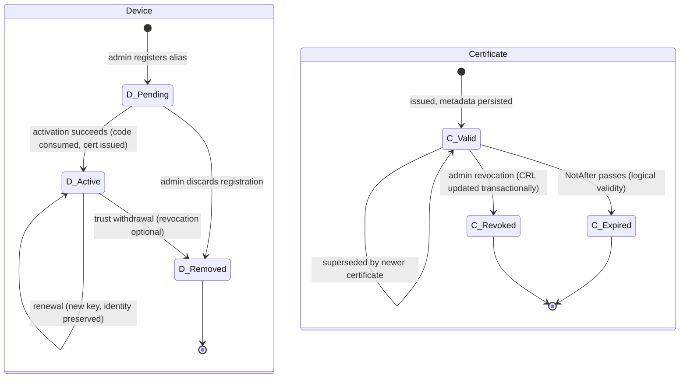

# Kryptonian Engineering Handoff Specification

| Field | Value |
|---|---|
| Document title | Engineering Handoff Specification (KSPEC-012) |
| Document ID | KSPEC-012 |
| Version | 0.2 (Draft) |
| Review status | Draft — pending review |
| Created | 2026-10-13 |
| Baseline repository commit | `682f996c8447afec13bc1fce5b7f59e6a06efa25` (branch `feat/windows-sandbox-installer`, "Release Windows gateway and portable enrollment demo 0.1.4") |
| Repository | https://github.com/AAPM-RT-SEC/RTSec.Kryptonian |
| Revision history | 0.1 — 2026-10-13 — Initial draft: implementation-independent engineering handoff synthesized from KSPEC-000 – KSPEC-007 (Author: integration engineering lead). |
| Source references | KSPEC-000 (conventions); KSPEC-001 (product definition); KSPEC-002 (UR-nnn); KSPEC-003 (SR-* register, 154 requirements); KSPEC-004 (design); KSPEC-005 (ICD-nnn); KSPEC-006 (THR-nnn); KSPEC-007 (ORK-nnn); docs/IMPLEMENTATION-TRACKER.md; docs/development.md; docs/DEPLOYMENT.md; docs/admin-setup.md |
| Author | Name: TBD — Date: TBD — Signature: TBD |
| Reviewer | Name: TBD — Date: TBD — Signature: TBD |
| Approver | Name: TBD — Date: TBD — Signature: TBD |
| Reconciliation revision | 0.2 - 2026-10-13 - source/document audit and publication controls (KSPEC-016) |

This document is the engineering handoff for the RTSec.Kryptonian Certificate
Enrollment Gateway. It is written for an **independent engineering team** that must
implement, test, maintain, and extend the system **without reading the original
prototype code**. Every normative statement here defers to the specification
documents it references; this document consolidates, prioritizes, and sequences —
it does not redefine requirements (KSPEC-000 §7).

**Prototype disclaimer (binding):** a prototype implementation exists in the
repository at the baseline commit. It is **reference material only**. Where
prototype behavior conflicts with the specification (KSPEC-002/003/004/005/006),
**the specification is normative and prototype behavior is not**. Known prototype
weaknesses are recorded as findings and gaps (KSPEC-004 §16.2; KSPEC-006 §9.2) and
must never be reproduced as intended behavior (KSPEC-000 §4).

**Package integration:** KSPEC-008 through KSPEC-011 are present and are the controlling references for verification, traceability, gaps, and standards readiness. Resolve discrepancies against the canonical KSPEC-003 requirement record and the reconciliation report, rather than document publication order.

---

## 1. Introduction

### 1.1 Purpose

To transfer, in one place, everything an independent team needs to build and operate
the gateway to the specified target: system description, workflows, interface
contracts, the security model, the certificate lifecycle, external integrations,
architectural decisions and their rationale, testing obligations, unresolved
decisions, a phased roadmap, and a definition of done.

### 1.2 Intended audience

- Implementation engineers (backend, platform, UI).
- Test/QA engineers preparing verification against KSPEC-008.
- DevOps/deployment engineers and hospital integrators.
- Reviewers of the formal specification package (KSPEC-000 §1 review sequence:
  KSPEC-012 sits after 008–011 and before independent review, KSPEC-013).

### 1.3 Conventions

- Identifier scheme, provenance classes (VERIFIED / CODE-OBSERVED / DOCUMENTED /
  INFERRED / PROPOSED / UNKNOWN), status classes (Existing / Partial / Missing /
  Proposed), and AS-IS / TO-BE / PROPOSED classification per KSPEC-000 §4–§7.
- Requirements are referenced by ID only (UR-nnn, SR-*, THR-nnn, ORK-nnn, ICD-nnn);
  the canonical requirement text lives in KSPEC-003 and KSPEC-002.
- Diagrams are Mermaid per KSPEC-000 §12.
- Verification method abbreviations: T/I/A/D per KSPEC-000 §11.
- No standards-conformity claims and no regulatory/medical-device classification
  are made anywhere in this document (KSPEC-000 §3).

## 2. System description (what the receiving team must build)

**Provenance: TO-BE intent synthesized from KSPEC-001 §2; AS-IS elements noted.**

Kryptonian is **enterprise healthcare IT cybersecurity infrastructure** (KSPEC-000
§3; KSPEC-001 §2.1): a certificate enrollment, identity provisioning, and
credential lifecycle management gateway for networked medical devices. It sits
between device-side EST clients (RFC 7030 Enrollment over Secure Transport) and
one or more hospital-authorized certificate authority (CA) backends. It is **not**
a regulated medical device, performs **no clinical functions**, and no clinical
capability may ever be derived from gateway state (KSPEC-000 §3; KSPEC-001 EXC-001,
EXC-002; SR-Z.010).

The problem it solves (KSPEC-001 §2, DOCUMENTED): hospitals operate heterogeneous
CA infrastructures (Microsoft ADCS, EJBCA, ACME services, private self-signed CAs)
while device manufacturers cannot control which CA a given hospital uses. The
gateway abstracts the CA choice behind a single standards-based device-facing
protocol so a device enrolls identically at every hospital.

Core capabilities, mapped to specification areas:

| Capability | Specification area | Representative requirements |
|---|---|---|
| One-time-code device onboarding | Device registration (SR-F-REG) | SR-F-REG.001–010 |
| EST protocol surface (RFC 7030 style) | EST behavior (SR-F-EST) | SR-F-EST.001–014 |
| Certificate lifecycle: issuance, renewal, expiry visibility, revocation | Lifecycle (SR-F-CLM, SR-C) | SR-F-CLM.001–010, SR-C.001–010 |
| Pluggable CA backends behind one abstraction | CA integration (SR-F-CAI) | SR-F-CAI.001–010 |
| Administrative portal + REST automation | Administration (SR-F-ADM, SR-F-INT) | SR-F-ADM.001–010 |
| Security controls: transport, secrets, RBAC, audit | Security/authn/authz/audit (SR-S, SR-A, SR-Z, SR-U) | SR-S.001–014, SR-A.001–010, SR-Z.001–010, SR-U.001–007 |
| Durable state, deployment, reliability | Data/deployment/reliability (SR-D, SR-B, SR-R, SR-V, SR-X) | SR-D.001–009, SR-B.001–007, SR-R.001–005, SR-V.001–004, SR-X.001–007 |

System boundary (KSPEC-001 §6): the gateway comprises the API host, the admin
portal (API-served React/TypeScript dashboard plus optional separate Blazor Server portal UI), and its persistence. Outside the
boundary: the devices themselves, the CA backends, the SMTP relay, the fronting
TLS proxy, and the demonstration components (`Kryptonian.MedicalDevice`,
`Kryptonian.DICOMTls`, DIMSE-TLS proxy), which are demonstration/reference clients,
**not production deliverables** (KSPEC-000 §3; SR-F-INT.005/006).

## 3. Required workflows (end-to-end walkthroughs)

These walkthroughs are the TO-BE operational behavior an implementation must
support. They are consolidated from KSPEC-004 §6–§7 (data flows and sequence
diagrams), KSPEC-003 (SR-* obligations), and KSPEC-005 (ICD contracts). Sequence
diagrams of record: KSPEC-004 §7.1–§7.6. State machines of record: KSPEC-004 §8.

### 3.1 Device registration (administrator)

1. An administrator (DeviceAdmin or SystemAdmin, SR-Z.002) registers a device by
   entering **only an administrative alias** — no certificate identity is entered
   manually (UR-001; SR-F-REG.001). The device record is created in status
   `Pending` (KSPEC-004 §8.1).
2. The gateway issues a **one-time activation code**: shown once in the API/portal
   response, stored **hashed only**, with an expiry time (optional validity
   parameter on the request) (SR-F-REG.002; SR-A; KSPEC-005 §10 ICD-ADM.001).
3. The administrator delivers the code to the device over a provisioning channel
   that is out of scope for the gateway (KSPEC-001 ASM assumptions).
4. Self-service device requests, where enabled, create **pending records only** and
   require administrator approval before any credential can be issued
   (SR-F-REG.006); the anonymous request surface is limited to the documented set
   (SR-Z.008) and must gain abuse controls (SR-F-REG.007 — Missing at baseline,
   required in TO-BE).

### 3.2 Device activation and initial EST enrollment

1. The device generates its own key pair and builds a PKCS#10 CSR whose subject CN
   carries its identity; the gateway never generates the device key (KSPEC-004
   trust note AS-1; SR-S.011 — device private key non-archival).
2. The device fetches bootstrap trust: `GET /.well-known/est/cacerts` (or
   `/{label}/cacerts`) returns the profile's CA chain as base64 PKCS#7 certs-only
   (SR-F-EST.002; ICD-EST.001). Profile resolution is by request host + path
   prefix; unknown labels are rejected with **404 and never fall back** to a
   default profile (SR-F-EST.005).
3. The device submits the CSR: `POST /.well-known/est/{label}/simpleenroll`
   authenticated by **HTTP Basic where the username is the device-record identifier
   and the password is the activation code**, over TLS only (SR-F-EST.006;
   ICD-EST.002). Plain-HTTP EST is refused with 426 (SR-F-EST.012). Legacy private
   activation headers observed in the sample client are **compatibility only and
   never a requirement** (SR-F-EST.007; SR-F-INT.002; UR-019).
4. Gateway-side validation order (KSPEC-004 §7.1): resolve the enabled EST profile;
   parse the CSR (raw DER, base64, or PEM; ≤ 64 KiB; signature **always** verified —
   SR-F-EST.003, ICD-PCR.001); find the pending device by CSR subject CN /
   activation hash; reject on unknown/expired/replayed code, missing identity, or CN
   collision; otherwise validate the CSR signature, bind CN + device metadata
   (manufacturer, model, serial — SR-F-REG.009), and **consume the activation code
   atomically**.
5. The orchestrator routes issuance to the **profile's bound CA backend** (never the
   globally active backend — B-3 in KSPEC-004 §5), via the connector factory
   (SR-F-CAI.002/003). CSR policy (subject-DN rules, key usage, validity) and
   returned-certificate policy are enforced before delivery (SR-S.002; SR-C.001;
   THR-004).
6. On success: certificate metadata is persisted, an `Issued` enrollment event is
   recorded (SR-C.010), the device becomes `Active`, and the EST response returns
   the leaf + chain as PKCS#7 certs-only (SR-F-EST.004; ICD-PCR.002). On rejection
   the gateway records a rejected event with reason and requestor IP and dispatches
   a rejection notification; the CA never sees unapproved requests.
7. If the backend cannot decide synchronously, the gateway returns **202 Accepted
   with `Retry-After`** and the enrollment event stays `Pending` until the backend
   outcome is known (SR-F-EST.010; ICD-EST.004). Deterministic per-backend pending
   semantics are required in TO-BE (SR-F-EST.011 — Missing, TBD matrix).

### 3.3 Renewal (device)

1. Renewal uses `POST /.well-known/est/{label}/simplereenroll` authenticated by the
   **current certificate presented as a native TLS client certificate** — never the
   activation code (SR-F-EST.008/009; SR-A.008). Client-certificate validation
   enforces configured trust anchors, clientAuth EKU, and online revocation checking
   (KSPEC-006 boundary B-1; SR-F-EST.009).
2. The gateway resolves the device by certificate identity, checks device status and
   policy, preserves the **approved identity** across renewals, and issues a new
   certificate for a **new key** (SR-F-CLM.003; UR-021; VERIFIED per
   IMPLEMENTATION-TRACKER.md).
3. Renewal within the renewal window requires **no new administrator approval**
   (SR-F-CLM.002; SR-C.004). Revoked or removed devices are denied renewal
   (SR-F-CLM.009).
4. The device installs the new key and certificate atomically before switching to
   the new credential and retains the old certificate for overlap (KSPEC-004 §10;
   docs/development.md). Pending-response retries apply as in §3.2 step 7.

### 3.4 Revocation and retirement (administrator)

1. An administrator with DeviceAdmin+ revokes a certificate:
   `POST /api/certificates/{id}/revoke` with a valid `RevocationReason`
   (`RemoveFromCrl` is explicitly rejected) (SR-Z.005; ICD-ADM.004).
2. The gateway verifies the certificate chains to the configured issuer, gathers all
   revoked serials for that issuer, increments the issuer CRL number, obtains a
   signed **issuer-scoped CRL** from the connector, and persists the CRL state and
   certificate status change **transactionally** (SR-F-CLM.007/008; ICD-PCR.003).
3. If the backend does not support remote revocation **and** cannot generate a CRL,
   revocation **fails closed** (HTTP 501/503; no silent success) (SR-X.001;
   SR-F-CAI.008; THR-010).
4. Revoked devices are denied enrollment and renewal; revocation denial is
   distinguishable from enrollment denial (SR-C.009). Revocation propagates via CRL
   fetch by TLS peers; **no instant mid-association termination is promised** —
   established sessions end at bounded lifetimes (SR-C.008; UR-010 constraints;
   KSPEC-002 §16.4).
5. Device removal (soft) blocks all future enrollment/renewal; permanent delete may
   be rejected to preserve history (SR-F-REG.010). TO-BE requires distinguishing
   `Untrusted` from `Retired` status semantics (KSPEC-004 §16.2 A-1 — see §10
   register).

### 3.5 Administrator bootstrap and account management

1. First-time setup runs through the initial-account wizard (or an
   environment-seeded initial administrator) and is refused once setup is complete
   (409) (SR-F-ADM.005; ICD-ADM.007 `/api/auth/setup`). The last active SystemAdmin
   cannot be deleted or deactivated (SR-F-ADM.003; THR-009 control).
2. Users authenticate to `/api/*` via JWT Bearer (8-hour tokens) or API keys
   (`X-API-Key`); passwords are BCrypt-hashed (work factor ≥ 12) (SR-A.001/003/009;
   ICD-ADM.001 preamble). API keys are stored as SHA-256 hashes with a visible
   prefix, carry the **generation-time role**, and are shown once at creation
   (SR-A.003/005; SR-Z.006). Login failures never disclose which factor was wrong
   (SR-A.010).

### 3.6 CA backend and EST profile administration

1. A SystemAdmin configures CA backends through guided fields or advanced JSON
   (SR-F-CAI.001; ICD-ADM.002), **tests** reachability before activation
   (SR-F-CAI.002), and activates **exactly one** backend as the globally active
   one — understanding that issuance routing is actually **profile → backend**
   (B-3; SR-F-CAI.004). Deleting a backend in use is rejected (400/409).
2. EST profiles bind devices to a backend plus policy: path prefix, hostnames +
   match type, certificate template, allowed key usages, validity days, client
   certificate requirements, trusted client CA thumbprints (KSPEC-004 §9.1
   `EST_PROFILE`; SR-C.001). Profile updates are **additive for trust lists** —
   partial updates preserve omitted trust data (SR-F-ADM.007; PR #47 evidence).
3. Self-signed CA generation (PFX export, thumbprint, NotAfter) is a SystemAdmin
   operation (ICD-ADM.002 `generate-selfsigned`); CA material persists durably
   (SR-F-CAI.009).

### 3.7 Monitoring, notifications, and day-2 operations

1. The dashboard summarizes backend state, device counts, enrollment outcomes, and
   backend evidence (SR-F-ADM.002); a live activity feed and structured,
   correlation-ID-linked logging support triage (SR-F-ADM.009; SR-U.003).
2. Notification settings (SMTP host/port/TLS mode/auth mode, recipients) are
   managed via API with passwords stored encrypted and never returned
   (ICD-ADM.009; ICD-CFG.002). A test-send validates draft settings.
3. The **expiry watcher** (a background hosted service) scans certificates daily,
   warns 1–365 days ahead (default 14), debounces 7 days per certificate, and skips
   certificates already renewed (KSPEC-004 §10; SR-F-CLM.004/005). It must be fault
   tolerant: scan failures are caught and the watcher continues (SR-R.001), but
   TO-BE requires surfacing repeated scan failure as an alert (KSPEC-007 §5).
4. Non-renewal alerting: certificates approaching expiry without a completed
   renewal generate alerts (SR-F-CLM.006 — Partial; delivery reliability TBD,
   SR-R.003). Backup/restore is required in TO-BE with the completeness rule of
   KSPEC-007 §6.2 (database + CA material + Data Protection key ring + effective
   configuration).

## 4. Interface contracts

Full normative detail: KSPEC-005 (ICD items). Summary only here.

### 4.1 Interface surface overview (KSPEC-005 §2, ICD items per §1)

| Surface | Base path | Transport | Authentication | Audience |
|---|---|---|---|---|
| EST protocol | `/.well-known/est[/{label}]` | HTTPS only (plain HTTP refused, 426) | TLS client certificate (re-enroll); HTTP Basic one-time activation (initial enroll) | Medical devices / EST clients |
| Admin REST API | `/api/*` | HTTPS | JWT Bearer or `X-API-Key` | Administrators, portal UI, automation |
| CRL distribution | `/api/crl/{issuerFingerprint}.crl` | Dedicated listener; HTTPS in production profile | None (public by design); GET/HEAD only on the restricted listener | Any peer performing revocation checks |
| ACME HTTP-01 challenges | `/.well-known/acme-challenge/{token}` | HTTP(S) | None (anonymous by ACME design) | ACME servers |
| Health/status | `/api/status/health` | HTTPS | None | Orchestrators, load balancers |

### 4.2 EST endpoint semantics (KSPEC-005 §3–§9, ICD-EST.001–006)

| Method | Path | Semantics |
|---|---|---|
| GET | `/.well-known/est/cacerts` | CA chain of profile resolved from Host + `/.well-known/est`; PKCS#7 certs-only, base64 |
| GET | `/.well-known/est/{label}/cacerts` | Same, label-scoped; unknown label → 404, no fallback |
| POST | `/.well-known/est/{label}/simpleenroll` | Initial enrollment; PKCS#10 in, PKCS#7 out; Basic activation bootstrap; 202 + Retry-After supported |
| POST | `/.well-known/est/{label}/simplereenroll` | Renewal; native TLS client certificate required; 202 + Retry-After supported |

Known AS-IS gaps that are TO-BE targets: `/csrattrs`, `/serverkeygen`, `/fullcmc`
are not implemented (SR-F-EST.014 requires `/csrattrs`; `/serverkeygen` is a
bounded PROPOSED extension — KSPEC-004 §16.3 P-3). Rate limiting applies to EST
paths with 429 responses (ICD-EST.006; SR-S.006 — production values TBD). Error
bodies and status-code semantics: KSPEC-005 §12 (ICD-ERR.001), including 413 for
oversized CSRs and 501 as the fail-closed revocation signal.

### 4.3 Administrative API families (KSPEC-005 §10, ICD-ADM.001–012)

| Family | Base path | Authorization highlights | Representative operations |
|---|---|---|---|
| Devices | `/api/devices` | DeviceAdmin for mutations; authenticated reads | Register, approve, activation code (+reactivate), remove, delete, list certificates/events, demo-enroll |
| Device self-requests | `/api/device-requests` | **Anonymous** (bounded surface, SR-Z.008) | Submit approval request → creates pending record only |
| CA backends | `/api/cas` | SystemAdmin for mutations | CRUD, test, activate, generate-selfsigned |
| EST profiles | `/api/est-profiles` | SystemAdmin-level management (SR-Z.003) | CRUD with additive trust-list updates |
| Certificates | `/api/certificates/{id}/revoke` | DeviceAdmin | Revoke with reason; 501/503 fail-closed mapping |
| Users | `/api/users` | SystemAdmin | CRUD; last-admin lockout protection |
| API keys | `/api/users/{userId}/api-keys` | Self or SystemAdmin | Generate (shown once), list, revoke |
| Auth | `/api/auth/*` | Mixed (setup/login anonymous) | status, setup, login, logout, me |
| Gateway settings | `/api/settings/gateway` | SystemAdmin (PUT) | Certificate-lifetime bounds |
| Notification settings | `/api/settings/notifications*` | SystemAdmin for mutations | SMTP settings, recipients, test send |
| Status/health/logs | `/api/status/*` | Authenticated per KSPEC-005 §10 | Health, enrollments, log stream |
| CRL | `/api/crl/{issuerFingerprint}.crl` | None (public) | Issuer-scoped signed DER CRL |

Authoritative machine-readable contracts: the OpenAPI artifacts
(`OpenAPI.Admin.yaml`, `OpenAPI.Client.yaml`, `OpenAPI.ESTProfiles.yaml`,
`OpenAPI.Schema.yaml`, `OpenAPI.StatusObserve.yaml`). **Baseline caution:** the
contract-first files are empty/stale relative to the implemented API
(SR-F-INT.003/004 — Missing/Partial). The receiving team must regenerate and then
maintain these as the authoritative contract (see §8.3 and Phase 1 exit criteria).

### 4.4 CA connector contract (KSPEC-005 §14, ICD-CAI.001–003)

The connector is the internal abstraction every CA backend implements. The
language-neutral contract of record is KSPEC-005 §14; its operations and failure
semantics are binding:

| Operation | Contract semantics |
|---|---|
| `Type()` | Backend type discriminator (`SelfSigned`, `Acme`, `Adcs`, `Ejbca`, …) |
| `GetCaCertificatesAsync` | Ordered CA chain for the backend's issuer; empty array (pre-issuance ACME/EJBCA) or exception mapped by the caller to 404/403/503 |
| `IssueCertificateAsync(csr, profile)` | Returns `Successful(leafCert, chain)` or `Failed(message)`; **never throws for backend rejection**; gateway maps to HTTP |
| `RevokeCertificateAsync(serial, reason)` | Native remote-CA revocation only; unsupported backends return `false` and log a warning — **never silent success** |
| `GenerateCrlAsync(request)` | Complete signed CRL for the connector's current issuer; must echo `ExpectedIssuerFingerprint`; default `Unsupported()` |
| `TestConnectionAsync` | Best-effort reachability probe |

The connector factory maps backend type → connector, **caches one instance per
backend id (thread-safe)**, and fails closed (`NotSupportedException`) for
unimplemented types (Cfssl, HashiCorpVault, Smallstep, OpenXpki exist only as enum
values) (SR-F-CAI.003). Per-connector capability matrix (revocation/CRL support
differences, fail-closed behavior): KSPEC-005 §14 ICD-CAI.002. New connectors shall
be added behind this contract only (SR-O.001).

### 4.5 Database and configuration interfaces

- Persistence: EF Core over SQLite (exercised) and PostgreSQL (schema upgrades
  implemented, **not exercised** — SR-D.002, TBD-006); additive, idempotent schema
  upgrades on startup (SR-D.003); conceptual model KSPEC-004 §9.
- Configuration: layered appsettings/environment/secrets per KSPEC-005 §16
  (ICD-CFG.001–002), `KRYPTONIAN__*` double-underscore environment names,
  per-connector JSON config with environment fallbacks, and the secret-handling
  rules summarized in §5.5 below.

## 5. Security model

Authoritative: KSPEC-006 (THR-nnn catalog, trust boundaries, controls mapping,
residual risk). Summary for the receiving team.

### 5.1 Trust boundaries (KSPEC-006 §6)

| Boundary | Statement | Key controls |
|---|---|---|
| B-1 Devices ↔ gateway | EST requires HTTPS; renewal identity is a native client certificate validated against configured CA files, clientAuth EKU required, online revocation, bounded retrieval timeout | `ConfiguredClientCertificateTrust`; SR-F-EST.009 |
| B-2 Proxy ↔ gateway | XFCC forwarded certificate accepted only from configured known proxies, single header, never with a native client certificate | `CertificateForwardingGuard` (VERIFIED spoof rejection); TO-BE: authenticated forwarders (SR-S.005, KSPEC-004 P-2) |
| B-3 Gateway ↔ CA | Each profile resolves its **own** bound backend; the globally active backend is never used for issuance routing | Prevents cross-profile issuer substitution |
| B-4 Gateway ↔ CRL consumers | CRL served anonymously on a dedicated listener that accepts only GET/HEAD on the CRL path | VERIFIED non-CRL denial (SR-B.005) |
| B-5 Admin UI ↔ API | CORS-restricted policy, dual-scheme authentication, 3-role RBAC | SR-A/SR-Z; authorization tests |
| B-6 Gateway ↔ SMTP / ACME | Outbound TLS; credentials from data-protected storage; ACME challenge path public by protocol design | ICD-CFG.002; SR-S.008 |

### 5.2 Authentication and authorization model

- **Admin plane:** dual scheme — JWT Bearer (issuer/audience `kryptonian`, 8-hour
  lifetime, validated signature) or API keys; the policy scheme selects JWT when an
  `Authorization` header is present, otherwise the API-key scheme (SR-A.001/002;
  KSPEC-005 §10). Three roles: **Standard** (read-only), **DeviceAdmin** (device
  operations, revocation), **SystemAdmin** (system configuration, users, backends)
  (SR-Z.001–005). Authorization is enforced per mutation with explicit role policies
  (SR-Z.007 — Partial, TO-BE target).
- **Device plane:** initial enrollment via HTTP Basic bootstrap (activation code),
  renewal via native TLS client certificate; both fail closed on credential
  failure (SR-A.007/008; SR-X.005).
- **Forwarded-certificate path (reverse proxy):** the Envoy XFCC format is honored
  only through boundary B-2 controls; baseline trusts the proxy's identity — closing
  this with authenticated forwarders is a required TO-BE control (SR-S.005 — Missing).

### 5.3 Activation bootstrap

Activation codes are the **only** bootstrap credential for initial enrollment:
one-time, time-limited, stored hashed, consumed on validated bootstrap acceptance before CA issuance,
replay rejected (VERIFIED per executed evidence) (SR-F-REG.002; SR-X.005; THR-003).
Consumption is race-safe at baseline: `UnitOfWork.TryConsumeActivationCodeAsync`
enforces one-time semantics under optimistic concurrency (`DbUpdateConcurrencyException`
→ rejection), demonstrated by `DeviceActivationConcurrencyTests` (see KSPEC-004 §13,
revised per RF-006). The TO-BE implementation must preserve this property, add
row-version tokens on hot entities, and verify the crash-scope of consumption versus
certificate issuance (KSPEC-004 §17 item 1; P-5 revised).

### 5.4 Revocation and CRL model

Issuer-scoped signed CRLs (RFC 5280) keyed by SHA-256 issuer fingerprint, monotonic
CRL numbers, transactional persistence, CDPs on issued certificates, online
revocation checking at peers, fail-closed on unsupported backends (SR-C.005/006/007;
SR-F-CLM.007/008; SR-X.001). The prototype CRL lifetime is a 60-second demo value —
production lifetime and stale-data handling are policy decisions (SR-S.012,
SR-C.008 — TBD; THR-010).

### 5.5 Key and secret storage requirements

| Asset | Requirement | Reference |
|---|---|---|
| Device private keys | Generated by the device; **never archived** by the gateway (server-side key generation only as bounded PROPOSED `/serverkeygen`) | SR-S.011; KSPEC-004 A-2 |
| CA private keys (self-signed backend) | Held by gateway by design (TO-BE: evaluate HSM-backed keys, THR-008 PROPOSED controls); persisted durably; included in backup set | SR-F-CAI.009; KSPEC-007 §6.2 |
| SMTP password, ACME keys | Encrypted at rest via the data-protection service; never returned by the API (`hasPassword` boolean only) | ICD-CFG.002; SR-D.008 |
| Activation codes, API keys | Hashed only; raw values shown once | SR-F-REG.002; SR-A.003 |
| Backend `config` JSON | **May contain plaintext PFX passwords at baseline — known finding**; TO-BE requires encryption at rest and a secrets store (SR-F-CAI.010, SR-S.008 — Missing; TBD-005) | KSPEC-005 §16; THR-016 |
| JWT signing secret | Must be provisioned; the hard-coded development fallback must not survive into TO-BE (SR-A.006, SR-S.007 — Missing; THR-007) | KSPEC-006 §9.2 |
| Data Protection key ring | Persisted durably; required to decrypt stored secrets; part of the backup set | SR-D.007; KSPEC-007 §6.2 |
| Passwords | BCrypt work factor ≥ 12 | SR-S.009 |

### 5.6 Threat mitigations the implementation must preserve

The implementation must preserve every VERIFIED mitigation in KSPEC-006 §9.1
(replay rejection; forwarded-certificate spoof rejection; non-CRL HTTP denial;
revocation round-trip to native X509Chain `Revoked`; restart persistence of
profiles/issuers/devices; independent curl HTTP-Basic EST over real HTTPS) and
close the five dominant residual-risk areas of KSPEC-006 §9.2: dependency
deployment blockers (THR-014, the only Critical band), administrative/secret
defaults (THR-007/009/016), CRL cadence and freshness (THR-010), audit integrity
(THR-015), and unverified institution-CA interoperability (THR-005/008). The full
THR-001 – THR-018 catalog and per-threat PROPOSED controls are in KSPEC-006 §7.

## 6. Certificate lifecycle

Authoritative state machines: KSPEC-004 §8 (device status, certificate status,
activation code, enrollment event); lifecycle design: KSPEC-004 §10; policy
requirements: SR-C.001–010, SR-F-CLM.001–010.

### 6.1 States

Normative notes (KSPEC-004 §8):

- Baseline device statuses are `Pending`, `Active`, `Removed`; trust withdrawal
  collapses into `Removed`. TO-BE requires explicit `Untrusted` vs `Retired`
  semantics (KSPEC-004 §16.2 A-1; decision register §10, DEC-011).
- Certificate status: `Valid`, `Revoked`, `Expired`. Renewal produces a new `Valid`
  certificate; the old record is retained for audit history. Expiry is checked from
  NotAfter; no baseline job that persists the Expired enum value was observed.
- Enrollment events: `Issued`, `Pending`, `Rejected`, `Error` — target is one event per attempt (SR-C.010); AS-IS only selected branches persist an event (GAP-038).
- Activation-code lifecycle rides on device fields: issued (hashed) → consumed
  (replay rejected) / expired / void.

### 6.2 Renewal window and expiry monitoring

- Renewal is certificate-authenticated only; while the presented certificate remains valid and device/profile checks pass, no new approval is needed; the gateway has no time-window restriction on early renewal. The client scheduling policy determines when to request renewal (SR-C.004). The device-side simulator renews at
  two-thirds of certificate lifetime while the application runs
  (docs/development.md); **production long-lived/OS-service renewal policy is an
  open decision** (KSPEC-004 A-7; DEC-009).
- Certificate lifetime defaults come from gateway settings bounded by min/max, with
  per-profile `ValidityDays` override (SR-C.003). **The production lifetime policy
  is TBD** (TBD-001; must be chosen from outage tolerance vs. revocation
  objectives, not an arbitrary demo value).
- The expiry watcher scans daily, warns 1–365 days ahead (default 14), debounces
  7 days per certificate, and skips already-renewed certificates (SR-F-CLM.005).
- Notification rules: near-expiry warnings and rejected-enrollment notifications
  dispatch via SMTP **best-effort**; gateway function never depends on SMTP
  availability (KSPEC-005 §17 ICD-EXT.001; SR-R.003). TO-BE: notification outbox
  for delivery reliability (KSPEC-004 P-6), defined trigger set (TBD-002), and
  non-renewal alerting completed (SR-F-CLM.006).

## 7. Required external integrations

Authoritative: KSPEC-005 §17 (ICD-EXT.001–004), §16 (ICD-CFG.001–002); KSPEC-004
§15. Configuration walkthroughs: docs/ca-backend-configuration.md, docs/admin-setup.md,
docs/DEPLOYMENT.md.

### 7.1 CA backends and configuration expectations

| Backend | Mechanism | Configuration expectations | Revocation/CRL capability |
|---|---|---|---|
| Self-Signed | In-process signing (local CA cert + key, PFX or PEM pair) or harness EST relay | PFX path/password or cert/key paths; CRL distribution point URL; environment fallbacks `KRYPTONIAN__CA__SELFSIGNED__*` | Gateway-side signed CRL supported; remote revocation n/a |
| ACME (RFC 8555) | Full ACME order flow (Certes-class client); http-01 challenge relay or DNS-01 (DNS-01 is a stub — SR-F-CAI.007 Partial) | Directory URL, account email, EAB key ID/HMAC, challenge type; gateway must be reachable for HTTP-01 challenges | No revocation path exercised; fails closed |
| ADCS (Microsoft) | SCEP client against NDES: `GET {base}/scep/adcs?operation=GetCACert`, `POST {base}/scep/adcs?operation=PKIOperation` | SCEP base URL; optional enrollment-agent mTLS credential (PFX path/password or machine-store thumbprint) required under NDES challenge mode; template name in profile | Remote revocation **not implemented** (returns false); CRL unsupported → fail closed; real-ADCS interoperability **unverified** |
| EJBCA | REST client: `POST {base}/ejbca/ejbca-rest-api/v1/certificate/pkcs10enroll`, `PUT .../certificate/{issuerDn}/{serial}/revoke` | REST base URL; `IssuerDn` required for revocation; REST credentials | Native remote revocation **supported** when IssuerDn configured; CRL generation unsupported → fail closed |

All backends are configured through the admin API/portal (guided fields or advanced
JSON) with per-backend `Config` JSON and environment fallbacks (ICD-CFG.001);
credentials must move into a secrets store in TO-BE (SR-F-CAI.010; TBD-005).

### 7.2 SMTP

MailKit-based sender; StartTLS/SMTPS/none TLS modes; auth modes; optional
`TrustServerCertificate` bypass (off by default). Best-effort dispatch; settings and
recipients managed via API; test-send endpoint (ICD-EXT.001; ICD-ADM.009).

### 7.3 Database

SQLite (exercised) and PostgreSQL 16+ (Npgsql path implemented, upgrade SQL
additive/idempotent, **not live-exercised** — SR-D.002; TBD-006). Connection
pooling per SR-P.004; UTC timestamp discipline per SR-D.005. Production database
selection and verification are Phase 0/1 exit criteria (§11).

### 7.4 Reverse proxy / TLS termination

Optional fronting proxy terminates TLS and forwards client certificates using the
Envoy XFCC format; the gateway honors it only from configured known proxies, never
when a native client certificate is present (KSPEC-005 §7; B-2). Production TLS
certificates are provisioned externally (SR-B.003). TO-BE requires authenticated
forwarders (SR-S.005). ACME HTTP-01 challenge traffic must reach the gateway
through the same fronting path.

## 8. Key architectural decisions and rationale

These decisions are carried into TO-BE as confirmed target design (KSPEC-004
§16.1). The receiving team shall preserve them; changing one requires specification
change, not just code change.

### 8.1 Clean architecture (domain → application → infrastructure → host)

Domain entities, enums, and the connector/service interfaces live dependency-free;
application services orchestrate use cases (enrollment orchestration, revocation,
policy enforcement); infrastructure implements persistence, cryptography, and CA
connectors; the API host wires it (KSPEC-004 §3). Rationale: the CA-agnostic
product promise (UR-030/038) is only maintainable if CA protocols stay behind the
domain interface; it also keeps the demonstration clients out of the product core
(KSPEC-000 §3).

### 8.2 Connector abstraction with profile→backend routing

All CA access flows through the connector contract (§4.4) and the factory;
issuance routing resolves **profile → bound backend**, never the globally active
backend (B-3). Rationale: prevents cross-profile issuer substitution (THR-005),
enables per-hospital CA heterogeneity with a single device-facing protocol
(UR-016/018), and makes adding backends a contained task (SR-O.001; KSPEC-004
extension points).

### 8.3 Contract-first OpenAPI interface management

The five OpenAPI artifacts are the authoritative machine-readable contracts for
admin, client, EST profiles, shared schema, and status surfaces (KSPEC-005 §11;
SR-F-INT.003/004). Rationale: an independent team and external integrators must be
able to build against stable contracts; the baseline files are stale/empty, so
regenerating and keeping them current is a **Phase 1 exit criterion** (§11). A
canonical error schema with stable machine-readable codes and correlation IDs is
TO-BE (ICD-ERR.001; KSPEC-005 §12).

### 8.4 Fail-closed revocation

Revocation never reports success when the backend cannot enforce or attest it:
unsupported remote revocation returns `false` (logged), CRL-incapable backends fail
the revocation request (HTTP 501/503), and the CRL document set stays
issuer-scoped, signed, and transactionally persisted (SR-X.001; SR-F-CAI.008;
THR-010). Rationale: a silently "successful" revocation is worse than a failed one —
trust would be withdrawn in the portal but not on the wire.

### 8.5 One-time activation codes as the bootstrap credential

Identity is supplied authoritatively by the device CSR and bound at first use;
activation codes are one-time, hashed, expiring, replay-rejected, and consumed
atomically (SR-F-REG.002; THR-003). Rationale: eliminates transcription of device
identity by administrators (UR-001), limits the bootstrap window, and keeps the
gateway out of the device-key-generation business (SR-S.011).

### 8.6 Supporting decisions (carry-forward)

- **Profile-scoped virtual EST servers** (`{label}` path segments) with strict
  unknown-label rejection — enables multi-policy deployments on one listener
  (SR-F-EST.005; VERIFIED).
- **Pending-response (202 + Retry-After) enrollment** for slow backends — device
  retries are first-class (SR-F-EST.010; ICD-EST.004).
- **Target audit completeness** — one persisted record per attempt with outcome and source IP; AS-IS coverage is partial (GAP-038) (SR-C.010; SR-U.001/002).
- **Additive, idempotent schema upgrades** on startup — safe restart/upgrade
  behavior (SR-D.003).
- **Demonstration components are isolated** (separate projects; not product
  deliverables) — protects the product boundary and prevents clinical claims
  (SR-F-INT.006).

## 9. Test and acceptance requirements

Authoritative verification obligations are in KSPEC-008 (VT records) and KSPEC-009 (traceability). This section summarizes them and does not replace their procedures or evidence limitations.

### 9.1 Mandatory verification classes (mapped to executed-evidence patterns)

At minimum, the following behavior classes must have automated tests plus, where
noted, live end-to-end demonstration; they mirror the executed evidence patterns of
docs/IMPLEMENTATION-TRACKER.md and `artifacts/developer/verify-*/evidence.json`:

| Class | What must be proven | Anchor requirements |
|---|---|---|
| Activation replay | A consumed code reused over EST is rejected; expired/unknown codes rejected | SR-F-REG.002, SR-X.005 |
| Independent-client EST | A standard HTTP-Basic EST enrollment (curl-class client, no private headers) over real HTTPS succeeds end-to-end | SR-F-EST.006, SR-F-INT.001 |
| Renewal integrity | Re-enroll with native TLS client cert; new key generated; approved identity preserved; revoked/removed devices denied | SR-F-CLM.003/009, SR-A.008 |
| Profile routing | Unknown label → 404, no fallback; profile resolves its own backend | SR-F-EST.005, SR-F-CAI.002 |
| Policy enforcement | CSR subject/EKU/key-usage/validity and returned-certificate policy enforced; >64 KiB CSR → 413 | SR-S.002, SR-C.001, SR-F-EST.003 |
| Fail-closed revocation | Unsupported backend revocation → 501/503, no silent success; CRL number monotonic; transactional persistence | SR-X.001, SR-F-CLM.007/008 |
| Peer-side revocation effect | After admin revocation, native online X509Chain validation reports `Revoked` without cache flushing | SR-C.007, THR-010 |
| Forwarding guard | XFCC spoof from non-known proxy rejected; never honored with a native client certificate | SR-S.004 |
| CRL listener restriction | Non-CRL requests on the restricted listener denied | SR-B.005 |
| Restart persistence | Populated database survives restart with profiles, issuers, devices, trust policy intact | SR-V.003, SR-C.002, SR-D.001 |
| RBAC | Each mutation endpoint rejects under-privileged roles; anonymous surface limited to the documented set | SR-Z.001–009 |
| Transport rules | Plain-HTTP EST → 426; Basic-over-HTTP → 403; rate limits → 429 | SR-F-EST.012, SR-S.006 |
| Watcher fault tolerance | Expiry scan failure does not crash the watcher; near-expiry notifications fire per rules | SR-F-CLM.005, SR-R.001 |
| Concurrency | Concurrent activation/renewal does not double-issue or corrupt state | SR-R.004; KSPEC-004 §13 |

### 9.2 Acceptance process requirements

- Every KSPEC-003 requirement must trace to at least one verification activity in
  KSPEC-008/KSPEC-009 once published; until then, maintain an internal matrix
  against the Requirements Register (§21 of KSPEC-003).
- Executed-test evidence must be recorded (as the baseline does under
  `artifacts/developer/verify-*/evidence.json`) — self-reported pass/fail without
  artifacts is not acceptable.
- A developer end-to-end verifier equivalent to docs/development.md
  (`verify-dev.ps1`) must exist and pass, including revocation checking mode.
- Hospital-backend interoperability (ADCS/EJBCA) acceptance in Phase 3 (§11) is
  against **real or harness-backed** instances per docs/admin-setup.md, and results
  are recorded as evidence, not assumed (THR-005/008).
- No conformity claims (RFC 7030/8555, DICOM, ATNA) may appear in test reports
  (KSPEC-000 §3; KSPEC-002 §1; assessment belongs to KSPEC-011 when published).

## 10. Decisions register (unresolved items the team needs answered)

Consolidates the TBD/UNKNOWN items recorded across KSPEC-001 §14, KSPEC-002 §13,
KSPEC-003 §22, KSPEC-004 §16–§17, and KSPEC-007 §7.2. Owners and needed-by dates
are **placeholders for the receiving program to fill** at kickoff; none are
fabricated. "Needed by" references roadmap phases in §11.

| DEC | Decision needed | Source (authoritative) | Blocking SR/THR | Owner (placeholder) | Needed by |
|---|---|---|---|---|---|
| DEC-001 | Production certificate-lifetime policy (outage tolerance vs. revocation objectives) | KSPEC-002 TBD-001 | SR-C.003 | TBD — PKI policy owner | Phase 1 exit |
| DEC-002 | Notification trigger set and delivery reliability model (incl. outbox) | KSPEC-002 TBD-002; KSPEC-004 P-6 | SR-F-CLM.006, SR-R.003 | TBD — operations owner | Phase 2 entry |
| DEC-003 | Scope of OR.NET white-paper settings (offline sites, legacy devices) | KSPEC-002 TBD-003 | UR-034, UR-036 | TBD — research liaison | Phase 3 |
| DEC-004 | Location and adoption of shared OR.NET/RT-SEC requirements and test vectors | KSPEC-002 TBD-004 | SR-F-INT.008 | TBD — research liaison | Phase 3 |
| DEC-005 | Secrets-management mechanism for connector credentials (vault/OS store) | KSPEC-002 TBD-005 | SR-F-CAI.010, SR-S.008 | TBD — security engineering | Phase 0 (plan), Phase 4 (implement) |
| DEC-006 | Production database: verify and select PostgreSQL vs SQLite | KSPEC-002 TBD-006 | SR-D.002 | TBD — platform engineering | Phase 0/1 exit |
| DEC-007 | EST rate-limit values for production | KSPEC-003 §22 | SR-S.006 | TBD — security engineering | Phase 1 exit |
| DEC-008 | Forwarder authentication mechanism (shared secret, allow-list, proxy mTLS) | KSPEC-004 P-2 | SR-S.005 | TBD — security engineering | Phase 4 |
| DEC-009 | Long-lived renewal operation (OS service vs. running app) and old-certificate retirement policy | KSPEC-004 A-7; docs/development.md | SR-F-CLM.002, SR-O.003 | TBD — deployment policy owner | Phase 2 |
| DEC-010 | CRL lifetime and stale-revocation-data policy (replace 60 s prototype value) | KSPEC-004 A-4/A-5; THR-010 | SR-S.012, SR-C.008 | TBD — PKI policy owner | Phase 2 |
| DEC-011 | Device status model: `Untrusted` vs `Retired` semantics | KSPEC-004 A-1 | SR-F-REG.004 | TBD — product owner | Phase 1 |
| DEC-012 | Key-archival policy: fate of `EncryptedPrivateKeyPem` field | KSPEC-004 A-2 | SR-S.011, SR-D.008 | TBD — security engineering | Phase 1 |
| DEC-013 | Enterprise PEN / OID namespace to replace `1.3.6.1.4.1.99999.*` | KSPEC-004 A-3 | SR-C.001 (gateway OID) | TBD — external stakeholder | Phase 2 |
| DEC-014 | Anonymous self-service authorization model confirmation | KSPEC-003 §22 | SR-Z.009, SR-F-REG.007 | TBD — product owner | Phase 1 |
| DEC-015 | Audit export standard (ATNA mapping) and tamper-protection approach | KSPEC-004 A-6; THR-015 | SR-U.005/006 | TBD — security engineering | Phase 4 |
| DEC-016 | Availability targets, capacity, latency budgets | KSPEC-003 §22 | SR-V.004, SR-P.001/003 | TBD — operations owner | Phase 3/4 |
| DEC-017 | Backup schedule, retention, RPO/RTO targets | KSPEC-007 §6.2, §7.2 | SR-X.007 | TBD — operations owner | Phase 4 |
| DEC-018 | Remediation plan for transitive advisories (SQLitePCLRaw.lib.e_sqlite3 2.1.6; System.Security.Cryptography.Xml 8.0.2) | THR-014; ORK-016 | SR-S.014, SR-B | TBD — engineering lead | Phase 0 |
| DEC-019 | Metrics format/stack (Prometheus) | KSPEC-007 §5 | SR-O.004 | TBD — operations owner | Phase 4 |
| DEC-020 | Log/record retention periods | KSPEC-003 §22 | SR-O.002, SR-D.006 | TBD — compliance owner | Phase 2 |

Rule: an implementation may not invent a value for any TBD; it shall implement the
mechanism with a clearly marked default and record the pending decision
(KSPEC-002 §16.5).

## 11. Phased implementation roadmap

Phases are sequenced so that known blockers are cleared first, then the core
protocol, then lifecycle completeness, then hospital interoperability, then
operational hardening. Entry/exit criteria are measurable; each phase's exit is a
gated acceptance review against the referenced SRs and verification classes (§9.1).

### Phase 0 — Deployment-blocker hardening and baseline hygiene

**Goal:** the system can be deployed without the known blockers, in a hardened
configuration.

- **Scope:** remediate the transitive advisories `SQLitePCLRaw.lib.e_sqlite3 2.1.6`
  and `System.Security.Cryptography.Xml 8.0.2` (THR-014 — the only Critical
  residual risk; DEC-018); eliminate the hard-coded JWT signing fallback
  (SR-A.006, SR-S.007) and fail fast on development defaults in Production;
  disable/retire static legacy API keys or make them explicit opt-in (SR-A.004,
  THR-007); define the production secret-provisioning story (SR-B.007; DEC-005
  plan); establish the upgrade-safety boundary (SR-D.004); exercise and verify the
  PostgreSQL path (SR-D.002; DEC-006); CI gates for build, tests, UI advisory
  audit (per docs/development.md "Automated checks").
- **Entry criteria:** baseline reviewed; specification package 000–007 available;
  test environment (Docker and/or Windows) available.
- **Exit criteria:** zero known high/critical advisories; no default credentials or
  fallback secrets in a Production-configured deployment; full solution test suite
  plus UI build pass on Windows CI; restart-persistence test passes on the selected
  production database; documented run book for configuration/secrets.

### Phase 1 — Core EST, self-signed CA, admin core

**Goal:** a device can be registered, activated, and enrolled through EST against
the self-signed backend, administered through the portal and REST API.

- **Scope:** EST endpoint surface with profile-scoped routing (SR-F-EST.001–013,
  `/cacerts` included); one-time activation bootstrap with race-safe consumption
  (SR-F-REG.001/002/004/005/009); device inventory and status model (resolve
  DEC-011/DEC-012/DEC-014); self-signed CA connector per the §4.4 contract
  (SR-F-CAI.001–004, SR-F-CAI.009); admin core: auth (JWT + API keys), users, API
  keys, devices, backends, profiles, gateway settings, health/status
  (SR-F-ADM.001–010 minus notifications depth); regenerate the OpenAPI artifacts
  and adopt the canonical error schema (SR-F-INT.003/004).
- **Entry criteria:** Phase 0 exit.
- **Exit criteria:** all §9.1 classes except revocation-specific ones pass with
  recorded evidence; OpenAPI files validate and match implemented routes (automated
  drift check); profile/unknown-label and replay tests pass; independent curl EST
  enrollment over real HTTPS demonstrated; last-admin lockout protection tested.

### Phase 2 — Renewal, revocation, notifications, policy lifecycle

**Goal:** full credential lifecycle without manual re-approval, with revocation
that actually propagates.

- **Scope:** certificate-authenticated renewal with new key and preserved identity
  (SR-F-CLM.002/003, SR-C.004); expiry watcher + notification rules with defined
  trigger set and delivery decoupling/outbox (SR-F-CLM.004/005/006, SR-R.003;
  DEC-002); issuer-scoped signed CRLs, transactional revocation, fail-closed
  mapping, CDP population (SR-F-CLM.007–009, SR-C.005–009, SR-S.012; DEC-010);
  configurable CRL lifetime; `Untrusted`/`Retired` semantics if approved (DEC-011);
  PEN/OID resolution (DEC-013); enrollment-event audit completeness (SR-C.010,
  SR-U.001–004).
- **Entry criteria:** Phase 1 exit; DEC-001/DEC-002/DEC-010 decisions recorded.
- **Exit criteria:** full §3 workflow walkthroughs (registration → activation →
  enrollment → renewal → revocation/retirement) pass end-to-end with evidence;
  revocation round-trip to native X509Chain `Revoked` demonstrated; CRL staleness
  and non-renewal alerts fire per configured rules; notification test-send and
  rejection notifications verified.

### Phase 3 — ADCS/EJBCA hospital interoperability

**Goal:** the gateway enrolls and (where supported) revokes against hospital-class
backends.

- **Scope:** ADCS SCEP connector hardening incl. NDES challenge mode and
  enrollment-agent credential (SR-F-CAI.005; ICD-EXT.003); EJBCA REST connector
  incl. native revocation with `IssuerDn` (SR-F-CAI.006; ICD-EXT.004); ACME
  challenge-set completion incl. real DNS-01 (SR-F-CAI.007); interoperability test
  execution against real or harness-backed instances (docs/admin-setup.md
  walkthroughs); shared OR.NET/RT-SEC test vectors if agreed (SR-F-INT.008;
  DEC-003/004).
- **Entry criteria:** Phase 2 exit; access to at least one ADCS/NDES and one EJBCA
  instance (real or faithful harness) — **a precondition, not guaranteed**;
  DEC-003/DEC-004 advanced.
- **Exit criteria:** enrollment (and revocation for EJBCA) demonstrated against
  each backend with recorded evidence and honest capability reporting; fail-closed
  behavior proven for unsupported operations against each backend; results recorded
  as the first real interoperability evidence (previously unverified — THR-005/008);
  no conformity claims introduced.

### Phase 4 — Operational hardening, HA, backup, observability

**Goal:** hospital-grade operability.

- **Scope:** backup/restore implementation per the KSPEC-007 §6.2 completeness rule
  with restore rehearsals (SR-X.007; DEC-017); secrets-store integration
  (SR-F-CAI.010, SR-S.008; DEC-005 implementation); authenticated forwarders
  (SR-S.005; DEC-008); metrics endpoint and alert set (SR-O.004; DEC-019;
  KSPEC-007 §5); audit tamper protection and export (SR-U.005/006; DEC-015);
  component-level health (SR-V.002); availability/HA posture per DEC-016;
  log/record retention per DEC-020; dependency vulnerability process (SR-S.014,
  SR-O.005).
- **Entry criteria:** Phase 3 exit; DEC-005/DEC-008/DEC-015–DEC-019 decisions
  recorded.
- **Exit criteria:** documented backup set captured and restored in a rehearsal
  with all §9.1 classes re-run against the restored instance; metrics endpoint
  exposes the proposed minimum series; alerts fire in a fault-injection exercise;
  secrets in database config encrypted at rest; security review of the deployment
  topology documented (feeds KSPEC-011 re-assessment).

## 12. Definition of done

The handoff is complete — and a delivered system may be declared done — when **all**
of the following measurable acceptance criteria hold:

1. **Specification conformance:** every requirement in the KSPEC-003 register
   (154 SR-*) is implemented or has an approved, recorded deviation; the traceability
   matrix (KSPEC-009) shows bidirectional SR ↔ verification coverage with no orphan
   requirements.
2. **Verification coverage:** every verification class in §9.1 (and every KSPEC-008
   VT-nnn entry once published) passes with recorded executed evidence; the
   end-to-end developer verifier passes including revocation mode.
3. **Workflow acceptance:** all §3 walkthroughs complete successfully in a clean
   environment, from install through retirement, using only documentation — no
   tribal knowledge required.
4. **Interface conformance:** the regenerated OpenAPI artifacts validate, match the
   implemented API (automated drift check in CI), and an independent integrator can
   complete enrollment against the documented contract alone.
5. **Security posture:** all VERIFIED mitigations of KSPEC-006 §9.1 demonstrably
   hold in the delivered build; the five residual-risk areas of KSPEC-006 §9.2 are
   either closed or carry approved, tracked compensating controls; no deployment
   blockers remain (THR-014).
6. **Fail-closed discipline:** no code path reports success on an operation it
   cannot enforce — specifically revocation on unsupported backends, invalid
   replacement credentials, and issuer-mismatched CRLs (SR-X.001–005).
7. **Deterministic state:** restart of a populated instance preserves profiles,
   issuers, devices, trust policy, and CRL state (SR-V.003); schema upgrades are
   additive and idempotent (SR-D.003); upgrade-safety boundary defined (SR-D.004).
8. **Decisions resolved:** every DEC-nnn in §10 has a recorded decision or an
   approved owner and date; no unowned TBDs remain.
9. **Operability:** backup/restore rehearsal passed; metrics and the minimum alert
   set exist; health endpoint reports component state; documented run books for
   upgrade, restore, and incident response exist.
10. **Boundary integrity:** no clinical capability, no standards-conformity claim,
    and no regulatory classification appears in delivered artifacts or
    documentation (KSPEC-000 §3; KSPEC-001 EXC-001 – EXC-008); demonstration
    components remain clearly labeled as non-product.
11. **Review closure:** this document and the package pass independent review
    (KSPEC-013) with no unresolved Critical/High findings.

## 13. Traceability and references

### 13.1 Traceability

This document introduces no requirement identifiers of its own; it references
UR-* (KSPEC-002), SR-* (KSPEC-003, canonical register §21), ICD-* (KSPEC-005),
THR-* (KSPEC-006), and ORK-* (KSPEC-007) by ID only (KSPEC-000 §7). DEC-nnn
identifiers are local to this document, are stable, and are inputs to requirement
elaboration, not requirements themselves. Verification test identifiers (VT-nnn)
belong to KSPEC-008 and are not allocated here.

### 13.2 References

- KSPEC-000 – KSPEC-007 (`docs/formal-specification/`), as cited per section.
- KSPEC-008, KSPEC-009, KSPEC-010, KSPEC-011 — included in this package; consult for authoritative verification, traceability, gap and readiness records.
- Repository operational documents: docs/IMPLEMENTATION-TRACKER.md;
  docs/development.md; docs/DEPLOYMENT.md; docs/admin-setup.md;
  docs/ca-backend-configuration.md; docs/device-enrollment.md;
  docs/user-management.md; docs/email-notifications.md; docs/API-GUIDE.md;
  docs/ARCHITECTURE.md; docs/flow.md; docs/windows-installation.md;
  docs/windows-sandbox.md.
- Standards referenced as context only, with no conformity claims: RFC 7030 (EST),
  RFC 8555 (ACME), RFC 5280 (X.509/CRL).

### 13.3 Provenance summary

This document classifies as **TO-BE** everything it states as required behavior,
with AS-IS evidence referenced only to (a) anchor what is already proven
(VERIFIED per executed evidence in docs/IMPLEMENTATION-TRACKER.md and
`artifacts/developer/verify-*/`), and (b) name what is known Missing/Partial
(pulled from KSPEC-003 §22 and KSPEC-004 §16.2). No statement here upgrades a
documented-only claim to verified, and no prototype behavior is adopted as
normative without specification approval (KSPEC-000 §4, §5, §13).
